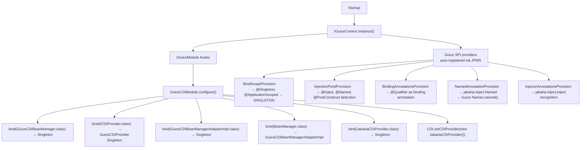
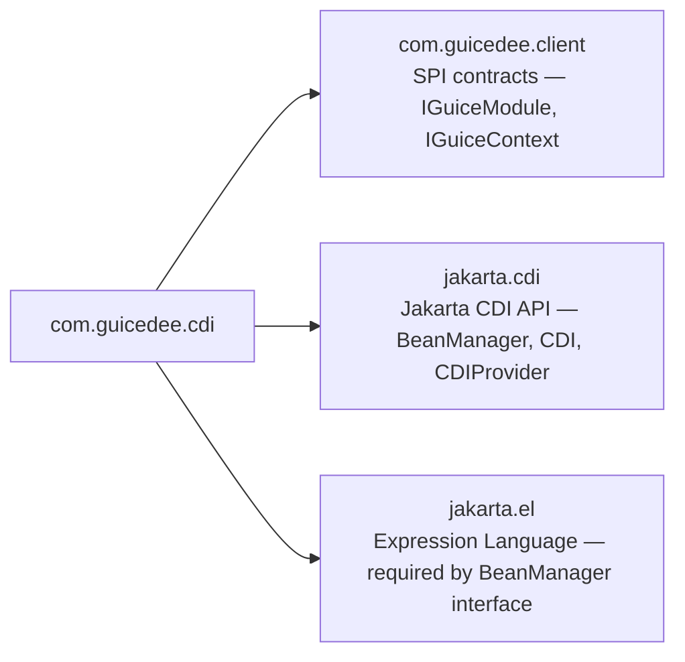

# com.guicedee:cdi

GuicedEE CDI provides a lightweight bridge that integrates Google Guice modules with Jakarta CDI runtimes.

- Version line: `2.6.0` (verify publication separately).
- Packaging: `jar`.
- JPMS module: `com.guicedee.cdi`.
- [Source POM](https://github.com/GuicedEE/GuicedCDI/blob/master/pom.xml).
- [Reference guide](https://guicedee.com/reference/overview.md).

## Direct dependency declarations

Versions may be supplied by the BOM or properties in the linked POM; this is not a flattened dependency lock.

- `org.projectlombok:lombok`; scope `provided`.
- `jakarta.enterprise:jakarta.enterprise.cdi-api`; scope `compile`.
- `com.guicedee:inject`; scope `compile`.
- `org.junit.jupiter:junit-jupiter-api`; scope `test`.

## JPMS descriptor

```java
import com.google.inject.gee.BindScopeProvider;
import com.google.inject.gee.InjectionPointProvider;
import com.guicedee.cdi.GuiceCDIModule;
import com.guicedee.cdi.GuiceCDIProviderImpl;
import com.guicedee.cdi.ICDIProvider;
import com.guicedee.cdi.implementations.*;
import com.guicedee.client.services.lifecycle.IGuiceModule;

module com.guicedee.cdi {
    exports com.guicedee.cdi;
    requires transitive com.guicedee.client;
    requires jakarta.cdi;
    requires jakarta.el;

    provides ICDIProvider with GuiceCDIProviderImpl;
    provides IGuiceModule with GuiceCDIModule;
    provides BindScopeProvider with BindScopeProvision;
    provides InjectionPointProvider with InjectionPointProvision;
    provides com.google.inject.gee.BindingAnnotationProvider with BindingAnnotationsProvision;
    provides com.google.inject.gee.NamedAnnotationProvider with NamedAnnotationProvision;
    provides com.google.inject.gee.InjectorAnnotationsProvider with InjectorAnnotationsProvision;
    provides com.google.inject.gee.ScopeAnnotationProvider with ScopeAnnotationProvision;


    uses ICDIProvider;
}
```

## Module guide

Source: [README.md](https://github.com/GuicedEE/GuicedCDI/blob/master/README.md). Historical version examples retain their original context.

# GuicedEE CDI

> **⚠️ Migration & Compatibility Module** — This module is **not** part of the GuicedEE foundation. It exists solely to assist projects migrating from Jakarta CDI-based frameworks to the native Guice-first model. New projects should use Google Guice annotations and APIs directly. GuicedEE's foundation is **Guice**, not CDI.

[](https://github.com/GuicedEE/Guiced-CDI/actions/workflows/build.yml)
[](https://central.sonatype.com/artifact/com.guicedee/cdi)
[](https://www.apache.org/licenses/LICENSE-2.0)


Lightweight **Jakarta CDI compatibility bridge** for [GuicedEE](https://github.com/GuicedEE) applications **migrating from CDI-based frameworks**.
Maps CDI annotations (`@Inject`, `@Named`, `@ApplicationScoped`, `@Qualifier`) to their Guice equivalents, provides a `BeanManager` adapter backed by the Guice injector, and registers itself as the Jakarta `CDIProvider` — so existing CDI-annotated code runs seamlessly inside a Guice-managed container during migration.

> **For new projects:** Use Google Guice annotations (`com.google.inject.Inject`, `@Singleton`, `@Provides`, etc.) directly. This module is intended as a transitional bridge, not a permanent dependency.

Built on [Google Guice](https://github.com/google/guice) · [Jakarta CDI](https://jakarta.ee/specifications/cdi/) · JPMS module `com.guicedee.cdi` · Java 25+

## 📦 Installation

```xml
<dependency>
  <groupId>com.guicedee</groupId>
  <artifactId>cdi</artifactId>
</dependency>
```

<details>
<summary>Gradle (Kotlin DSL)</summary>

```kotlin
implementation("com.guicedee:cdi:2.4.1")
```
</details>

## ✨ Features

- **CDI → Guice annotation mapping** — `jakarta.inject.Inject`, `jakarta.inject.Named`, `jakarta.inject.Singleton`, and `jakarta.inject.Qualifier` are mapped to their Guice counterparts automatically
- **Scope bridging** — `@jakarta.inject.Singleton` and `@jakarta.enterprise.context.ApplicationScoped` are bound to Guice's `SINGLETON` scope via `BindScopeProvision`
- **`BeanManager` adapter** — `GuiceCDIBeanManagerAdapter` implements `jakarta.enterprise.inject.spi.BeanManager` and delegates to `IGuiceContext` for bean resolution
- **`CDIProvider` registration** — `JakartaCDIProvider` is set as the Jakarta `CDI` provider on startup, so `CDI.current()` returns a Guice-backed `GuicedCDI` instance
- **`GuiceCDIBeanManager`** — simplified bean lookup API with support for type, `@Named` qualifier, and annotation qualifier
- **SPI-driven wiring** — five Guice SPI providers (`BindScopeProvider`, `InjectionPointProvider`, `BindingAnnotationProvider`, `NamedAnnotationProvider`, `InjectorAnnotationsProvider`) are registered via JPMS `provides`
- **Automatic module loading** — `GuiceCDIModule` is discovered via `ServiceLoader` / JPMS; no manual installation required
- **JPMS-first** — full `module-info.java` with proper `exports`, `requires`, `provides`, and `uses` directives

## 🚀 Quick Start

**Step 1** — Add the dependency (see Installation above).

**Step 2** — Annotate your classes with standard Jakarta CDI annotations:

```java
@jakarta.enterprise.context.ApplicationScoped
public class GreetingService {

    public String greet(String name) {
        return "Hello, " + name + "!";
    }
}
```

**Step 3** — Inject anywhere via `@Inject`:

```java
public class WelcomeResource {

    @jakarta.inject.Inject
    private GreetingService greeter;

    public String hello(String name) {
        return greeter.greet(name);
    }
}
```

**Step 4** — Declare the dependency in your `module-info.java`:

```java
module my.app {
    requires com.guicedee.cdi;
}
```

**Step 5** — Bootstrap GuicedEE:

```java
IGuiceContext.registerModuleForScanning.add("my.app");
IGuiceContext.instance();

WelcomeResource resource = IGuiceContext.get(WelcomeResource.class);
resource.hello("World"); // "Hello, World!"
```

The CDI module itself is loaded automatically — no JPMS `provides` declaration is needed in your application module.

## 📐 Architecture



### CDI Provider chain

```
CDI.current()
 → JakartaCDIProvider.getCDI()
   → GuicedCDI (singleton)
     → select(Class<T>)
       → IGuiceContext.get(Class<T>)   ← Guice injector lookup
```

### BeanManager delegation

```
@Inject BeanManager beanManager
 → GuiceCDIBeanManagerAdapterImpl
   → getReference(bean, type, ctx)     → IGuiceContext.get(type)
   → getInjectableReference(ip, ctx)   → IGuiceContext.get(ip.getType())
   → createCreationalContext(...)      → no-op implementation
```

## 🧩 SPI Providers

The CDI module registers five Guice SPI providers that teach the Guice runtime how to handle Jakarta CDI annotations:

| SPI Interface | Implementation | Purpose |
|---|---|---|
| `BindScopeProvider` | `BindScopeProvision` | Binds `@jakarta.inject.Singleton` and `@ApplicationScoped` to Guice's `SINGLETON` scope |
| `InjectionPointProvider` | `InjectionPointProvision` | Detects `@Inject`, `@Named`, and `@PostConstruct` on annotated members |
| `BindingAnnotationProvider` | `BindingAnnotationsProvision` | Registers `@Qualifier` as a Guice binding annotation marker |
| `NamedAnnotationProvider` | `NamedAnnotationProvision` | Converts `jakarta.inject.Named` to `com.google.inject.name.Names.named()` |
| `InjectorAnnotationsProvider` | `InjectorAnnotationsProvision` | Identifies `jakarta.inject.Inject` as an injector annotation |

## 🫘 Core Classes

### `GuiceCDIBeanManager`

Simplified bean lookup API backed by `IGuiceContext`:

```java
@Inject
private GuiceCDIBeanManager beanManager;

// By type
MyService svc = beanManager.getBean(MyService.class);

// By type + @Named qualifier
MyService svc = beanManager.getBean(MyService.class, "primary");

// By type + annotation qualifier
MyService svc = beanManager.getBean(MyService.class, myQualifier);

// Check existence
boolean exists = beanManager.containsBean(MyService.class);
```

### `GuicedCDI`

Minimal `jakarta.enterprise.inject.spi.CDI<Object>` implementation. Returned by `CDI.current()` after the module sets the provider:

```java
CDI<Object> cdi = CDI.current();
MyService svc = cdi.select(MyService.class).get();
```

### `GuiceCDIModule`

The Guice module that wires everything together. Loaded automatically via `IGuiceModule` SPI — sort order `Integer.MAX_VALUE - 200` (loads after most modules).

## 🗺️ Module Graph



## 🤝 Contributing

Issues and pull requests are welcome — please add tests for new bridging behaviour or annotation support.

## 📄 License

[Apache 2.0](https://www.apache.org/licenses/LICENSE-2.0)

## Declared API reference

Java public/protected declarations and public interface methods are parsed with the JDK compiler. This includes implementation types; package exports determine JPMS accessibility. Inherited and generated members are not expanded. Kotlin adapters retain their source and comments.

## CDI

[Java source](https://github.com/GuicedEE/GuicedCDI/blob/master/src/main/java/com/guicedee/cdi/CDI.java)

### CDI

```java
public static GuiceCDIBeanManager getBeanManager();
public static <T> T getBean(Class<T> beanType);
public static <T> T getBean(Class<T> beanType, String qualifier);
public static <T> boolean containsBean(Class<T> beanType);
```

## GuiceCDIBeanManager

[Java source](https://github.com/GuicedEE/GuicedCDI/blob/master/src/main/java/com/guicedee/cdi/GuiceCDIBeanManager.java)

### GuiceCDIBeanManager

```java
public <T> T getBean(Class<T> beanType);
public <T> T getBean(Class<T> beanType, String qualifier);
public <T> T getBean(Class<T> beanType, Annotation qualifier);
public <T> Set<T> getBeans(Class<T> beanType);
public <T> boolean containsBean(Class<T> beanType);
```

## GuiceCDIBeanManagerAdapter

[Java source](https://github.com/GuicedEE/GuicedCDI/blob/master/src/main/java/com/guicedee/cdi/GuiceCDIBeanManagerAdapter.java)

### GuiceCDIBeanManagerAdapter

```java
public GuiceCDIBeanManagerAdapter(GuiceCDIBeanManager beanManager);
@Override public <T> CreationalContext<T> createCreationalContext(Contextual<T> contextual);
@Override public Object getReference(Bean<?> bean, Type beanType, CreationalContext<?> ctx);
@Override public Object getInjectableReference(InjectionPoint injectionPoint, CreationalContext<?> ctx);
public <T> Bean<T> getBean(Class<T> beanType, Annotation... qualifiers);
public <T> Bean<T> getBean(TypeLiteral<T> beanType, Annotation... qualifiers);
@Override public Set<Bean<?>> getBeans(Type beanType, Annotation... qualifiers);
@Override public Set<Bean<?>> getBeans(String name);
@Override public <X> Bean<? extends X> resolve(Set<Bean<? extends X>> beans);
@Override public void validate(InjectionPoint injectionPoint);
public void fireEvent(Object event, Annotation... qualifiers);
@Override public Bean<?> getPassivationCapableBean(String id);
@Override public <T> Set<ObserverMethod<? super T>> resolveObserverMethods(T event, Annotation... qualifiers);
@Override public List<Decorator<?>> resolveDecorators(Set<Type> types, Annotation... qualifiers);
@Override public List<Interceptor<?>> resolveInterceptors(InterceptionType type, Annotation... interceptorBindings);
@Override public boolean isScope(Class<? extends Annotation> annotationType);
@Override public boolean isNormalScope(Class<? extends Annotation> annotationType);
@Override public boolean isPassivatingScope(Class<? extends Annotation> annotationType);
@Override public boolean isQualifier(Class<? extends Annotation> annotationType);
@Override public boolean areQualifiersEquivalent(Annotation qualifier1, Annotation qualifier2);
@Override public int getQualifierHashCode(Annotation qualifier);
@Override public boolean isStereotype(Class<? extends Annotation> annotationType);
@Override public Set<Annotation> getStereotypeDefinition(Class<? extends Annotation> stereotype);
@Override public boolean isInterceptorBinding(Class<? extends Annotation> annotationType);
@Override public Set<Annotation> getInterceptorBindingDefinition(Class<? extends Annotation> bindingType);
@Override public boolean areInterceptorBindingsEquivalent(Annotation binding1, Annotation binding2);
@Override public int getInterceptorBindingHashCode(Annotation binding);
@Override public Context getContext(Class<? extends Annotation> scopeType);
@Override public <T> InterceptionFactory<T> createInterceptionFactory(CreationalContext<T> ctx, Class<T> clazz);
@Override public <T> AnnotatedType<T> createAnnotatedType(Class<T> type);
@Override public <T> BeanAttributes<T> createBeanAttributes(AnnotatedType<T> annotatedType);
@Override public BeanAttributes<?> createBeanAttributes(AnnotatedMember<?> annotatedMember);
@Override public <T> InjectionTargetFactory<T> getInjectionTargetFactory(AnnotatedType<T> annotatedType);
@Override public <T> Bean<T> createBean(BeanAttributes<T> attributes, Class<T> beanClass, InjectionTargetFactory<T> injectionTargetFactory);
@Override public <T, X> Bean<T> createBean(BeanAttributes<T> attributes, Class<X> beanClass, ProducerFactory<X> producerFactory);
@Override public <X> ProducerFactory<X> getProducerFactory(AnnotatedField<? super X> field, Bean<X> declaringBean);
@Override public InjectionPoint createInjectionPoint(AnnotatedField<?> field);
@Override public InjectionPoint createInjectionPoint(AnnotatedParameter<?> parameter);
@Override public <X> ProducerFactory<X> getProducerFactory(AnnotatedMethod<? super X> method, Bean<X> declaringBean);
@Override public <T extends Extension> T getExtension(Class<T> extensionClass);
@Override public Collection<Context> getContexts(Class<? extends Annotation> scopeType);
@Override public Event<Object> getEvent();
@Override public Instance<Object> createInstance();
@Override @Deprecated(forRemoval = true) @SuppressWarnings("removal") public ELResolver getELResolver();
@Override @Deprecated(forRemoval = true) @SuppressWarnings("removal") public ExpressionFactory wrapExpressionFactory(ExpressionFactory expressionFactory);
```

## GuiceCDIBeanManagerAdapterImpl

[Java source](https://github.com/GuicedEE/GuicedCDI/blob/master/src/main/java/com/guicedee/cdi/GuiceCDIBeanManagerAdapterImpl.java)

### GuiceCDIBeanManagerAdapterImpl

```java
public GuiceCDIBeanManagerAdapterImpl();
@Override public boolean isMatchingBean(Set<Type> beanTypes, Set<Annotation> beanQualifiers, Type requiredType, Set<Annotation> requiredQualifiers);
@Override public boolean isMatchingEvent(Type eventType, Set<Annotation> eventQualifiers, Type observedEventType, Set<Annotation> observedEventQualifiers);
```

## GuiceCDIModule

[Java source](https://github.com/GuicedEE/GuicedCDI/blob/master/src/main/java/com/guicedee/cdi/GuiceCDIModule.java)

### GuiceCDIModule

```java
@Override protected void configure();
@Override public Integer sortOrder();
```

## GuiceCDIProvider

[Java source](https://github.com/GuicedEE/GuicedCDI/blob/master/src/main/java/com/guicedee/cdi/GuiceCDIProvider.java)

### GuiceCDIProvider

```java
@Inject public GuiceCDIProvider(GuiceCDIBeanManager beanManager);
@Override public GuiceCDIBeanManager getBeanManager();
```

## GuiceCDIProviderImpl

[Java source](https://github.com/GuicedEE/GuicedCDI/blob/master/src/main/java/com/guicedee/cdi/GuiceCDIProviderImpl.java)

### GuiceCDIProviderImpl

```java
public GuiceCDIProviderImpl();
@Override public GuiceCDIBeanManager getBeanManager();
```

## GuicedCDI

[Java source](https://github.com/GuicedEE/GuicedCDI/blob/master/src/main/java/com/guicedee/cdi/GuicedCDI.java)

### GuicedCDI

```java
public static GuicedCDI getInstance();
@Override public BeanManager getBeanManager();
@Override public <U extends Object> Instance<U> select(Class<U> subtype, Annotation... qualifiers);
@Override public <U extends Object> Instance<U> select(TypeLiteral<U> subtype, Annotation... qualifiers);
@Override public Instance<Object> select(Annotation... qualifiers);
@Override public boolean isUnsatisfied();
@Override public boolean isAmbiguous();
@Override public void destroy(Object instance);
@Override public Handle<Object> getHandle();
@Override public Iterable<? extends Handle<Object>> handles();
@Override public Object get();
@Override public Iterator<Object> iterator();
```

## ICDIProvider

[Java source](https://github.com/GuicedEE/GuicedCDI/blob/master/src/main/java/com/guicedee/cdi/ICDIProvider.java)

### ICDIProvider

```java
GuiceCDIBeanManager getBeanManager();
```

## BindingAnnotationsProvision

[Java source](https://github.com/GuicedEE/GuicedCDI/blob/master/src/main/java/com/guicedee/cdi/implementations/BindingAnnotationsProvision.java)

### BindingAnnotationsProvision

```java
@Override public List<Class<? extends Annotation>> getBindingAnnotations();
```

## BindScopeProvision

[Java source](https://github.com/GuicedEE/GuicedCDI/blob/master/src/main/java/com/guicedee/cdi/implementations/BindScopeProvision.java)

### BindScopeProvision

```java
@Override public void bindScope(Binder binder);
```

## InjectionPointProvision

[Java source](https://github.com/GuicedEE/GuicedCDI/blob/master/src/main/java/com/guicedee/cdi/implementations/InjectionPointProvision.java)

### InjectionPointProvision

```java
@Override public Class<? extends Annotation> injectionPoint(AnnotatedElement member);
```

## InjectorAnnotationsProvision

[Java source](https://github.com/GuicedEE/GuicedCDI/blob/master/src/main/java/com/guicedee/cdi/implementations/InjectorAnnotationsProvision.java)

### InjectorAnnotationsProvision

```java
@Override public boolean isInjectorAnnotation(Class<? extends Annotation> annotationType);
```

## NamedAnnotationProvision

[Java source](https://github.com/GuicedEE/GuicedCDI/blob/master/src/main/java/com/guicedee/cdi/implementations/NamedAnnotationProvision.java)

### NamedAnnotationProvision

```java
@Override public Named getNamedAnnotation(Annotation annotationType);
@Override public Named getNamedAnnotation(Class<? extends Annotation> annotationType);
```

## ScopeAnnotationProvision

[Java source](https://github.com/GuicedEE/GuicedCDI/blob/master/src/main/java/com/guicedee/cdi/implementations/ScopeAnnotationProvision.java)

### ScopeAnnotationProvision

```java
@Override public List<Class<? extends Annotation>> getScopeAnnotations();
```

## JakartaCDIProvider

[Java source](https://github.com/GuicedEE/GuicedCDI/blob/master/src/main/java/com/guicedee/cdi/JakartaCDIProvider.java)

### JakartaCDIProvider

```java
@Override public CDI<Object> getCDI();
```
