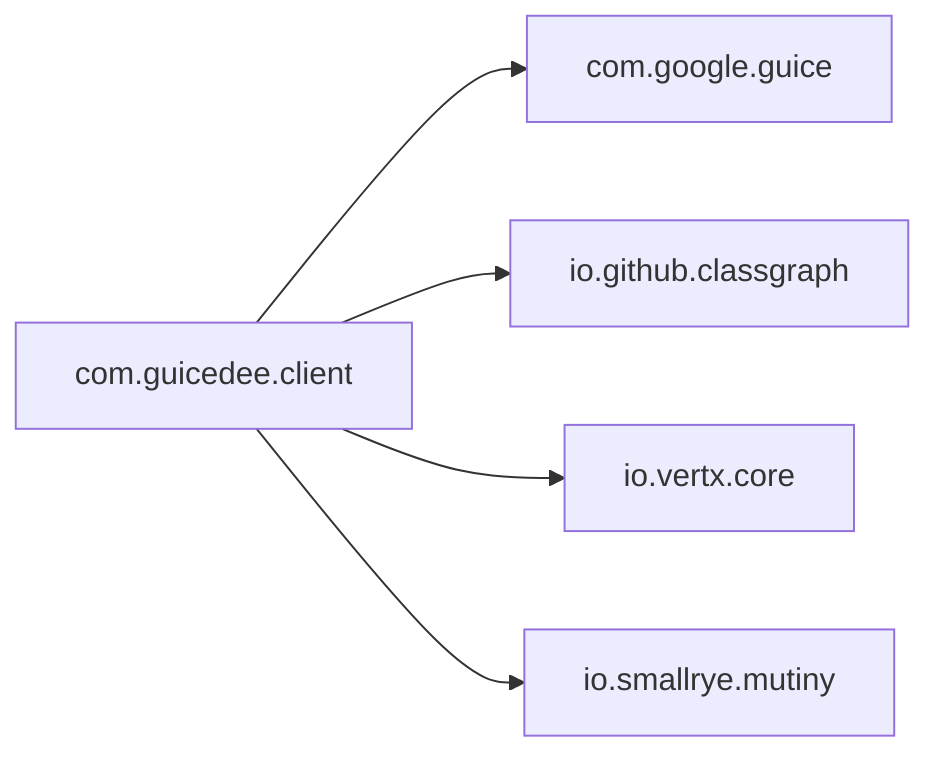

# com.guicedee:client

GuicedEE Client

- Version line: `2.6.0` (verify publication separately).
- Packaging: `jar`.
- JPMS module: `com.guicedee.client`.
- [Source POM](https://github.com/GuicedEE/Client/blob/master/pom.xml).
- [Reference guide](https://guicedee.com/reference/overview.md).

## Direct dependency declarations

Versions may be supplied by the BOM or properties in the linked POM; this is not a flattened dependency lock.

- `org.apache.logging.log4j:log4j-layout-template-json`; scope `compile`.
- `com.guicedee.modules.services:guice`; scope `compile`.
- `org.jspecify:jspecify`; scope `compile`.
- `io.vertx:vertx-core`; scope `compile`.
- `io.github.classgraph:classgraph`; scope `compile`.
- `tools.jackson.core:jackson-databind`; scope `test`.
- `org.apache.commons:commons-lang3`; scope `compile`.
- `org.apache.logging.log4j:log4j-api`; scope `compile`.
- `org.apache.logging.log4j:log4j-core`; scope `compile`.
- `org.apache.logging.log4j:log4j-slf4j2-impl`; scope `compile`.
- `org.apache.logging.log4j:log4j-jul`; scope `compile`.
- `jakarta.inject:jakarta.inject-api`; scope `compile`; optional.
- `io.smallrye.reactive:mutiny`; scope `compile`.
- `org.junit.jupiter:junit-jupiter`; scope `test`.

## JPMS descriptor

```java
import com.guicedee.client.implementations.GuicedEEClientModule;
import com.guicedee.client.implementations.GuicedEEClientPostStartup;
import com.guicedee.client.implementations.GuicedEEClientStartup;
import com.guicedee.client.services.IGuiceProvider;
import com.guicedee.client.services.lifecycle.*;
import com.guicedee.client.services.websocket.IWebSocketMessageReceiver;
import com.guicedee.client.scopes.mutiny.CallScopeUniInterceptor;

/**
 * GuicedEE client module definition, exporting the client API, lifecycle hooks, scopes, and service contracts.
 */
module com.guicedee.client {
        requires transitive com.google.guice;
        requires transitive io.github.classgraph;

        //requires transitive jakarta.validation;

        exports com.guicedee.client;
        requires transitive io.vertx.core;

        requires transitive org.jspecify;

        requires static lombok;

        requires org.apache.commons.lang3;

        //slf4j config
        requires org.apache.logging.log4j.core;
        requires org.apache.logging.log4j.layout.template.json;
        requires org.apache.logging.log4j.jul;
        requires org.apache.logging.log4j;
        requires org.apache.logging.log4j.slf4j2.impl;
        requires java.logging;
        //requires io.vertx;

        requires static jakarta.inject;
        requires io.smallrye.mutiny;

        uses IGuiceProvider;
        uses com.guicedee.client.services.IGuiceDiscovery;
        uses com.guicedee.client.services.IJsonCodec;
        uses IOnCallScopeEnter;
        uses IOnCallScopeExit;
        uses IWebSocketMessageReceiver;

        opens com.guicedee.client.implementations to com.google.guice;
        opens com.guicedee.client to tools.jackson.databind;
        exports com.guicedee.client.services;
        exports com.guicedee.client.implementations;
        exports com.guicedee.client.annotations;
        exports com.guicedee.client.utils;
        opens com.guicedee.client.utils to tools.jackson.databind;
        exports com.guicedee.client.scopes;
        exports com.guicedee.client.scopes.mutiny;
        opens com.guicedee.client.scopes to tools.jackson.databind;
        opens com.guicedee.client.services to com.google.guice;
        opens com.guicedee.client.annotations to com.google.guice;
        exports com.guicedee.client.services.websocket;
        opens com.guicedee.client.services.websocket to tools.jackson.databind, com.google.guice;
        exports com.guicedee.client.services.lifecycle;
        opens com.guicedee.client.services.lifecycle to com.google.guice;
        opens com.guicedee.client.services.config to com.google.guice;
        exports com.guicedee.client.services.config;

        provides IGuicePreStartup with GuicedEEClientStartup;
        provides IGuicePostStartup with GuicedEEClientPostStartup;
        provides IGuiceModule with GuicedEEClientModule;
        provides io.smallrye.mutiny.infrastructure.UniInterceptor with CallScopeUniInterceptor;
}
```

## Module guide

Source: [README.md](https://github.com/GuicedEE/Client/blob/master/README.md). Historical version examples retain their original context.

# GuicedEE Inject Client

[](https://github.com/GuicedEE/Client/actions/workflows/build.yml)
[](https://sonarcloud.io/summary/new_code?id=GuicedEE_Client)
[](https://github.com/GuicedEE/Client)

[](https://www.apache.org/licenses/LICENSE-2.0)


Dependency injection interfaces, lifecycle hooks, and scoping primitives for the [GuicedEE](https://github.com/GuicedEE) ecosystem.
Built on [Google Guice](https://github.com/google/guice) and fully modularized for JPMS (`com.guicedee.client`).

See [call-scope Uni lifecycle](https://github.com/GuicedEE/Client/blob/master/docs/call-scope-uni-lifecycle.md) for completion,
reference release, and cancellation ownership.

This library is the **client SPI** — it defines the contracts that all GuicedEE modules program against without pulling in the full runtime.

## 📦 Installation

```xml
<dependency>
    <groupId>com.guicedee</groupId>
    <artifactId>client</artifactId>
</dependency>
```

<details>
<summary>Gradle (Kotlin DSL)</summary>

```kotlin
implementation("com.guicedee:client:2.4.1")
```
</details>

## 🚀 Quick Start

Register your application module for classpath scanning, then let GuicedEE discover everything automatically:

```java
// Enable your module for classpath scanning
IGuiceContext.registerModuleForScanning.add("my.app");

// Bootstrap — modules and lifecycle hooks are discovered via ServiceLoader
IGuiceContext context = IGuiceContext.instance();
Injector injector = context.inject();

// Use managed instances
MyService svc = injector.getInstance(MyService.class);
```

Standard Guice injection works everywhere:

```java
@Inject
private MyService svc;

@Inject
public void onCreate() {
    // called after injection
}
```

Register your own module with a single JPMS `provides` directive:

```java
module my.app {
    requires com.guicedee.client;

    provides com.guicedee.client.services.lifecycle.IGuiceModule
        with my.app.AppModule;
}
```

## 🔄 Lifecycle

All lifecycle hooks implement `IDefaultService` — override `sortOrder()` to control execution order.

```
IGuicePreStartup  →  Injector created  →  IGuicePostStartup
                                                   ↓
                                          IGuicePreDestroy (shutdown)
```

| Interface | Runs |
|---|---|
| `IGuicePreStartup` | Before the injector is created |
| `IGuicePostStartup` | After the injector is created |
| `IGuicePreDestroy` | On shutdown or context teardown |

## 🔒 Scoping

`CallScope` provides request-style scoping that works outside of servlets — including reactive Mutiny pipelines.

| Class | Purpose |
|---|---|
| `CallScope` | Guice scope for per-request state |
| `CallScoper` | Opens and closes a scope boundary |
| `CallScopeUniInterceptor` | Propagates scope across Mutiny `Uni` chains |

## 🔌 SPI Contracts

| Interface | Purpose |
|---|---|
| `IGuiceContext` | Bootstrap, injection, and service loading |
| `IGuiceModule` | Contribute Guice bindings |
| `IGuiceProvider` | Supply the `IGuiceContext` implementation |
| `IGuiceConfigurator` | Configure classpath scanning and module filtering |
| `IGuiceDiscovery` | Register application classes and packages for [SPI discovery](https://github.com/GuicedEE/Client/blob/master/SPI_DISCOVERY.md) |
| `IJsonCodec` | Optional JSON representation; see [activation and migration](https://github.com/GuicedEE/Client/blob/master/JSON_OPT_IN.md) |

## 🗺️ Module Graph



## 📝 Logging — `LogUtils`

`LogUtils` provides one-call Log4j2 appender setup — no XML configuration files needed.
When the `CLOUD` environment variable is set, all layouts automatically switch to compact JSON for log aggregator ingestion.

```java
// ANSI-highlighted console output (local development)
LogUtils.addHighlightedConsoleLogger();

// Plain console output at a specific level
LogUtils.addConsoleLogger(Level.INFO);

// Rolling file logger (time + size based, auto-rollover on startup)
LogUtils.addFileRollingLogger("my-app", "logs");

// Dedicated logger with its own file — isolated from the root logger
Logger auditLog = LogUtils.getSpecificRollingLogger(
    "audit",        // logger name & file base
    "logs/audit",   // directory
    null,           // pattern (null = default)
    false           // additive — false keeps it out of the root logger
);
auditLog.info("User signed in");
```

| Method | What it does |
|---|---|
| `addConsoleLogger()` | Adds a stdout appender with a default pattern |
| `addHighlightedConsoleLogger()` | Adds a stdout appender with ANSI `%highlight` colors |
| `addFileRollingLogger(name, dir)` | Adds a rolling file appender (100 MB / daily rollover) |
| `addMinimalFileRollingLogger(name)` | Same as above with a `logs/` default directory |
| `getSpecificRollingLogger(…)` | Returns a named `Logger` with its own isolated rolling file |
| `addAppender(appender, level)` | Escape hatch — attach any Log4j2 `Appender` to the root logger |

## 🔍 Classpath Scanner Configuration

GuicedEE supports [explicit discovery through `IGuiceDiscovery`](https://github.com/GuicedEE/Client/blob/master/SPI_DISCOVERY.md), with the contract in `client`. Set `GUICEDEE_DISCOVERY_MODE=spi` for adapted core/Vert.x applications with complete registrations. ClassGraph remains the compatibility default for applications using automatic discovery or integrations that still require raw scan metadata.
The scan scope is controlled through a set of SPI interfaces — implement them and register via `ServiceLoader` / JPMS `provides`.

### Module & JAR filtering

| SPI Interface | Method | Purpose |
|---|---|---|
| `IGuiceScanModuleInclusions` | `includeModules()` | Modules to **include** in scanning |
| `IGuiceScanModuleExclusions` | `excludeModules()` | Modules to **exclude** from scanning |
| `IGuiceScanJarInclusions` | `includeJars()` | JAR filenames to **include** |
| `IGuiceScanJarExclusions` | `excludeJars()` | JAR filenames to **exclude** |

```java
public class MyModuleExclusions
        implements IGuiceScanModuleExclusions<MyModuleExclusions> {

    @Override
    public Set<String> excludeModules() {
        return Set.of("java.sql", "jdk.crypto.ec");
    }
}
```

### Package & path filtering

| SPI Interface | Method | Purpose |
|---|---|---|
| `IPackageContentsScanner` | `searchFor()` | Packages to **include** in the scan |
| `IPackageRejectListScanner` | `exclude()` | Packages to **exclude** from the scan |
| `IPathContentsScanner` | `searchFor()` | Resource paths to **include** |
| `IPathContentsRejectListScanner` | `searchFor()` | Resource paths to **exclude** |

### File content scanners

These fire during the ClassGraph scan and let you process matched resources inline:

| SPI Interface | Method | Match by |
|---|---|---|
| `IFileContentsScanner` | `onMatch()` | Exact file name (`Map<String, ByteArrayConsumer>`) |
| `IFileContentsPatternScanner` | `onMatch()` | Regex pattern (`Map<Pattern, ByteArrayConsumer>`) |

```java
public class LiquibaseFileScanner implements IFileContentsScanner {

    @Override
    public Map<String, ResourceList.ByteArrayConsumer> onMatch() {
        return Map.of("changelog.xml", (resource, bytes) -> {
            // process the matched resource bytes
        });
    }
}
```

## 🤝 Contributing

Issues and pull requests are welcome.

## 📄 License

[Apache 2.0](https://www.apache.org/licenses/LICENSE-2.0)

## Declared API reference

Java public/protected declarations and public interface methods are parsed with the JDK compiler. This includes implementation types; package exports determine JPMS accessibility. Inherited and generated members are not expanded. Kotlin adapters retain their source and comments.

## EnvironmentProperties

[Java source](https://github.com/GuicedEE/Client/blob/master/src/main/java/com/guicedee/client/annotations/EnvironmentProperties.java)

### EnvironmentProperties

```java
EnvironmentProperty[] value();
```

## EnvironmentProperty

[Java source](https://github.com/GuicedEE/Client/blob/master/src/main/java/com/guicedee/client/annotations/EnvironmentProperty.java)

### EnvironmentProperty

```java
String name();
String value();
```

## GuiceOptions

[Java source](https://github.com/GuicedEE/Client/blob/master/src/main/java/com/guicedee/client/annotations/GuiceOptions.java)

### GuiceOptions

```java
DiscoveryMode discoveryMode() default DiscoveryMode.SCAN;
String logLevel() default "INFO";
```

### DiscoveryMode

```java
public static final DiscoveryMode SCAN;
public static final DiscoveryMode SPI;
```

## INotEnhanceable

[Java source](https://github.com/GuicedEE/Client/blob/master/src/main/java/com/guicedee/client/annotations/INotEnhanceable.java)

### INotEnhanceable

```java
```

## INotInjectable

[Java source](https://github.com/GuicedEE/Client/blob/master/src/main/java/com/guicedee/client/annotations/INotInjectable.java)

### INotInjectable

```java
```

## Environment

[Java source](https://github.com/GuicedEE/Client/blob/master/src/main/java/com/guicedee/client/Environment.java)

### Environment

```java
public static void configureApplication(Class<?> applicationClass);
public static String getProperty(String key, String defaultValue);
public static String getSystemPropertyOrEnvironment(String name, String defaultValue);
public static String getSystemPropertyOrEnvironment(String name);
public static String getSystemPropertyOrEnvironment(java.util.List<String> names, String defaultValue);
public static String getSystemPropertyOrEnvironment(String name, String delimiter, String... defaultValues);
public static String getSystemPropertyOrEnvironment(java.util.List<String> names, String delimiter, String... defaultValues);
public static String resolveAnnotationValue(String value);
public static String resolvePlaceholders(String value);
public static synchronized void reloadDotEnv();
public static Map<String, String> getDotEnvEntries();
public static Map<String, String> getDotEnvLocalEntries();
```

## IEnvironment

[Java source](https://github.com/GuicedEE/Client/blob/master/src/main/java/com/guicedee/client/IEnvironment.java)

### IEnvironment

```java
String name();
int ordinal();
Map<String, Object> properties();
```

## IGuiceContext

[Java source](https://github.com/GuicedEE/Client/blob/master/src/main/java/com/guicedee/client/IGuiceContext.java)

### IGuiceContext

```java
Map<String, IGuiceContext> contexts;
Set<String> registerModuleForScanning;
Set<Class<?>> scanRoots;
List<com.google.inject.Module> modules;
Map<Class<?>, Set<?>> allLoadedServices;
static Map<Class<?>, Set<?>> getAllLoadedServices();
static IGuiceContext getContext();
static IGuiceContext instance();
Future<Void> getLoadingFinished();
Injector inject();
default java.util.Optional<Injector> existingInjector();
IGuiceConfig<?> getConfig();
void destroy();
static <T> T get(Key<T> type);
static <T> T get(Class<T> type, Class<? extends Annotation> annotation);
static <T> T get(Class<T> type);
ScanResult getScanResult();
Map<String, Set<Class>> loaderClasses;
static <T extends Comparable<T>> Set<T> loaderToSet(ServiceLoader<T> loader);
static <T> Set<T> loaderToSetNoInjection(ServiceLoader<T> loader);
static <T extends Comparable<T>> Set<Class<T>> loadClassSet(ServiceLoader<T> loader);
<T extends IDefaultService<T>> Set<T> getLoader(Class<T> loaderType, ServiceLoader<T> serviceLoader);
<T extends IDefaultService<T>> Set<T> getLoader(Class<T> loaderType, @SuppressWarnings("unused")
boolean dontInject, ServiceLoader<T> serviceLoader);
boolean isBuildingInjector();
static void registerModule(String javaModuleName);
static void registerModule(Class<?> applicationClass);
static void registerModule(com.google.inject.Module module);
Set<IGuicePreDestroy> loadPreDestroyServices();
Set<IGuicePreStartup> loadPreStartupServices();
```

## GuicedEEClientModule

[Java source](https://github.com/GuicedEE/Client/blob/master/src/main/java/com/guicedee/client/implementations/GuicedEEClientModule.java)

### GuicedEEClientModule

```java
public GuicedEEClientModule();
@Override protected void configure();
```

## GuicedEEClientPostStartup

[Java source](https://github.com/GuicedEE/Client/blob/master/src/main/java/com/guicedee/client/implementations/GuicedEEClientPostStartup.java)

### GuicedEEClientPostStartup

```java
public GuicedEEClientPostStartup();
@Override public List<Uni<Boolean>> postLoad();
@Override public Integer sortOrder();
```

## GuicedEEClientStartup

[Java source](https://github.com/GuicedEE/Client/blob/master/src/main/java/com/guicedee/client/implementations/GuicedEEClientStartup.java)

### GuicedEEClientStartup

```java
public GuicedEEClientStartup();
@Override public List<Future<Boolean>> onStartup();
@Override public Integer sortOrder();
```

## CallScope

[Java source](https://github.com/GuicedEE/Client/blob/master/src/main/java/com/guicedee/client/scopes/CallScope.java)

### CallScope

```java
```

## CallScopeProperties

[Java source](https://github.com/GuicedEE/Client/blob/master/src/main/java/com/guicedee/client/scopes/CallScopeProperties.java)

### CallScopeProperties

```java
public CallScopeProperties();
```

## CallScoper

[Java source](https://github.com/GuicedEE/Client/blob/master/src/main/java/com/guicedee/client/scopes/CallScoper.java)

### CallScoper

```java
public CallScoper();
public boolean isStartedScope();
public void enter();
public void enterQuietly();
public void exitQuietly();
public Map<Key<?>, Object> getValues();
public void setValues(Map<Key<?>, Object> values);
public void exit();
public <T> void seed(Key<T> key, T value);
public <T> void seed(Class<T> clazz, T value);
public <T> Provider<T> scope(final Key<T> key, final Provider<T> unscoped);
@SuppressWarnings({"unchecked"}) public static <T> Provider<T> seededKeyProvider();
```

## CallScopeSource

[Java source](https://github.com/GuicedEE/Client/blob/master/src/main/java/com/guicedee/client/scopes/CallScopeSource.java)

### CallScopeSource

```java
public static final CallScopeSource Unknown;
public static final CallScopeSource Http;
public static final CallScopeSource WebSocket;
public static final CallScopeSource RabbitMQ;
public static final CallScopeSource Timer;
public static final CallScopeSource SerialPort;
public static final CallScopeSource Transaction;
public static final CallScopeSource Test;
public static final CallScopeSource Rest;
public static final CallScopeSource Persistence;
public static final CallScopeSource WebService;
public static final CallScopeSource Startup;
public static final CallScopeSource VertXConsumer;
public static final CallScopeSource VertXProducer;
public static final CallScopeSource Event;
public static final CallScopeSource Kafka;
public static final CallScopeSource IBMMQ;
```

## CallScopeUniInterceptor

[Java source](https://github.com/GuicedEE/Client/blob/master/src/main/java/com/guicedee/client/scopes/mutiny/CallScopeUniInterceptor.java)

### CallScopeUniInterceptor

```java
public CallScopeUniInterceptor();
@Override public <T> Uni<T> onUniCreation(Uni<T> uni);
```

## IFileContentsPatternScanner

[Java source](https://github.com/GuicedEE/Client/blob/master/src/main/java/com/guicedee/client/services/config/IFileContentsPatternScanner.java)

### IFileContentsPatternScanner

```java
Map<Pattern, ResourceList.ByteArrayConsumer> onMatch();
```

## IFileContentsScanner

[Java source](https://github.com/GuicedEE/Client/blob/master/src/main/java/com/guicedee/client/services/config/IFileContentsScanner.java)

### IFileContentsScanner

```java
Map<String, ResourceList.ByteArrayConsumer> onMatch();
```

## IGuiceScanJarExclusions

[Java source](https://github.com/GuicedEE/Client/blob/master/src/main/java/com/guicedee/client/services/config/IGuiceScanJarExclusions.java)

### IGuiceScanJarExclusions

```java
Set<String> excludeJars();
```

## IGuiceScanJarInclusions

[Java source](https://github.com/GuicedEE/Client/blob/master/src/main/java/com/guicedee/client/services/config/IGuiceScanJarInclusions.java)

### IGuiceScanJarInclusions

```java
Set<String> includeJars();
```

## IGuiceScanModuleExclusions

[Java source](https://github.com/GuicedEE/Client/blob/master/src/main/java/com/guicedee/client/services/config/IGuiceScanModuleExclusions.java)

### IGuiceScanModuleExclusions

```java
Set<String> excludeModules();
```

## IGuiceScanModuleInclusions

[Java source](https://github.com/GuicedEE/Client/blob/master/src/main/java/com/guicedee/client/services/config/IGuiceScanModuleInclusions.java)

### IGuiceScanModuleInclusions

```java
Set<String> includeModules();
```

## IPackageContentsScanner

[Java source](https://github.com/GuicedEE/Client/blob/master/src/main/java/com/guicedee/client/services/config/IPackageContentsScanner.java)

### IPackageContentsScanner

```java
Set<String> searchFor();
```

## IPackageRejectListScanner

[Java source](https://github.com/GuicedEE/Client/blob/master/src/main/java/com/guicedee/client/services/config/IPackageRejectListScanner.java)

### IPackageRejectListScanner

```java
Set<String> exclude();
```

## IPathContentsRejectListScanner

[Java source](https://github.com/GuicedEE/Client/blob/master/src/main/java/com/guicedee/client/services/config/IPathContentsRejectListScanner.java)

### IPathContentsRejectListScanner

```java
Set<String> searchFor();
```

## IPathContentsScanner

[Java source](https://github.com/GuicedEE/Client/blob/master/src/main/java/com/guicedee/client/services/config/IPathContentsScanner.java)

### IPathContentsScanner

```java
Set<String> searchFor();
```

## IDefaultBinder

[Java source](https://github.com/GuicedEE/Client/blob/master/src/main/java/com/guicedee/client/services/IDefaultBinder.java)

### IDefaultBinder

```java
void onBind(M module);
```

## IDefaultService

[Java source](https://github.com/GuicedEE/Client/blob/master/src/main/java/com/guicedee/client/services/IDefaultService.java)

### IDefaultService

```java
@Override default int compare(J o1, J o2);
default Integer sortOrder();
@Override default int compareTo(J o);
```

## IGuiceConfig

[Java source](https://github.com/GuicedEE/Client/blob/master/src/main/java/com/guicedee/client/services/IGuiceConfig.java)

### IGuiceConfig

```java
boolean isServiceLoadWithClassPath();
J setServiceLoadWithClassPath(boolean serviceLoadWithClassPath);
boolean isFieldScanning();
J setFieldScanning(boolean fieldScanning);
boolean isAnnotationScanning();
J setAnnotationScanning(boolean annotationScanning);
boolean isMethodInfo();
J setMethodInfo(boolean methodInfo);
boolean isIgnoreFieldVisibility();
J setIgnoreFieldVisibility(boolean ignoreFieldVisibility);
boolean isIgnoreMethodVisibility();
J setIgnoreMethodVisibility(boolean ignoreMethodVisibility);
boolean isIncludePackages();
J setIncludePackages(boolean includePackages);
boolean isFieldInfo();
J setFieldInfo(boolean fieldInfo);
boolean isVerbose();
J setVerbose(boolean verbose);
boolean isClasspathScanning();
J setClasspathScanning(boolean classpathScanning);
boolean isExcludeModulesAndJars();
J setExcludeModulesAndJars(boolean excludeModulesAndJars);
boolean isExcludePaths();
J setExcludePaths(boolean excludePaths);
boolean isAllowPaths();
J setAllowPaths(boolean allowedPaths);
boolean isIgnoreClassVisibility();
J setIgnoreClassVisibility(boolean ignoreClassVisibility);
boolean isIncludeModuleAndJars();
J setIncludeModuleAndJars(boolean includeModuleAndJars);
boolean isPathScanning();
J setPathScanning(boolean pathScanning);
@SuppressWarnings("unused") boolean isExcludeParentModules();
@SuppressWarnings("unused") J setExcludeParentModules(boolean excludeParentModules);
boolean isRejectPackages();
J setExcludePackages(boolean excludePackages);
```

## IGuiceContextInternalBinder

[Java source](https://github.com/GuicedEE/Client/blob/master/src/main/java/com/guicedee/client/services/IGuiceContextInternalBinder.java)

### IGuiceContextInternalBinder

```java
```

## IGuiceDiscovery

[Java source](https://github.com/GuicedEE/Client/blob/master/src/main/java/com/guicedee/client/services/IGuiceDiscovery.java)

### IGuiceDiscovery

```java
default Collection<Class<?>> classes();
default Collection<Package> packages();
```

## IGuiceProvider

[Java source](https://github.com/GuicedEE/Client/blob/master/src/main/java/com/guicedee/client/services/IGuiceProvider.java)

### IGuiceProvider

```java
IGuiceContext get();
```

## IJsonCodec

[Java source](https://github.com/GuicedEE/Client/blob/master/src/main/java/com/guicedee/client/services/IJsonCodec.java)

### IJsonCodec

```java
String write(Object value);
<T> T read(String json, Type type);
<T> T convert(Object value, Type type);
void update(Object target, Object source);
default <T> T copy(T value, Type type);
```

## IServiceEnablement

[Java source](https://github.com/GuicedEE/Client/blob/master/src/main/java/com/guicedee/client/services/IServiceEnablement.java)

### IServiceEnablement

```java
boolean enabled();
```

## IGuiceConfigurator

[Java source](https://github.com/GuicedEE/Client/blob/master/src/main/java/com/guicedee/client/services/lifecycle/IGuiceConfigurator.java)

### IGuiceConfigurator

```java
IGuiceConfig<?> configure(IGuiceConfig<?> config);
```

## IGuiceModule

[Java source](https://github.com/GuicedEE/Client/blob/master/src/main/java/com/guicedee/client/services/lifecycle/IGuiceModule.java)

### IGuiceModule

```java
default boolean enabled();
```

## IGuicePostStartup

[Java source](https://github.com/GuicedEE/Client/blob/master/src/main/java/com/guicedee/client/services/lifecycle/IGuicePostStartup.java)

### IGuicePostStartup

```java
List<Uni<Boolean>> postLoad();
default Future<Boolean> executeSingle(Callable<Boolean> callable, boolean grouped);
default Future<Boolean> execute(Callable<Boolean> callable, boolean grouped);
@Override default Integer sortOrder();
default Vertx getVertx();
```

## IGuicePreDestroy

[Java source](https://github.com/GuicedEE/Client/blob/master/src/main/java/com/guicedee/client/services/lifecycle/IGuicePreDestroy.java)

### IGuicePreDestroy

```java
void onDestroy();
default Integer shutdownSortOrder();
```

## IGuicePreStartup

[Java source](https://github.com/GuicedEE/Client/blob/master/src/main/java/com/guicedee/client/services/lifecycle/IGuicePreStartup.java)

### IGuicePreStartup

```java
List<Future<Boolean>> onStartup();
@Override default Integer sortOrder();
```

## IOnCallScopeEnter

[Java source](https://github.com/GuicedEE/Client/blob/master/src/main/java/com/guicedee/client/services/lifecycle/IOnCallScopeEnter.java)

### IOnCallScopeEnter

```java
void onScopeEnter(Scope scope);
```

## IOnCallScopeExit

[Java source](https://github.com/GuicedEE/Client/blob/master/src/main/java/com/guicedee/client/services/lifecycle/IOnCallScopeExit.java)

### IOnCallScopeExit

```java
void onScopeExit();
```

## Log4JConfigurator

[Java source](https://github.com/GuicedEE/Client/blob/master/src/main/java/com/guicedee/client/services/Log4JConfigurator.java)

### Log4JConfigurator

```java
void configure(Configuration config);
```

## GuicedWebSocketOnAddToGroup

[Java source](https://github.com/GuicedEE/Client/blob/master/src/main/java/com/guicedee/client/services/websocket/GuicedWebSocketOnAddToGroup.java)

### GuicedWebSocketOnAddToGroup

```java
CompletableFuture<Boolean> onAddToGroup(String groupName);
```

## GuicedWebSocketOnPublish

[Java source](https://github.com/GuicedEE/Client/blob/master/src/main/java/com/guicedee/client/services/websocket/GuicedWebSocketOnPublish.java)

### GuicedWebSocketOnPublish

```java
boolean publish(String groupName, String message) throws Exception;
```

## GuicedWebSocketOnRemoveFromGroup

[Java source](https://github.com/GuicedEE/Client/blob/master/src/main/java/com/guicedee/client/services/websocket/GuicedWebSocketOnRemoveFromGroup.java)

### GuicedWebSocketOnRemoveFromGroup

```java
CompletableFuture<Boolean> onRemoveFromGroup(String groupName);
```

## IGuicedWebSocket

[Java source](https://github.com/GuicedEE/Client/blob/master/src/main/java/com/guicedee/client/services/websocket/IGuicedWebSocket.java)

### IGuicedWebSocket

```java
Map<String, IWebSocketMessageReceiver<?, ?>> messageListeners;
String EveryoneGroup;
void addToGroup(String groupName) throws Exception;
void removeFromGroup(String groupName) throws Exception;
void broadcastMessage(String groupName, String message);
void broadcastMessage(String message);
void broadcastMessageSync(String groupName, String message) throws Exception;
static void addWebSocketMessageReceiver(IWebSocketMessageReceiver<?, ?> receiver);
static boolean isWebSocketReceiverRegistered(String name);
ThreadLocal<Boolean> loadingReceivers;
static void addReceiver(IWebSocketMessageReceiver<?, ?> messageReceiver, String action);
static Map<String, IWebSocketMessageReceiver<?, ?>> getMessagesListeners();
static void loadWebSocketReceivers();
```

## IWebSocketAuthDataProvider

[Java source](https://github.com/GuicedEE/Client/blob/master/src/main/java/com/guicedee/client/services/websocket/IWebSocketAuthDataProvider.java)

### IWebSocketAuthDataProvider

```java
StringBuilder getJavascriptToPopulate();
String name();
```

## IWebSocketMessageReceiver

[Java source](https://github.com/GuicedEE/Client/blob/master/src/main/java/com/guicedee/client/services/websocket/IWebSocketMessageReceiver.java)

### IWebSocketMessageReceiver

```java
Set<String> messageNames();
io.smallrye.mutiny.Uni<R> receiveMessage(WebSocketMessageReceiver<?> message) throws SecurityException;
```

## IWebSocketPreConfiguration

[Java source](https://github.com/GuicedEE/Client/blob/master/src/main/java/com/guicedee/client/services/websocket/IWebSocketPreConfiguration.java)

### IWebSocketPreConfiguration

```java
void configure();
```

## WebSocketMessageReceiver

[Java source](https://github.com/GuicedEE/Client/blob/master/src/main/java/com/guicedee/client/services/websocket/WebSocketMessageReceiver.java)

### WebSocketMessageReceiver

```java
public WebSocketMessageReceiver(String action, Map<String, Object> data);
public void add(String key, String value);
@Override public String toString();
```

## ClassLoading

[Java source](https://github.com/GuicedEE/Client/blob/master/src/main/java/com/guicedee/client/utils/ClassLoading.java)

### ClassLoading

```java
public static Class<?> loadClass(ClassInfo classInfo);
public static Class<?> loadClassFromLayer(ClassInfo classInfo, ModuleLayer layer);
public static Class<?> loadClass(ClassInfo classInfo, ClassLoader loader);
public static List<Class<?>> loadClasses(Iterable<ClassInfo> classes);
public static <T> List<Class<? extends T>> loadClasses(Iterable<ClassInfo> classes, Class<T> type);
```

## Discovery

[Java source](https://github.com/GuicedEE/Client/blob/master/src/main/java/com/guicedee/client/utils/Discovery.java)

### Discovery

```java
public static String mode();
public static boolean isSpiOnly();
public static ScanResult scanResult();
public static List<Class<?>> registeredClasses();
public static List<Package> registeredPackages();
public static List<Class<?>> annotatedClasses(Class<? extends Annotation> annotation);
public static List<Class<?>> classesWithMethodAnnotation(Class<? extends Annotation> annotation);
public static List<Class<?>> classesWithFieldAnnotation(Class<? extends Annotation> annotation);
public static List<Class<?>> implementations(Class<?> service);
public static boolean isConcrete(Class<?> type);
public static <A extends Annotation> List<A> registeredAnnotations(Class<A> annotation);
public static <A extends Annotation> Optional<A> firstRegisteredAnnotation(Class<A> annotation);
public static <A extends Annotation> List<A> annotations(Class<A> annotation);
public static <A extends Annotation> Optional<A> singleAnnotation(Class<A> annotation);
public static boolean hasRegisteredAnnotation(String name);
```

## GlobalProperties

[Java source](https://github.com/GuicedEE/Client/blob/master/src/main/java/com/guicedee/client/utils/GlobalProperties.java)

### GlobalProperties

```java
public GlobalProperties();
public void addKey(String key, Map<Object, Object> properties);
public void addProperty(String key, String property, String value);
public void addProperty(String key, String property, Object value);
@SuppressWarnings({"unchecked", "UnusedReturnValue"}) public <K, V> Map<K, V> getKey(String key);
@SuppressWarnings("unchecked") public <V> V getProperty(String key, String property);
public void removeProperty(String key, String property);
public void emptyProperty(String key, String property);
@Override public String toString();
```

## JsonRepresentation

[Java source](https://github.com/GuicedEE/Client/blob/master/src/main/java/com/guicedee/client/utils/JsonRepresentation.java)

### JsonRepresentation

```java
public static Optional<IJsonCodec> find();
public static IJsonCodec require();
```

## LogUtils

[Java source](https://github.com/GuicedEE/Client/blob/master/src/main/java/com/guicedee/client/utils/LogUtils.java)

### LogUtils

```java
public static final String DEFAULT_PATTERN;
public static final String DEFAULT_HIGHLIGHT_PATTERN;
public static String getPattern();
public static String getHighlightPattern();
public static void setLevel(String loggerName, Level level);
public static Layout<? extends Serializable> jsonLayout(Configuration configuration);
public static void addConsoleLogger();
public static void addConsoleLogger(Level level);
public static void addHighlightedConsoleLogger();
public static void addHighlightedConsoleLogger(Level level);
public static void addFileRollingLogger(String name, String baseLogFolder);
public static void addMinimalFileRollingLogger(String name);
public static Logger getSpecificRollingLogger(String name, String baseLogFolder, String pattern, boolean logToRoot);
public static void addAppender(Appender appender, Level level);
```

## OptionalPair

[Java source](https://github.com/GuicedEE/Client/blob/master/src/main/java/com/guicedee/client/utils/OptionalPair.java)

### OptionalPair

```java
public OptionalPair();
public OptionalPair(K key, V value);
@Override public String toString();
@Override public OptionalPair<K, V> setValue(V value);
@Override public OptionalPair<K, V> setKey(K key);
public Optional<K> getKeyOptional();
public Optional<V> getValueOptional();
```

## Pair

[Java source](https://github.com/GuicedEE/Client/blob/master/src/main/java/com/guicedee/client/utils/Pair.java)

### Pair

```java
public Pair();
public Pair(K key, V value);
@Override public String toString();
public K getKey();
public V getValue();
public Pair<K, V> setValue(V value);
public Pair<K, V> setKey(K key);
@Override public int compareTo(Pair<K, V> o);
@SuppressWarnings("unchecked") public static <K, V> Pair<K, V> empty();
public boolean isEmpty();
public static <K, V> Pair<K, V> of(K key, V value);
@Override public boolean equals(Object o);
@Override public int hashCode();
```
