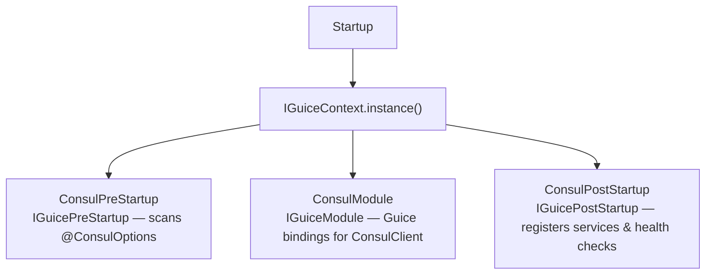
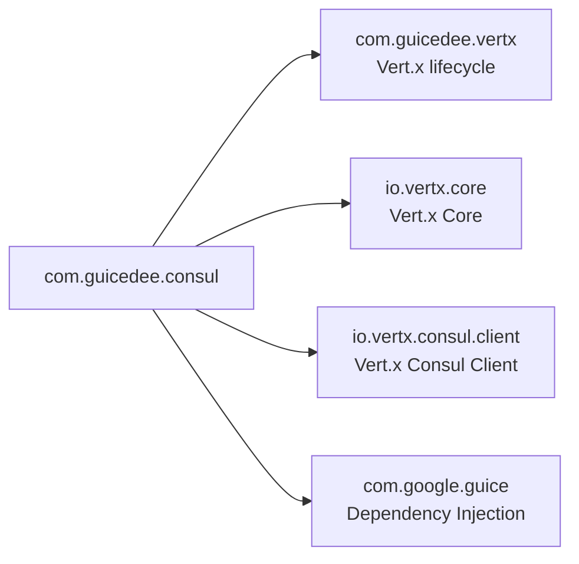

# com.guicedee:consul

Integrates Vert.x Consul Client for service registration, health checks, and KV access

- Version line: `2.6.0` (verify publication separately).
- Packaging: `jar`.
- JPMS module: `com.guicedee.consul`.
- [Source POM](https://github.com/GuicedEE/Consul/blob/master/pom.xml).
- [Reference guide](https://guicedee.com/reference/overview.md).

## Direct dependency declarations

Versions may be supplied by the BOM or properties in the linked POM; this is not a flattened dependency lock.

- `org.projectlombok:lombok`; scope `compile`.
- `com.guicedee:vertx`; scope `compile`.
- `com.guicedee:client`; scope `compile`.
- `io.vertx:vertx-core`; scope `compile`.
- `io.vertx:vertx-consul-client`; scope `compile`.
- `com.guicedee:inject`; scope `test`.
- `org.junit.jupiter:junit-jupiter`; scope `test`.
- `com.guicedee.modules.services:testcontainers`; scope `test`.

## JPMS descriptor

```java
import com.guicedee.client.services.lifecycle.IGuiceModule;
import com.guicedee.client.services.lifecycle.IGuicePostStartup;
import com.guicedee.client.services.lifecycle.IGuicePreStartup;
import com.guicedee.consul.ConsulModule;
import com.guicedee.consul.ConsulPostStartup;
import com.guicedee.consul.ConsulPreStartup;

module com.guicedee.consul {

    exports com.guicedee.consul;

    requires transitive com.guicedee.vertx;
    requires transitive io.vertx.core;
    requires transitive io.vertx.consul.client;
    requires com.google.guice;
    requires io.github.classgraph;
    requires static lombok;

    provides IGuicePreStartup with ConsulPreStartup;
    provides IGuicePostStartup with ConsulPostStartup;
    provides IGuiceModule with ConsulModule;

    opens com.guicedee.consul to com.google.guice, io.github.classgraph;
}
```

## Module guide

Source: [README.md](https://github.com/GuicedEE/Consul/blob/master/README.md). Historical version examples retain their original context.

# GuicedEE Consul

[](https://github.com/GuicedEE/GuicedConsul/actions/workflows/build.yml)
[](https://github.com/GuicedEE/GuicedConsul)
[](https://www.apache.org/licenses/LICENSE-2.0)


Core **Consul integration for GuicedEE** using Vert.x Consul Client. Provides annotation-driven Consul client access, automatic service registration, health check wiring, and clean deregistration on shutdown.

Built on [Vert.x 5](https://vertx.io/) · [Vert.x Consul Client](https://vertx.io/docs/vertx-consul-client/java/) · [Google Guice](https://github.com/google/guice) · JPMS module `com.guicedee.consul` · Java 25+

## 📦 Installation

```xml
<dependency>
  <groupId>com.guicedee</groupId>
  <artifactId>consul</artifactId>
</dependency>
```

<details>
<summary>Gradle (Kotlin DSL)</summary>

```kotlin
implementation("com.guicedee:consul:2.4.1")
```
</details>

## ✨ Features

- **Annotation-driven configuration** — `@ConsulOptions` on `package-info.java` configures the Consul client
- **Automatic service registration** — registers on startup, deregisters on shutdown
- **HTTP health checks** — attaches health check endpoints to registered services
- **Environment variable overrides** — all annotation attributes overridable without code changes
- **Named client injection** — multiple Consul clients via `@Named` qualifier
- **Guice-managed lifecycle** — startup/shutdown hooks via `IGuicePostStartup` / `IGuicePreDestroy`

## 🚀 Quick Start

**Step 1** — Configure Consul on your package:

```java
@ConsulOptions(
    value = "default",
    host = "localhost",
    port = 8500,
    registerService = true,
    serviceName = "wallet-api",
    servicePort = 8080,
    healthPath = "/health/ready",
    healthInterval = "10s",
    deregisterAfter = "1m"
)
package com.myapp.wallet;

import com.guicedee.consul.ConsulOptions;
```

**Step 2** — Inject and use the Consul client:

```java
@Inject
@Named("default")
ConsulClient consulClient;
```

That's it. The module discovers `@ConsulOptions`, creates the client, registers the service, and wires health checks automatically.

## 📐 Architecture



## ⚙️ Configuration

Place `@ConsulOptions` on `package-info.java`:

| Attribute | Default | Purpose |
|---|---|---|
| `value` | `"default"` | Named qualifier for injection |
| `host` | `"localhost"` | Consul agent host |
| `port` | `8500` | Consul agent port |
| `token` | `""` | ACL token |
| `registerService` | `true` | Whether to register the service |
| `serviceName` | `""` | Service name in Consul catalog |
| `servicePort` | `8080` | Port for the registered service |
| `healthPath` | `"/health/ready"` | HTTP health check path |
| `healthInterval` | `"10s"` | Health check interval |
| `deregisterAfter` | `"1m"` | Critical service deregister timeout |

## 🌍 Environment Variable Overrides

All annotation values are overridable:

| Pattern | Example |
|---|---|
| `CONSUL_{NORMALIZED_NAME}_{PROPERTY}` | `CONSUL_DEFAULT_HOST=consul.internal` |
| `CONSUL_{PROPERTY}` (global fallback) | `CONSUL_TOKEN=my-acl-token` |

## 🔗 Service Registration

When `registerService = true`, the module automatically:
1. Registers the service with Consul on startup
2. Attaches HTTP health checks at the configured path
3. Deregisters cleanly on JVM shutdown

## 🔍 Service Discovery

Combine with `com.guicedee:consul-service-resolver` to resolve services via Consul:

```java
@ServiceResolverOptions(value = "my-service", type = "consul")
package com.myapp.client;
```

Then use with `@Endpoint` and `RestClient` as normal.

## 🔌 SPI & Extension Points

| SPI | Purpose |
|---|---|
| `IGuicePreStartup` | Scans for `@ConsulOptions` annotations |
| `IGuicePostStartup` | Registers services and health checks |
| `IGuiceModule` | Binds `ConsulClient` instances to Guice |

## 🗺️ Module Graph



## 🧩 JPMS

Module name: **`com.guicedee.consul`**

The module:
- **exports** `com.guicedee.consul`
- **provides** `IGuicePreStartup` with `ConsulPreStartup`, `IGuicePostStartup` with `ConsulPostStartup`, `IGuiceModule` with `ConsulModule`

```java
module my.app {
    requires com.guicedee.consul;
}
```

## 🏗️ Key Classes

| Class | Role |
|---|---|
| `ConsulOptions` | Annotation for Consul connection and registration configuration |
| `WrappedConsulOptions` | Resolved options with environment variable overrides applied |
| `ConsulPreStartup` | Scans `@ConsulOptions` annotations at startup |
| `ConsulPostStartup` | Registers services and health checks with Consul |
| `ConsulModule` | Guice module binding `ConsulClient` instances |

## 🤝 Contributing

Issues and pull requests are welcome — please add tests for new features.

## 📄 License

[Apache 2.0](https://www.apache.org/licenses/LICENSE-2.0)

## Declared API reference

Java public/protected declarations and public interface methods are parsed with the JDK compiler. This includes implementation types; package exports determine JPMS accessibility. Inherited and generated members are not expanded. Kotlin adapters retain their source and comments.

## ConsulModule

[Java source](https://github.com/GuicedEE/Consul/blob/master/src/main/java/com/guicedee/consul/ConsulModule.java)

### ConsulModule

```java
@Override protected void configure();
```

## ConsulOptions

[Java source](https://github.com/GuicedEE/Consul/blob/master/src/main/java/com/guicedee/consul/ConsulOptions.java)

### ConsulOptions

```java
String value() default "default";
String host() default "localhost";
int port() default 8500;
boolean ssl() default false;
String token() default "";
String datacenter() default "";
String configPrefix() default "";
boolean registerService() default false;
String serviceName() default "";
String serviceId() default "";
String serviceAddress() default "";
int servicePort() default 0;
String healthPath() default "/health/ready";
String healthInterval() default "10s";
String deregisterAfter() default "1m";
```

## ConsulPostStartup

[Java source](https://github.com/GuicedEE/Consul/blob/master/src/main/java/com/guicedee/consul/ConsulPostStartup.java)

### ConsulPostStartup

```java
@Override public List<Uni<Boolean>> postLoad();
@Override public Integer sortOrder();
```

## ConsulPreStartup

[Java source](https://github.com/GuicedEE/Consul/blob/master/src/main/java/com/guicedee/consul/ConsulPreStartup.java)

### ConsulPreStartup

```java
@Override public List<Future<Boolean>> onStartup();
public static String envForName(String name, String property, String defaultValue);
@Override public Integer sortOrder();
```

## WrappedConsulOptions

[Java source](https://github.com/GuicedEE/Consul/blob/master/src/main/java/com/guicedee/consul/WrappedConsulOptions.java)

### WrappedConsulOptions

```java
public WrappedConsulOptions(String name, String host, int port, boolean ssl, String token, String datacenter, String configPrefix, boolean registerService, String serviceName, String serviceId, String serviceAddress, int servicePort, String healthPath, String healthInterval, String deregisterAfter);
@Override public Class<? extends Annotation> annotationType();
@Override public String value();
@Override public String host();
@Override public int port();
@Override public boolean ssl();
@Override public String token();
@Override public String datacenter();
@Override public String configPrefix();
@Override public boolean registerService();
@Override public String serviceName();
@Override public String serviceId();
@Override public String serviceAddress();
@Override public int servicePort();
@Override public String healthPath();
@Override public String healthInterval();
@Override public String deregisterAfter();
```
