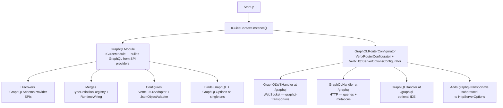
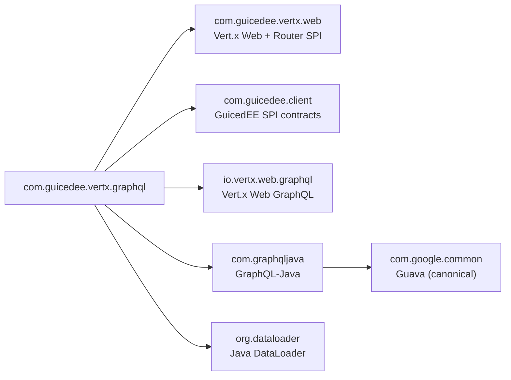

# com.guicedee:graphql

GraphQL integration for GuicedEE using Vert.x Web GraphQL

- Version line: `2.6.0` (verify publication separately).
- Packaging: `jar`.
- JPMS module: `com.guicedee.vertx.graphql`.
- [Source POM](https://github.com/GuicedEE/GraphQL/blob/master/pom.xml).
- [Reference guide](https://guicedee.com/reference/overview.md).

## Direct dependency declarations

Versions may be supplied by the BOM or properties in the linked POM; this is not a flattened dependency lock.

- `com.guicedee:web`; scope `compile`.
- `io.vertx:vertx-web-graphql`; scope `compile`.
- `com.guicedee.modules.services:graphql-java`; scope `compile`.
- `com.guicedee:service-registry`; scope `compile`; optional.
- `io.vertx:vertx-web-client`; scope `compile`; optional.
- `org.junit.jupiter:junit-jupiter`; scope `test`.
- `com.guicedee:inject`; scope `test`.

## JPMS descriptor

```java
import com.guicedee.client.services.lifecycle.IGuiceModule;
import com.guicedee.vertx.graphql.implementations.GraphQLModule;
import com.guicedee.vertx.graphql.implementations.GraphQLRouterConfigurator;
import com.guicedee.vertx.web.spi.VertxHttpServerOptionsConfigurator;
import com.guicedee.vertx.web.spi.VertxRouterConfigurator;

/**
 * GuicedEE GraphQL module — annotation-driven GraphQL integration using Vert.x Web GraphQL.
 *
 * <p>Provides HTTP, WebSocket, and GraphiQL endpoints, auto-configured with
 * {@link io.vertx.ext.web.handler.graphql.instrumentation.VertxFutureAdapter VertxFutureAdapter}
 * and {@link io.vertx.ext.web.handler.graphql.instrumentation.JsonObjectAdapter JsonObjectAdapter}
 * instrumentations.</p>
 *
 * <p>Optional GraphQL Gateway: when {@code com.guicedee.service.registry} is on the module path
 * and {@code GRAPHQL_GATEWAY_ENABLED=true}, remote services with {@code graphqlPath} metadata
 * are introspected, their schemas merged, and queries proxied to the originating service.</p>
 */
module com.guicedee.vertx.graphql {

    requires transitive com.guicedee.vertx.web;
    requires transitive io.vertx.web.graphql;
    requires transitive com.graphqljava;
    requires transitive org.dataloader;

    requires java.logging;
    requires static lombok;

    // Optional: gateway feature activates only if service-registry and web-client are present
    requires static com.guicedee.service.registry;
    requires static io.vertx.web.client;

    // Public SPI for schema and data loader contribution
    exports com.guicedee.vertx.graphql.services;
    // Public config
    exports com.guicedee.vertx.graphql;
    // Public gateway package
    exports com.guicedee.vertx.graphql.gateway;

    // SPI contracts this module discovers
    uses com.guicedee.vertx.graphql.services.IGraphQLSchemaProvider;
    uses com.guicedee.vertx.graphql.services.IGraphQLDataLoaderProvider;

    // SPI implementations this module provides
    provides IGuiceModule with GraphQLModule;
    provides VertxRouterConfigurator with GraphQLRouterConfigurator;
    provides VertxHttpServerOptionsConfigurator with GraphQLRouterConfigurator;
    provides com.guicedee.vertx.graphql.services.IGraphQLSchemaProvider
        with com.guicedee.vertx.graphql.gateway.RemoteGraphQLSchemaProvider;

    // Open implementation packages for Guice injection
    opens com.guicedee.vertx.graphql to com.google.guice;
    opens com.guicedee.vertx.graphql.implementations to com.google.guice;
    opens com.guicedee.vertx.graphql.gateway to com.google.guice;
}
```

## Module guide

Source: [README.md](https://github.com/GuicedEE/GraphQL/blob/master/README.md). Historical version examples retain their original context.

# GuicedEE GraphQL

[](https://github.com/GuicedEE/GraphQL/actions/workflows/build.yml)
[](https://central.sonatype.com/artifact/com.guicedee/graphql)
[](https://www.apache.org/licenses/LICENSE-2.0)


**GraphQL integration for [GuicedEE](https://github.com/GuicedEE)** powered by [Vert.x Web GraphQL](https://vertx.io/docs/vertx-web-graphql/java/).
Add the dependency, implement an `IGraphQLSchemaProvider`, and the module auto-registers HTTP, WebSocket, and optional GraphiQL endpoints — zero manual router wiring required.

Built on [Vert.x 5](https://vertx.io/) · [GraphQL-Java](https://www.graphql-java.com/) · [Google Guice](https://github.com/google/guice) · JPMS module `com.guicedee.vertx.graphql` · Java 25+

## 📦 Installation

```xml
<dependency>
  <groupId>com.guicedee</groupId>
  <artifactId>graphql</artifactId>
</dependency>
```

<details>
<summary>Gradle (Kotlin DSL)</summary>

```kotlin
implementation("com.guicedee:graphql:2.4.1")
```
</details>

## ✨ Features

- **HTTP endpoint** — `GraphQLHandler` at `/graphql` (configurable) with automatic query/mutation support
- **WebSocket endpoint** — `GraphQLWSHandler` with `graphql-transport-ws` subprotocol for subscriptions, queries, and mutations
- **GraphiQL IDE** — optional browsable IDE at `/graphiql` (disabled by default for security)
- **SPI-driven schema** — contribute SDL type definitions and runtime wiring via `IGraphQLSchemaProvider`
- **DataLoader support** — register batch loaders via `IGraphQLDataLoaderProvider` (fresh per-request registry)
- **Auto-instrumented** — `VertxFutureAdapter` and `JsonObjectAdapter` configured automatically
- **Query batching** — toggleable via `GRAPHQL_BATCHING_ENABLED` environment variable
- **File uploads** — multipart request support toggleable via `GRAPHQL_UPLOADS_ENABLED` environment variable
- **Environment-driven config** — all paths and feature toggles configurable via system properties or environment variables
- **JPMS + ServiceLoader friendly** — fully modular with `module-info.java` and `META-INF/services` descriptors

## 🚀 Quick Start

**Step 1** — Add the dependency (see [Installation](#-installation)).

**Step 2** — Implement a schema provider:

```java
public class MySchemaProvider implements IGraphQLSchemaProvider<MySchemaProvider> {

    @Override
    public TypeDefinitionRegistry getTypeDefinitions() {
        return new SchemaParser().parse("""
            type Query {
                hello(name: String): String
            }
        """);
    }

    @Override
    public RuntimeWiring.Builder configureWiring(RuntimeWiring.Builder builder) {
        return builder.type("Query", b -> b.dataFetcher("hello",
            env -> "Hello, " + env.getArgument("name") + "!"));
    }
}
```

**Step 3** — Register via JPMS and META-INF:

```java
module my.app {
    requires com.guicedee.vertx.graphql;

    provides com.guicedee.vertx.graphql.services.IGraphQLSchemaProvider
        with my.app.MySchemaProvider;

    opens my.app to com.google.guice;
}
```

`META-INF/services/com.guicedee.vertx.graphql.services.IGraphQLSchemaProvider`:
```
my.app.MySchemaProvider
```

**Step 4** — Bootstrap GuicedEE:

```java
IGuiceContext.registerModuleForScanning.add("my.app");
IGuiceContext.instance().inject();
```

That's it. The GraphQL endpoint is live:

```
POST http://localhost:8080/graphql
{"query": "{ hello(name: \"World\") }"}
→ {"data": {"hello": "Hello, World!"}}
```

## 📐 Architecture



### Request lifecycle

```
HTTP POST /graphql
 → Vert.x Router
   → GraphQLHandler
     → Build per-request DataLoaderRegistry (IGraphQLDataLoaderProvider SPIs)
     → graphql-java execution
       → Data fetchers (return Future<T>, CompletionStage<T>, or plain values)
     → JSON response

WebSocket /graphql (graphql-transport-ws)
 → GraphQLWSHandler
   → graphql-java execution per message
   → Subscription → Publisher stream
```

## ⚙️ Configuration

All settings can be overridden via system properties or environment variables:

| Variable | Default | Description |
|---|---|---|
| `GRAPHQL_HTTP_PATH` | `/graphql` | HTTP endpoint path |
| `GRAPHQL_WS_ENABLED` | `true` | Enable GraphQL over WebSocket |
| `GRAPHQL_WS_PATH` | `/graphql` | WebSocket endpoint path |
| `GRAPHIQL_ENABLED` | `false` | Enable GraphiQL IDE |
| `GRAPHIQL_PATH` | `/graphiql` | GraphiQL mount path |
| `GRAPHQL_BATCHING_ENABLED` | `false` | Enable query batching |
| `GRAPHQL_UPLOADS_ENABLED` | `false` | Enable multipart file uploads |

## 📊 DataLoader Support

Implement `IGraphQLDataLoaderProvider` to register batch loaders:

```java
public class UserDataLoaderProvider implements IGraphQLDataLoaderProvider<UserDataLoaderProvider> {
    @Override
    public void configureDataLoaders(DataLoaderRegistry registry) {
        BatchLoader<String, User> userLoader = ids -> retrieveUsersByIds(ids);
        registry.register("users", DataLoaderFactory.newDataLoader(userLoader));
    }
}
```

A fresh `DataLoaderRegistry` is created for each request automatically.

## ⚡ Data Fetchers

Return Vert.x `Future<T>` directly from data fetchers — `VertxFutureAdapter` is auto-configured:

```java
DataFetcher<Future<List<User>>> fetcher = env -> {
    Future<List<User>> future = userService.findAll();
    return future;
};
```

Use `JsonObject` in results — `JsonObjectAdapter` is auto-configured.

## 📤 File Uploads

Enable multipart file uploads:

```bash
export GRAPHQL_UPLOADS_ENABLED=true
```

Add the `Upload` scalar to your wiring and use `FileUpload` from `DataFetchingEnvironment`.

> Note: The `BodyHandler` must be mounted on the router (provided by the `web` module).

## 🔌 SPI & Extension Points

| SPI | Purpose |
|---|---|
| `IGraphQLSchemaProvider` | Contribute SDL type definitions and runtime wiring |
| `IGraphQLDataLoaderProvider` | Register batch loaders per request |
| `VertxRouterConfigurator` | Customize the Vert.x `RouterConfig` (provided by `GraphQLRouterConfigurator`) |
| `VertxHttpServerOptionsConfigurator` | Customize `HttpServerOptions` (WebSocket subprotocol added automatically) |
| `IGuiceModule` | Contribute Guice bindings (provided by `GraphQLModule`) |

## 💉 Injecting the GraphQL Instance

The `GraphQL` instance is bound as a singleton. Inject it anywhere:

```java
@Inject
private GraphQL graphQL;
```

Or retrieve it programmatically:

```java
GraphQL graphQL = IGuiceContext.get(GraphQL.class);
```

## 🗺️ Module Graph



## 🛡️ Dependency Hygiene

GraphQL-Java ships a **shaded copy of Guava** embedded under `graphql.com.google.common.*`.
The GuicedEE shade module `com.graphqljava` **strips that embedded copy out** and rewrites
GraphQL-Java's internal references back to the real `com.google.common` package, so the runtime
reuses the **canonical `com.google.guava:guava` (JPMS module `com.google.common`)** that GuicedEE
already ships and patches centrally.

Benefits:
- **No duplicate Guava** on the module path — a single, suite-managed version.
- **Security** — the embedded Guava is no longer pinned to whatever GraphQL-Java last bundled;
  it tracks the centrally-managed, up-to-date Guava and its CVE fixes.
- **Clean JPMS graph** — `com.graphqljava requires transitive com.google.common`, so consumers of
  `com.guicedee.vertx.graphql` automatically read Guava with no extra `requires` clause.

## 🧩 JPMS

Module name: **`com.guicedee.vertx.graphql`**

The module:
- **exports** `com.guicedee.vertx.graphql.services`, `com.guicedee.vertx.graphql`
- **uses** `IGraphQLSchemaProvider`, `IGraphQLDataLoaderProvider`
- **provides** `IGuiceModule` with `GraphQLModule`
- **provides** `VertxRouterConfigurator` with `GraphQLRouterConfigurator`
- **provides** `VertxHttpServerOptionsConfigurator` with `GraphQLRouterConfigurator`
- **opens** `graphql` and `implementations` packages to `com.google.guice`

## 🏗️ Key Classes

| Class | Package | Role |
|---|---|---|
| `GraphQLRouterConfigurator` | `implementations` | `VertxRouterConfigurator` + `VertxHttpServerOptionsConfigurator` — mounts HTTP, WS, GraphiQL handlers and adds WS subprotocol |
| `GraphQLModule` | `implementations` | `IGuiceModule` — builds `GraphQL` from SPI providers with `VertxFutureAdapter` + `JsonObjectAdapter` instrumentations |
| `GraphQLOptions` | (root) | Environment-driven configuration POJO for paths and toggles |
| `IGraphQLSchemaProvider` | `services` | SPI for contributing type definitions and runtime wiring |
| `IGraphQLDataLoaderProvider` | `services` | SPI for registering batch loaders per request |

## 🧪 Testing

```bash
mvn test
```

## 🤝 Contributing

Issues and pull requests are welcome — please add tests for new schema contributions, data loader integrations, or configuration changes.

## 📄 License

[Apache 2.0](https://www.apache.org/licenses/LICENSE-2.0)

## Declared API reference

Java public/protected declarations and public interface methods are parsed with the JDK compiler. This includes implementation types; package exports determine JPMS accessibility. Inherited and generated members are not expanded. Kotlin adapters retain their source and comments.

## RemoteGraphQLSchemaProvider

[Java source](https://github.com/GuicedEE/GraphQL/blob/master/src/main/java/com/guicedee/vertx/graphql/gateway/RemoteGraphQLSchemaProvider.java)

### RemoteGraphQLSchemaProvider

```java
@Override public Integer sortOrder();
@Override public TypeDefinitionRegistry getTypeDefinitions();
@Override public RuntimeWiring.Builder configureWiring(RuntimeWiring.Builder builder);
```

## GraphQLOptions

[Java source](https://github.com/GuicedEE/GraphQL/blob/master/src/main/java/com/guicedee/vertx/graphql/GraphQLOptions.java)

### GraphQLOptions

```java
```

## GraphQLModule

[Java source](https://github.com/GuicedEE/GraphQL/blob/master/src/main/java/com/guicedee/vertx/graphql/implementations/GraphQLModule.java)

### GraphQLModule

```java
@Override protected void configure();
```

## GraphQLRouterConfigurator

[Java source](https://github.com/GuicedEE/GraphQL/blob/master/src/main/java/com/guicedee/vertx/graphql/implementations/GraphQLRouterConfigurator.java)

### GraphQLRouterConfigurator

```java
@Override public Integer sortOrder();
@Override public Router builder(Router router);
@Override public HttpServerOptions builder(HttpServerOptions options);
```

## IGraphQLDataLoaderProvider

[Java source](https://github.com/GuicedEE/GraphQL/blob/master/src/main/java/com/guicedee/vertx/graphql/services/IGraphQLDataLoaderProvider.java)

### IGraphQLDataLoaderProvider

```java
void configureDataLoaders(DataLoaderRegistry registry);
```

## IGraphQLSchemaProvider

[Java source](https://github.com/GuicedEE/GraphQL/blob/master/src/main/java/com/guicedee/vertx/graphql/services/IGraphQLSchemaProvider.java)

### IGraphQLSchemaProvider

```java
TypeDefinitionRegistry getTypeDefinitions();
RuntimeWiring.Builder configureWiring(RuntimeWiring.Builder builder);
```
