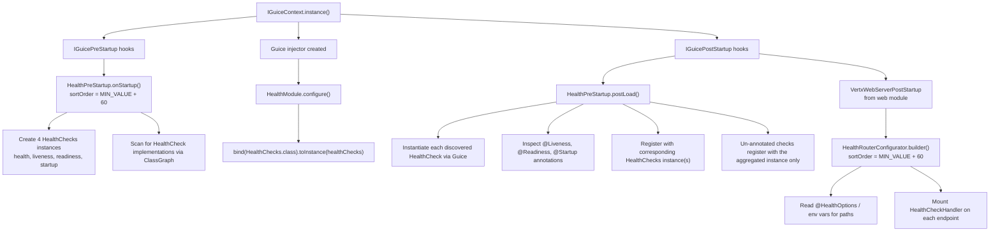
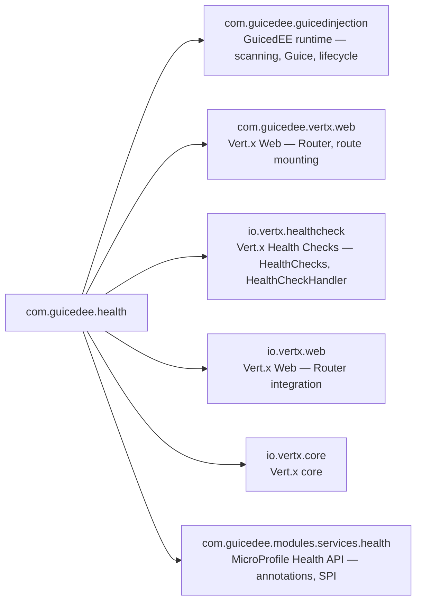

# com.guicedee:health

MicroProfile Health for GuicedEE

- Version line: `2.6.0` (verify publication separately).
- Packaging: `jar`.
- JPMS module: `com.guicedee.health`.
- [Source POM](https://github.com/GuicedEE/Health/blob/master/pom.xml).
- [Reference guide](https://guicedee.com/reference/overview.md).

## Direct dependency declarations

Versions may be supplied by the BOM or properties in the linked POM; this is not a flattened dependency lock.

- `io.vertx:vertx-health-check`; scope `compile`.
- `com.guicedee.modules.services:health-core`; scope `compile`.
- `com.guicedee:inject`; scope `compile`.
- `org.junit.jupiter:junit-jupiter`; scope `test`.
- `org.mockito:mockito-core`; scope `test`.
- `org.mockito:mockito-junit-jupiter`; scope `test`.
- `com.guicedee:web`; scope `compile`.
- `com.guicedee:service-registry`; scope `compile`; optional.

## JPMS descriptor

```java
/**
 * The GuicedEE Health module provides integration between Vert.x Health Checks and the MicroProfile Health API.
 *
 * <p>It automatically scans for classes implementing {@link org.eclipse.microprofile.health.HealthCheck} and
 * registers them with Vert.x {@link io.vertx.ext.healthchecks.HealthChecks} instances.</p>
 *
 * <p>This module exposes several health check endpoints:</p>
 * <ul>
 *     <li>{@code /health}: Aggregated health status</li>
 *     <li>{@code /health/live}: Liveness status (via {@link org.eclipse.microprofile.health.Liveness})</li>
 *     <li>{@code /health/ready}: Readiness status (via {@link org.eclipse.microprofile.health.Readiness})</li>
 *     <li>{@code /health/started}: Startup status (via {@link org.eclipse.microprofile.health.Startup})</li>
 * </ul>
 */
module com.guicedee.health {
    requires transitive com.guicedee.guicedinjection;
    requires transitive io.vertx.healthcheck;
    requires transitive io.vertx.web;
    requires transitive com.guicedee.modules.services.health;

    requires com.guicedee.vertx.web;

    requires static com.guicedee.service.registry;

    exports com.guicedee.health;

    opens com.guicedee.health to com.google.guice, com.guicedee.client, com.guicedee.guicedinjection;
    opens com.guicedee.health.implementations to com.google.guice, com.guicedee.client, com.guicedee.guicedinjection;
    exports com.guicedee.health.implementations;

    provides com.guicedee.client.services.lifecycle.IGuiceModule with com.guicedee.health.implementations.HealthModule;
    provides com.guicedee.client.services.lifecycle.IGuicePreStartup with com.guicedee.health.implementations.HealthPreStartup;
    provides com.guicedee.client.services.lifecycle.IGuicePostStartup with com.guicedee.health.implementations.HealthPreStartup;
    provides com.guicedee.vertx.web.spi.VertxRouterConfigurator with com.guicedee.health.implementations.HealthRouterConfigurator;
    provides org.eclipse.microprofile.health.spi.HealthCheckResponseProvider with com.guicedee.health.implementations.mp.GuicedHealthCheckResponseProvider;
}
```

## Module guide

Source: [README.md](https://github.com/GuicedEE/Health/blob/master/README.md). Historical version examples retain their original context.

# GuicedEE Health

[](https://github.com/GuicedEE/GuicedHealth/actions/workflows/build.yml)
[](https://central.sonatype.com/artifact/com.guicedee/health)
[](https://www.apache.org/licenses/LICENSE-2.0)


Seamless **MicroProfile Health** integration for [GuicedEE](https://github.com/GuicedEE) applications using **Vert.x 5 Health Checks**.
Annotate your classes with standard `@Liveness`, `@Readiness`, and `@Startup` — health checks are discovered at startup via ClassGraph, registered with Vert.x `HealthChecks`, and exposed as JSON endpoints on the Vert.x Web `RouterConfig` automatically.

Built on [Vert.x Health Checks](https://vertx.io/docs/vertx-health-check/java/) · [MicroProfile Health](https://github.com/eclipse/microprofile-health) · [Google Guice](https://github.com/google/guice) · JPMS module `com.guicedee.health` · Java 25+

## 📦 Installation

```xml
<dependency>
  <groupId>com.guicedee</groupId>
  <artifactId>health</artifactId>
</dependency>
```

<details>
<summary>Gradle (Kotlin DSL)</summary>

```kotlin
implementation("com.guicedee:health:2.4.1")
```
</details>

## ✨ Features

- **MicroProfile Health annotations** — `@Liveness`, `@Readiness`, `@Startup`, and the legacy `@Health` are all supported
- **Automatic discovery** — `HealthPreStartup` scans for `HealthCheck` implementations via ClassGraph and registers them with the appropriate Vert.x `HealthChecks` instance
- **Four dedicated endpoints** — aggregated `/health`, plus `/health/live`, `/health/ready`, and `/health/started`
- **Configurable paths** — use `@HealthOptions` on any class (or package) to override default endpoint paths
- **Environment variable overrides** — `HEALTH_ENABLED`, `HEALTH_PATH`, `HEALTH_LIVENESS_PATH`, `HEALTH_READINESS_PATH`, `HEALTH_STARTUP_PATH` override annotation values
- **Guice-managed checks** — health check instances are obtained from the Guice injector, so `@Inject` works inside them
- **Manual registration** — inject the `HealthChecks` instance and register Vert.x-native checks directly
- **MicroProfile SPI** — custom `HealthCheckResponseProvider` and `HealthCheckResponseBuilder` provided out of the box
- **Lifecycle-aware** — integrated with `IGuicePreStartup` (scan), `IGuicePostStartup` (register), and `IGuicePreDestroy` (cleanup)
- **Timeout protection** — each registered check has a 2-second timeout to prevent hanging health endpoints

## 🚀 Quick Start

**Step 1** — Implement a health check with a MicroProfile annotation:

```java
import org.eclipse.microprofile.health.HealthCheck;
import org.eclipse.microprofile.health.HealthCheckResponse;
import org.eclipse.microprofile.health.Liveness;

@Liveness
public class DatabaseLiveness implements HealthCheck {
    @Override
    public HealthCheckResponse call() {
        return HealthCheckResponse.named("DatabaseLiveness")
                .up()
                .withData("connection", "stable")
                .build();
    }
}
```

**Step 2** — Bootstrap GuicedEE (health endpoints are registered automatically):

```java
IGuiceContext.registerModuleForScanning.add("my.app");
IGuiceContext.instance();
// GET /health        → aggregated status
// GET /health/live   → liveness checks only
// GET /health/ready  → readiness checks only
// GET /health/started → startup checks only
```

No JPMS `provides` declaration is needed for health check classes — they are discovered via classpath scanning. The health module itself is registered automatically.

## 📐 Startup Flow



## 🏥 Health Check Types

### Liveness

Liveness checks determine if the application is running correctly. A failing liveness check typically means the application should be restarted.

```java
@Liveness
public class ProcessLiveness implements HealthCheck {
    @Override
    public HealthCheckResponse call() {
        return HealthCheckResponse.named("ProcessLiveness")
                .up()
                .build();
    }
}
```

### Readiness

Readiness checks determine if the application is ready to receive traffic. A failing readiness check means the application should be temporarily removed from the load balancer.

```java
@Readiness
public class ServiceReadiness implements HealthCheck {
    @Override
    public HealthCheckResponse call() {
        boolean ready = checkExternalDependencies();
        return HealthCheckResponse.named("ServiceReadiness")
                .status(ready)
                .build();
    }
}
```

### Startup

Startup checks verify if the application has finished its initialization. Failing startup checks prevent liveness probes from running during long startup sequences.

```java
@Startup
public class InitializerStartup implements HealthCheck {
    @Override
    public HealthCheckResponse call() {
        return HealthCheckResponse.named("InitializerStartup")
                .up()
                .build();
    }
}
```

### Un-annotated (Generic)

A `HealthCheck` implementation without any annotation is registered with the aggregated `/health` endpoint only.

```java
public class GenericCheck implements HealthCheck {
    @Override
    public HealthCheckResponse call() {
        return HealthCheckResponse.named("GenericCheck")
                .up()
                .withData("version", "1.0")
                .build();
    }
}
```

### Multiple annotations

A check can carry more than one annotation — it will be registered with each corresponding instance **and** the aggregated instance:

```java
@Liveness
@Readiness
public class CriticalServiceCheck implements HealthCheck {
    @Override
    public HealthCheckResponse call() {
        return HealthCheckResponse.named("CriticalService")
                .up()
                .build();
    }
}
```

## ⚙️ Configuration

### `@HealthOptions` annotation

Place `@HealthOptions` on any class or package to customize endpoints:

```java
@HealthOptions(
    enabled = true,
    path = "/health",
    livenessPath = "/health/live",
    readinessPath = "/health/ready",
    startupPath = "/health/started"
)
public class MyAppConfig {
}
```

| Attribute | Default | Description |
|---|---|---|
| `enabled` | `true` | Enables or disables health check endpoints |
| `path` | `/health` | Aggregated health status endpoint |
| `livenessPath` | `/health/live` | Liveness checks endpoint |
| `readinessPath` | `/health/ready` | Readiness checks endpoint |
| `startupPath` | `/health/started` | Startup checks endpoint |

### Environment variable overrides

Every `@HealthOptions` attribute can be overridden with a system property or environment variable:

| Variable | Overrides | Example |
|---|---|---|
| `HEALTH_ENABLED` | `enabled` | `false` |
| `HEALTH_PATH` | `path` | `/api/health` |
| `HEALTH_LIVENESS_PATH` | `livenessPath` | `/api/health/live` |
| `HEALTH_READINESS_PATH` | `readinessPath` | `/api/health/ready` |
| `HEALTH_STARTUP_PATH` | `startupPath` | `/api/health/started` |

Environment variables take precedence over annotation values.

## 🛠 Manual Registration

If you need to register health checks manually using the Vert.x API, inject the `HealthChecks` instance:

### Constructor injection

```java
import io.vertx.ext.healthchecks.HealthChecks;
import io.vertx.ext.healthchecks.Status;
import com.google.inject.Inject;

public class MyService {
    @Inject
    public MyService(HealthChecks hc) {
        hc.register("my-check", 2000, promise -> promise.complete(Status.OK()));
    }
}
```

### Field injection

```java
import io.vertx.ext.healthchecks.HealthChecks;
import io.vertx.ext.healthchecks.Status;
import com.google.inject.Inject;

public class MyOtherService {
    @Inject
    private HealthChecks hc;

    public void registerChecks() {
        hc.register("my-field-check", 2000, promise ->
            promise.complete(Status.OK()));
    }
}
```

### Accessing specific instances

The aggregated `HealthChecks` is what Guice binds. For direct access to the liveness, readiness, or startup instances, use the static accessors:

```java
HealthChecks liveness = HealthPreStartup.getLivenessChecks();
HealthChecks readiness = HealthPreStartup.getReadinessChecks();
HealthChecks startup = HealthPreStartup.getStartupChecks();
```

## 📋 Response Format

Health endpoints return standard Vert.x health check JSON:

```json
{
  "status": "UP",
  "checks": [
    {
      "id": "com.example.DatabaseLiveness",
      "status": "UP",
      "data": {
        "connection": "stable"
      }
    },
    {
      "id": "com.example.ServiceReadiness",
      "status": "UP"
    }
  ]
}
```

| HTTP Status | Meaning |
|---|---|
| `200 OK` | All checks are UP |
| `503 Service Unavailable` | One or more checks are DOWN |

### Default checks

When no `HealthCheck` implementations are found on the classpath, four placeholder checks are registered automatically (`guicedee-health`, `guicedee-liveness`, `guicedee-readiness`, `guicedee-startup`) — all returning `Status.OK` — so the endpoints always respond.

## 🗺️ Module Graph



## 🧩 JPMS

Module name: **`com.guicedee.health`**

The module:
- **exports** `com.guicedee.health` and `com.guicedee.health.implementations`
- **provides** `IGuiceModule` with `HealthModule`
- **provides** `IGuicePreStartup` with `HealthPreStartup`
- **provides** `IGuicePostStartup` with `HealthPreStartup`
- **provides** `VertxRouterConfigurator` with `HealthRouterConfigurator`
- **provides** `HealthCheckResponseProvider` with `GuicedHealthCheckResponseProvider`

## 🏗️ Key Classes

| Class | Role |
|---|---|
| `HealthOptions` | Annotation — configures endpoint paths and enable/disable |
| `HealthPreStartup` | `IGuicePreStartup` + `IGuicePostStartup` + `IGuicePreDestroy` — scans, registers, and manages health check lifecycle |
| `HealthModule` | `IGuiceModule` — binds the `HealthChecks` instance into Guice |
| `HealthRouterConfigurator` | `VertxRouterConfigurator` — mounts `HealthCheckHandler` on the Vert.x Router |
| `GuicedHealthCheckResponseProvider` | MicroProfile `HealthCheckResponseProvider` SPI — creates response builders |

## 🤝 Contributing

Issues and pull requests are welcome — please add tests for new health check integrations.

## 📄 License

[Apache 2.0](https://www.apache.org/licenses/LICENSE-2.0)

## Declared API reference

Java public/protected declarations and public interface methods are parsed with the JDK compiler. This includes implementation types; package exports determine JPMS accessibility. Inherited and generated members are not expanded. Kotlin adapters retain their source and comments.

## HealthOptions

[Java source](https://github.com/GuicedEE/Health/blob/master/src/main/java/com/guicedee/health/HealthOptions.java)

### HealthOptions

```java
boolean enabled() default true;
String path() default "/health";
String livenessPath() default "/health/live";
String readinessPath() default "/health/ready";
String startupPath() default "/health/started";
```

## DownstreamHealthCheck

[Java source](https://github.com/GuicedEE/Health/blob/master/src/main/java/com/guicedee/health/implementations/DownstreamHealthCheck.java)

### DownstreamHealthCheck

```java
@Override public HealthCheckResponse call();
```

## HealthModule

[Java source](https://github.com/GuicedEE/Health/blob/master/src/main/java/com/guicedee/health/implementations/HealthModule.java)

### HealthModule

```java
public HealthModule();
@Override protected void configure();
```

## HealthPreStartup

[Java source](https://github.com/GuicedEE/Health/blob/master/src/main/java/com/guicedee/health/implementations/HealthPreStartup.java)

### HealthPreStartup

```java
public HealthPreStartup();
@Override public List<Future<Boolean>> onStartup();
@Override public List<Uni<Boolean>> postLoad();
public static HealthChecks getHealthChecks();
public static HealthChecks getLivenessChecks();
public static HealthChecks getReadinessChecks();
public static HealthChecks getStartupChecks();
public static HealthOptions getOptions();
@Override public void onDestroy();
@Override public Integer sortOrder();
```

## HealthRouterConfigurator

[Java source](https://github.com/GuicedEE/Health/blob/master/src/main/java/com/guicedee/health/implementations/HealthRouterConfigurator.java)

### HealthRouterConfigurator

```java
public HealthRouterConfigurator();
@Override public Router builder(Router router);
@Override public Integer sortOrder();
```

## GuicedHealthCheckResponseProvider

[Java source](https://github.com/GuicedEE/Health/blob/master/src/main/java/com/guicedee/health/implementations/mp/GuicedHealthCheckResponseProvider.java)

### GuicedHealthCheckResponseProvider

```java
public GuicedHealthCheckResponseProvider();
@Override public HealthCheckResponseBuilder createResponseBuilder();
```

### GuicedHealthCheckResponseBuilder

```java
public GuicedHealthCheckResponseBuilder();
@Override public HealthCheckResponseBuilder name(String name);
@Override public HealthCheckResponseBuilder up();
@Override public HealthCheckResponseBuilder down();
@Override public HealthCheckResponseBuilder status(boolean up);
@Override public HealthCheckResponseBuilder withData(String key, String value);
@Override public HealthCheckResponseBuilder withData(String key, long value);
@Override public HealthCheckResponseBuilder withData(String key, boolean value);
@Override public HealthCheckResponse build();
```

### GuicedHealthCheckResponse

```java
public GuicedHealthCheckResponse(String name, Status status, Map<String, Object> data);
@Override public String getName();
@Override public Status getStatus();
@Override public Optional<Map<String, Object>> getData();
```
