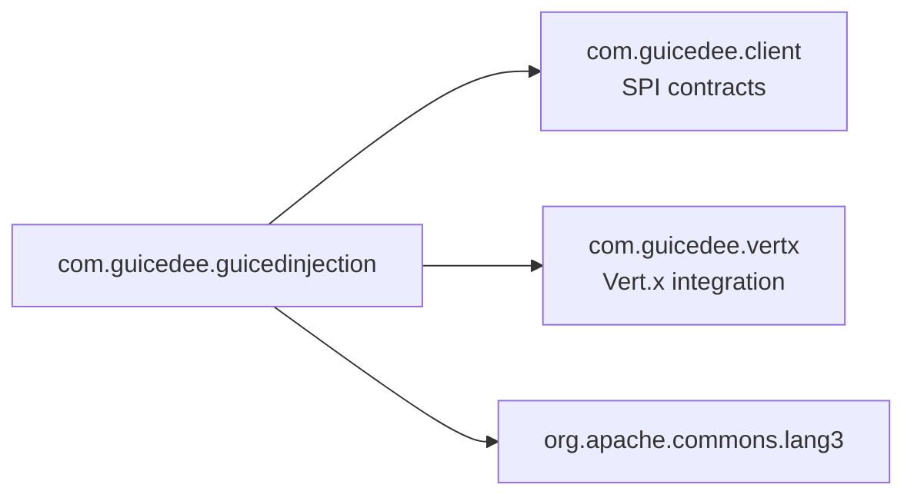

# com.guicedee:inject

GuicedEE Inject is an open-source Guice integration library that discovers binders/modules across JARs via SPI and classpath scanning, bootstraps logging, job services, and JRT URL handling, and keeps optional adapters (e.g., Vert.x) isolated. Requires Java 25 LTS.

- Version line: `2.6.0` (verify publication separately).
- Packaging: `jar`.
- JPMS module: `com.guicedee.guicedinjection`.
- [Source POM](https://github.com/GuicedEE/GuicedInjection/blob/master/pom.xml).
- [Reference guide](https://guicedee.com/reference/overview.md).

## Direct dependency declarations

Versions may be supplied by the BOM or properties in the linked POM; this is not a flattened dependency lock.

- `com.guicedee:vertx`; scope `compile`.
- `org.projectlombok:lombok`; scope `provided`.
- `com.guicedee.modules.services:aopalliance-core`; scope `compile`.
- `com.google.guava:guava`; scope `compile`.
- `org.junit.jupiter:junit-jupiter-api`; scope `test`.

## JPMS descriptor

```java
import com.guicedee.client.services.*;
import com.guicedee.client.services.config.*;
import com.guicedee.client.services.lifecycle.*;
import com.guicedee.guicedinjection.JobService;
import com.guicedee.guicedinjection.implementations.GuiceContextProvision;
import com.guicedee.client.services.IGuiceProvider;

/**
 * Core Guice context module providing configuration, scanning, and lifecycle hooks.
 */
module com.guicedee.guicedinjection {
    requires transitive org.apache.commons.lang3;

    requires static lombok;
    requires org.apache.logging.log4j.core;
    requires org.apache.logging.log4j.jul;

    requires transitive com.guicedee.vertx;

    exports com.guicedee.guicedinjection;
    //exports com.guicedee.guicedinjection.exceptions;
    //exports com.guicedee.guicedinjection.abstractions;
    //exports com.guicedee.guicedinjection.pairing;
    //exports com.guicedee.modules.services.jsonrepresentation.json;
    exports com.guicedee.guicedinjection.representations;

    uses IPackageContentsScanner;
    uses IFileContentsScanner;
    uses IFileContentsPatternScanner;
    uses IGuiceConfigurator;
    uses IGuicePreStartup;
    uses IGuicePreDestroy;


    uses IGuiceModule;
    uses IGuicePostStartup;
    uses IPathContentsScanner;
    uses IPathContentsRejectListScanner;
    uses IGuiceScanModuleExclusions;
    uses IGuiceScanModuleInclusions;
    uses IPackageRejectListScanner;
    uses IGuiceScanJarExclusions;
    uses IGuiceScanJarInclusions;
    uses Log4JConfigurator;

    provides IGuiceScanModuleExclusions with com.guicedee.guicedinjection.implementations.GuiceDefaultModuleExclusions;
    provides IGuiceScanJarExclusions with com.guicedee.guicedinjection.implementations.GuiceDefaultModuleExclusions;

    provides IGuiceModule with com.guicedee.guicedinjection.injections.ContextBinderGuice;
    //provides com.guicedee.client.services.lifecycle.IGuiceModule with com.guicedee.guicedinjection.abstractions.GuiceInjectorModule;
    provides IGuiceProvider with GuiceContextProvision;

    provides IGuicePreDestroy with JobService;

    provides java.net.spi.URLStreamHandlerProvider with com.guicedee.guicedinjection.urls.JrtUrlHandler;

    opens com.guicedee.guicedinjection to tools.jackson.databind;
}
```

## Module guide

Source: [README.md](https://github.com/GuicedEE/GuicedInjection/blob/master/README.md). Historical version examples retain their original context.

# GuicedEE Inject

[](https://github.com/GuicedEE/GuicedInjection/actions/workflows/maven-publish.yml)
[](https://github.com/GuicedEE/GuicedInjection)
[](https://www.apache.org/licenses/LICENSE-2.0)


The **runtime engine** for [GuicedEE](https://github.com/GuicedEE).
This is the library you add to your application — it wires together the [Client SPI](https://github.com/GuicedEE/Client), performs classpath scanning, creates the Guice injector, and manages the full startup/shutdown lifecycle.

Built on [Google Guice](https://github.com/google/guice) · JPMS module `com.guicedee.guicedinjection` · Java 25+

JSON is opt-in: core has no Jackson runtime dependency. Add `com.guicedee.modules.representations:json-representation` to activate its providers through SPI. See [activation and migration](https://github.com/GuicedEE/GuicedInjection/blob/client/JSON_OPT_IN.md), including the relocated `ObjectBinderKeys` API.

## 📦 Installation

```xml
<dependency>
  <groupId>com.guicedee</groupId>
  <artifactId>inject</artifactId>
</dependency>
```

<details>
<summary>Gradle (Kotlin DSL)</summary>

```kotlin
implementation("com.guicedee:inject:2.4.1")
```
</details>

## 🚀 Quick Start

```java
// Register your module for classpath scanning
IGuiceContext.registerModuleForScanning.add("my.app");

// Bootstrap — scanning, SPI discovery, injector creation, lifecycle hooks
IGuiceContext.instance();

// Grab any managed instance
MyService svc = IGuiceContext.get(MyService.class);
```

Provide a Guice module via JPMS + ServiceLoader:

```java
public class AppModule extends AbstractModule
        implements IGuiceModule<AppModule> {

    @Override
    protected void configure() {
        bind(Greeter.class).to(DefaultGreeter.class);
    }
}
```

```java
module my.app {
    requires com.guicedee.guicedinjection;

    provides com.guicedee.client.services.lifecycle.IGuiceModule
        with my.app.AppModule;
}
```

## 📝 Logging — `@InjectLogger`

Inject a named Log4j2 logger into any Guice-managed class — no boilerplate, no static fields:

```java
public class OrderService {

    @InjectLogger("orders")
    Logger log;

    public void place(Order order) {
        log.info("Placed order {}", order.id());
    }
}
```

| Attribute | Default | Purpose |
|---|---|---|
| `value` | declaring class name | Logger name |
| `level` | *(none)* | Optional level hint |
| `rollingFileName` | *(none)* | File name hint for rolling appenders |
| `fileName` | *(none)* | File name hint for file appenders |

The `Log4JTypeListener` and `Log4JMembersInjector` handle the wiring — they're registered automatically by `ContextBinderGuice`.

### Programmatic logging with `LogUtils`

For setup outside of injection (e.g. `main()` or pre-startup hooks):

```java
// ANSI-highlighted console (local dev)
LogUtils.addHighlightedConsoleLogger();

// Plain console at a specific level
LogUtils.addConsoleLogger(Level.INFO);

// Rolling file logger (100 MB / daily rollover)
LogUtils.addFileRollingLogger("my-app", "logs");

// Isolated logger with its own file
Logger auditLog = LogUtils.getSpecificRollingLogger(
    "audit", "logs/audit", null, false
);
```

> When the `CLOUD` environment variable is set, all layouts automatically switch to compact JSON for log aggregator ingestion.

Cloud JSON uses Log4j JSON Template Layout (`JsonLayout.json`), without Jackson.
The shared client dependency supplies the template layout module. `mvn verify` runs a fresh-JVM
regression against the packaged Inject JAR with `CLOUD=true` and Jackson 2 and 3 absent, checking
startup plus INFO/WARN JSON output and exception serialization.

## ⚙️ Job Service

`JobService` manages named virtual-thread executor pools with graceful shutdown:

```java
JobService jobs = JobService.INSTANCE;

// Register and submit work
jobs.registerJob("import", 100);
jobs.addJob("import", () -> processFile(file));

// Scheduled polling
jobs.registerPollingJob("heartbeat", () -> ping(), 0, 30, TimeUnit.SECONDS);
```

All pools are shut down automatically via `IGuicePreDestroy` when the context tears down.

## 🔍 Classpath Scanner Configuration

`GuiceContext` uses [ClassGraph 6.0.2](https://github.com/classgraph/classgraph/releases/tag/classgraph-6.0.2), requiring Java 25 or newer. See [application scan boundaries and module layers](https://github.com/GuicedEE/GuicedInjection/blob/master/SCAN_SCOPE.md) for exact source selection, executing-module mode and compatibility overrides.

Core/Vert.x applications can opt into `GUICEDEE_DISCOVERY_MODE=spi` with complete `IGuiceDiscovery` registrations from `client`. This bypasses ClassGraph even when a legacy configurator enables scan flags. Scanning remains the compatibility default; raw scan consumers must be adapted before opting in. See `client/SPI_DISCOVERY.md` in the sibling module and [the measured comparison](https://github.com/GuicedEE/GuicedInjection/blob/master/benchmarks/SPI_DISCOVERY_RESULTS.md).
The scanner explicitly enables the classpath and non-system modules. Metadata collection remains controlled by `GuiceConfig`;
visibility options also enable the metadata they require. Package configuration reads directly declared annotations, while
implementation and subclass discovery uses the transitive `getAll...` queries.

ClassGraph 6 does not load classes. Use `com.guicedee.client.utils.ClassLoading.loadClass(classInfo)` to resolve a boot-layer
module or the thread context classloader without running static initializers. For a custom classloader or module layer, pass
the application-owned loader to `ClassLoading.loadClass(classInfo, loader)`. Keep that loader alive while using the discovered
classes. Metadata queries should use class names directly when no runtime `Class` is needed.

This is a source and binary API migration: rebuild libraries that expose or consume ClassGraph types together. The scanning
artifact brings `classgraph-classpath`, `classgraph-vfs` and `classgraph-base` transitively, with their own JPMS modules.
See the [upstream porting guide](https://github.com/classgraph/classgraph/wiki/Porting-ClassGraph-4.x-code-to-ClassGraph-6.x)
for the renamed metadata APIs and behavior changes.
Control the scan scope with SPI interfaces — implement and register via `ServiceLoader` / JPMS `provides`:

### Module & JAR filtering

| SPI Interface | Method | Purpose |
|---|---|---|
| `IGuiceScanModuleInclusions` | `includeModules()` | Modules to **include** |
| `IGuiceScanModuleExclusions` | `excludeModules()` | Modules to **exclude** |
| `IGuiceScanJarInclusions` | `includeJars()` | JAR filenames to **include** |
| `IGuiceScanJarExclusions` | `excludeJars()` | JAR filenames to **exclude** |

```java
public class MyExclusions
        implements IGuiceScanModuleExclusions<MyExclusions> {

    @Override
    public Set<String> excludeModules() {
        return Set.of("java.sql", "jdk.crypto.ec");
    }
}
```

### Package & path filtering

| SPI Interface | Method | Purpose |
|---|---|---|
| `IPackageContentsScanner` | `searchFor()` | Packages to **include** |
| `IPackageRejectListScanner` | `exclude()` | Packages to **exclude** |
| `IPathContentsScanner` | `searchFor()` | Resource paths to **include** |
| `IPathContentsRejectListScanner` | `searchFor()` | Resource paths to **exclude** |

### File content scanners

These fire during the ClassGraph scan and let you process matched resources inline:

| SPI Interface | Method | Match by |
|---|---|---|
| `IFileContentsScanner` | `onMatch()` | Exact file name |
| `IFileContentsPatternScanner` | `onMatch()` | Regex pattern |

```java
public class ChangelogScanner implements IFileContentsScanner {

    @Override
    public Map<String, ResourceList.ByteArrayConsumer> onMatch() {
        return Map.of("changelog.xml", (resource, bytes) -> {
            // process matched resource
        });
    }
}
```

### `GuiceConfig` options

| Setter | Default | Effect |
|---|---|---|
| `setFieldScanning(true)` | `false` | Enable field-level scanning |
| `setAnnotationScanning(true)` | `false` | Enable annotation scanning |
| `setMethodInfo(true)` | `false` | Include method metadata |
| `setIgnoreFieldVisibility(true)` | `false` | Scan non-public fields |
| `setIncludePackages(true)` | `false` | Whitelist-only package scanning |
| `setVerbose(true)` | `false` | Verbose ClassGraph output |

Configure via an `IGuiceConfigurator` SPI implementation.

## 🔄 Lifecycle

```
IGuicePreStartup  →  ClassGraph scan  →  Injector created  →  IGuicePostStartup
                                                                        ↓
                                                               IGuicePreDestroy (shutdown)
```

| Hook | Purpose |
|---|---|
| `IGuicePreStartup` | Runs before scanning and injector creation |
| `IGuicePostStartup` | Runs after the injector is ready |
| `IGuicePreDestroy` | Cleanup on shutdown (e.g. `JobService`) |

`GuiceContext.destroy()` stops the context exactly once for both direct injection
and `GuiceApplication` entry points. Concurrent callers wait for that cleanup;
same-thread reentrant calls return. The existing injector remains available to
cleanup hooks until they finish. Subsequent shutdown calls are harmless, and
injection after shutdown is rejected instead of restarting closed services.
Failed synchronous startup uses the same ordered, terminal cleanup path.
| `IGuiceConfigurator` | Configures `GuiceConfig` before scanning |
| `Log4JConfigurator` | Customizes Log4j2 appenders/patterns at startup |

## 🗺️ Module Graph



## 🧩 JPMS

Module name: **`com.guicedee.guicedinjection`**

The module declares `uses` for every scanner and lifecycle SPI, and provides default implementations for module/jar exclusions, the Guice context provider, and JRT URL handling. Audited infrastructure exclusions are enabled by default; see [scan exclusions and overrides](https://github.com/GuicedEE/GuicedInjection/blob/master/SCAN_EXCLUSIONS.md).

In non-JPMS environments, `META-INF/services` discovery still works.

MicroProfile Config is opt-in: core does not depend on `config-core`, SmallRye Config or the MicroProfile Config API. Applications that need it add `com.guicedee.microprofile:config` (JPMS: `requires com.guicedee.microprofile.config;`). That integration supplies its own configurator, pre-startup and Guice module through the existing client SPIs. Core's lightweight `Environment` resolver remains available without it.

## 🤝 Contributing

Issues and pull requests are welcome.

## 📄 License

[Apache 2.0](https://www.apache.org/licenses/LICENSE-2.0)

## Declared API reference

Java public/protected declarations and public interface methods are parsed with the JDK compiler. This includes implementation types; package exports determine JPMS accessibility. Inherited and generated members are not expanded. Kotlin adapters retain their source and comments.

## CronExpression

[Java source](https://github.com/GuicedEE/GuicedInjection/blob/master/src/main/java/com/guicedee/guicedinjection/CronExpression.java)

### CronExpression

```java
public static CronExpression parse(String expr);
public Optional<Duration> timeToNextExecution(ZonedDateTime from);
public Optional<ZonedDateTime> nextExecution(ZonedDateTime from);
@Override public String toString();
```

## GuiceApplication

[Java source](https://github.com/GuicedEE/GuicedInjection/blob/master/src/main/java/com/guicedee/guicedinjection/GuiceApplication.java)

### GuiceApplication

```java
public static void run(Class<?> applicationClass);
public static void run(Class<?> applicationClass, Runnable preparation);
public static void run(Runnable preparation);
```

## GuiceConfig

[Java source](https://github.com/GuicedEE/GuicedInjection/blob/master/src/main/java/com/guicedee/guicedinjection/GuiceConfig.java)

### GuiceConfig

```java
public GuiceConfig();
@SuppressWarnings("unchecked") public J reset();
@Override public boolean isServiceLoadWithClassPath();
@Override @SuppressWarnings("unchecked") @org.jspecify.annotations.NonNull public J setServiceLoadWithClassPath(boolean serviceLoadWithClassPath);
@Override public boolean isFieldScanning();
@Override @SuppressWarnings("unchecked") @org.jspecify.annotations.NonNull public J setFieldScanning(boolean fieldScanning);
@Override public boolean isAnnotationScanning();
@Override @SuppressWarnings("unchecked") @org.jspecify.annotations.NonNull public J setAnnotationScanning(boolean annotationScanning);
@Override public boolean isMethodInfo();
@Override @SuppressWarnings("unchecked") @org.jspecify.annotations.NonNull public J setMethodInfo(boolean methodInfo);
@Override public boolean isIgnoreFieldVisibility();
@Override @SuppressWarnings("unchecked") @org.jspecify.annotations.NonNull public J setIgnoreFieldVisibility(boolean ignoreFieldVisibility);
@Override public boolean isIgnoreMethodVisibility();
@Override @SuppressWarnings("unchecked") @org.jspecify.annotations.NonNull public J setIgnoreMethodVisibility(boolean ignoreMethodVisibility);
@Override public boolean isIncludePackages();
@Override @SuppressWarnings("unchecked") @org.jspecify.annotations.NonNull public J setIncludePackages(boolean includePackages);
@Override public boolean isFieldInfo();
@Override @SuppressWarnings("unchecked") @org.jspecify.annotations.NonNull public J setFieldInfo(boolean fieldInfo);
@Override public boolean isVerbose();
@Override @SuppressWarnings("unchecked") @org.jspecify.annotations.NonNull public J setVerbose(boolean verbose);
@Override public boolean isClasspathScanning();
@Override @SuppressWarnings("unchecked") @org.jspecify.annotations.NonNull public J setClasspathScanning(boolean classpathScanning);
@Override public boolean isExcludeModulesAndJars();
@Override @SuppressWarnings("unchecked") @org.jspecify.annotations.NonNull public J setExcludeModulesAndJars(boolean excludeModulesAndJars);
@Override public boolean isExcludePaths();
@Override @SuppressWarnings("unchecked") @org.jspecify.annotations.NonNull public J setExcludePaths(boolean excludePaths);
@Override public String toString();
@Override public boolean isAllowPaths();
@Override @org.jspecify.annotations.NonNull public J setAllowPaths(boolean allowedPaths);
@Override public boolean isIgnoreClassVisibility();
@Override @SuppressWarnings("unchecked") @org.jspecify.annotations.NonNull public J setIgnoreClassVisibility(boolean ignoreClassVisibility);
@Override public boolean isIncludeModuleAndJars();
@Override @org.jspecify.annotations.NonNull public J setIncludeModuleAndJars(boolean includeModuleAndJars);
@Override public boolean isPathScanning();
@Override @org.jspecify.annotations.NonNull public J setPathScanning(boolean pathScanning);
@Override @SuppressWarnings("unused") public boolean isExcludeParentModules();
@Override @SuppressWarnings("unused") @org.jspecify.annotations.NonNull public J setExcludeParentModules(boolean excludeParentModules);
@Override public boolean isRejectPackages();
@Override @org.jspecify.annotations.NonNull public J setExcludePackages(boolean excludePackages);
```

## GuiceContext

[Java source](https://github.com/GuicedEE/GuicedInjection/blob/master/src/main/java/com/guicedee/guicedinjection/GuiceContext.java)

### GuiceContext

```java
public static void setConsoleLayout(ConsoleLayoutOption option);
public static void setDefaultLogLevel(Level level);
public static void setDefaultLogLevel(String levelName);
public static Level getDefaultLogLevel();
public static boolean buildingInjector;
@Override public Optional<Injector> existingInjector();
public Injector inject();
@SuppressWarnings("unused") public void destroy();
public ScanResult getScanResult();
@SuppressWarnings("unused") public void setScanResult(ScanResult scanResult);
public static GuiceContext<?> instance();
public Future<Void> getLoadingFinished();
@SuppressWarnings("unchecked") public <T extends IDefaultService<T>> Set<T> getLoader(Class<T> loaderType, @SuppressWarnings("unused")
boolean dontInject, ServiceLoader<T> serviceLoader);
@SuppressWarnings("unchecked") public <T extends IDefaultService<T>> Set<T> getLoader(Class<T> loaderType, ServiceLoader<T> serviceLoader);
@Override public boolean isBuildingInjector();
@SuppressWarnings("unused") public ClassGraph getScanner();
@SuppressWarnings("unused") public static void setScanner(ClassGraph scanner);
public GuiceConfig<?> getConfig();
public Set<IGuicePostStartup<?>> loadPostStartupServices();
public Set<IPathContentsRejectListScanner> loadPathRejectScanners();
public Set<IGuiceScanJarExclusions> loadJarRejectScanners();
public Set<IGuiceScanJarInclusions> loadJarInclusionScanners();
public Set<IGuicePreStartup> loadPreStartupServices();
public Set<IGuicePreDestroy> loadPreDestroyServices();
public Set<IGuiceModule> loadIGuiceModules();
public Set<IGuiceConfigurator> loadIGuiceConfigs();
public boolean isAsync();
public void setAsync(boolean async);
```

### ConsoleLayoutOption

```java
public static final ConsoleLayoutOption CURRENT;
public static final ConsoleLayoutOption FIXED;
public static final ConsoleLayoutOption HIGHLIGHT;
public static final ConsoleLayoutOption JSON;
```

## GuiceContextProvision

[Java source](https://github.com/GuicedEE/GuicedInjection/blob/master/src/main/java/com/guicedee/guicedinjection/implementations/GuiceContextProvision.java)

### GuiceContextProvision

```java
@Override public IGuiceContext get();
```

## GuiceDefaultModuleExclusions

[Java source](https://github.com/GuicedEE/GuicedInjection/blob/master/src/main/java/com/guicedee/guicedinjection/implementations/GuiceDefaultModuleExclusions.java)

### GuiceDefaultModuleExclusions

```java
@Override public Set<String> excludeModules();
@Override public Set<String> excludeJars();
```

## GuiceDefaultModuleInclusions

[Java source](https://github.com/GuicedEE/GuicedInjection/blob/master/src/main/java/com/guicedee/guicedinjection/implementations/GuiceDefaultModuleInclusions.java)

### GuiceDefaultModuleInclusions

```java
@Override public Set<String> includeModules();
```

## ContextBinderGuice

[Java source](https://github.com/GuicedEE/GuicedInjection/blob/master/src/main/java/com/guicedee/guicedinjection/injections/ContextBinderGuice.java)

### ContextBinderGuice

```java
public ContextBinderGuice();
@Override public void configure();
```

## InjectLogger

[Java source](https://github.com/GuicedEE/GuicedInjection/blob/master/src/main/java/com/guicedee/guicedinjection/InjectLogger.java)

### InjectLogger

```java
String value();
String level() default "";
String rollingFileName() default "";
String fileName() default "";
```

## JobService

[Java source](https://github.com/GuicedEE/GuicedInjection/blob/master/src/main/java/com/guicedee/guicedinjection/JobService.java)

### JobService

```java
public static final JobService INSTANCE;
public JobService();
public void registerJob(String name, int maxQueueCount);
public void registerJob(String name);
public void registerPollingJob(String name, Runnable task, long initialDelay, long delay, TimeUnit unit);
public Set<String> getJobPools();
public Set<String> getPollingPools();
public Set<String> getCronPools();
public int getActiveTaskCount(String poolName);
public int getMaxQueueCount(String poolName);
public boolean isRegistered(String poolName);
public void removeJob(String pool);
public void removeJobNoWait(String pool);
public void removePollingJob(String pool);
public Future<Void> addJob(String jobPoolName, Runnable task);
public <T> Future<T> addTask(String jobPoolName, Callable<T> task);
public void addDelayedJob(String jobPoolName, Runnable task, long delay, TimeUnit unit);
public void addPollingJob(String jobPoolName, Runnable task, long delay, TimeUnit unit);
public void addPollingJob(String jobPoolName, Runnable task, long initialDelay, long delay, TimeUnit unit);
public void addCronJob(String jobPoolName, String cronExpression, Runnable task);
public Optional<CronExpression> getCronExpression(String jobPoolName);
@Deprecated(since = "2.1.0") public void waitForJob(String jobName);
@Deprecated(since = "2.1.0") public void waitForJob(String jobName, long timeout, TimeUnit unit);
@Deprecated(since = "2.1.0") public Object registerJobPool(String name, Object executorService);
@Deprecated(since = "2.1.0") public Object registerJobPollingPool(String name, Object executorService);
public void setMaxQueueCount(String queueName, int queueCount);
public void destroy();
@Override public void onDestroy();
@Override public Integer sortOrder();
```

## Log4JMembersInjector

[Java source](https://github.com/GuicedEE/GuicedInjection/blob/master/src/main/java/com/guicedee/guicedinjection/logging/Log4JMembersInjector.java)

### Log4JMembersInjector

```java
public void injectMembers(T t);
```

## Log4JTypeListener

[Java source](https://github.com/GuicedEE/GuicedInjection/blob/master/src/main/java/com/guicedee/guicedinjection/logging/Log4JTypeListener.java)

### Log4JTypeListener

```java
public <T> void hear(TypeLiteral<T> typeLiteral, TypeEncounter<T> typeEncounter);
```

## GlueList

[Java source](https://github.com/GuicedEE/GuicedInjection/blob/master/src/main/java/com/guicedee/guicedinjection/representations/GlueList.java)

### GlueList

```java
public GlueList();
public GlueList(int initialCapacity);
public GlueList(Collection<? extends T> c);
@Override public boolean add(T element);
@SuppressWarnings("unchecked") @Override public void add(int index, T element);
@SuppressWarnings("unchecked") @Override public boolean addAll(Collection<? extends T> c);
@Override public T set(int index, T element);
@Override public T get(int index);
@Override public int indexOf(Object o);
@Override public int lastIndexOf(Object o);
@Override public boolean contains(Object o);
@Override public T remove(int index);
@Override public boolean removeAll(Collection<?> c);
@Override public boolean retainAll(Collection<?> c);
@Override public boolean remove(Object o);
@Override public void clear();
public void trimToSize();
@Override public List<T> subList(int fromIndex, int toIndex);
@Override public Object[] toArray();
@SuppressWarnings("unchecked") @Override public <T> T[] toArray(T[] a);
public boolean isEmpty();
@Override public Iterator<T> iterator();
@Override public ListIterator<T> listIterator(int index);
@Override public ListIterator<T> listIterator();
@Override public int size();
@SuppressWarnings("unchecked") @Override public Object clone();
```

## ICopyable

[Java source](https://github.com/GuicedEE/GuicedInjection/blob/master/src/main/java/com/guicedee/guicedinjection/representations/ICopyable.java)

### ICopyable

```java
Logger log;
default J updateNonNullField(J source);
default Map<String, Field> asMap(Field[] fields);
default J updateFrom(Object source);
```

## ScanScope

[Java source](https://github.com/GuicedEE/GuicedInjection/blob/master/src/main/java/com/guicedee/guicedinjection/ScanScope.java)

### ScanScope

```java
public static String mode();
public static ClassGraph configure(ClassGraph graph, String mode, boolean inclusionsEnabled, Collection<String> modules, Collection<String> jars, Collection<Class<?>> anchors, boolean ignoreParents);
```

## JrtUrlConnection

[Java source](https://github.com/GuicedEE/GuicedInjection/blob/master/src/main/java/com/guicedee/guicedinjection/urls/JrtUrlConnection.java)

### JrtUrlConnection

```java
protected JrtUrlConnection(URL url);
@Override public void connect() throws IOException;
@Override public int getContentLength();
@Override public long getContentLengthLong();
@Override public long getDate();
@Override public long getLastModified();
@Override public InputStream getInputStream() throws IOException;
@Override public OutputStream getOutputStream() throws IOException;
```

## JrtUrlHandler

[Java source](https://github.com/GuicedEE/GuicedInjection/blob/master/src/main/java/com/guicedee/guicedinjection/urls/JrtUrlHandler.java)

### JrtUrlHandler

```java
@Override public URLStreamHandler createURLStreamHandler(String protocol);
```
