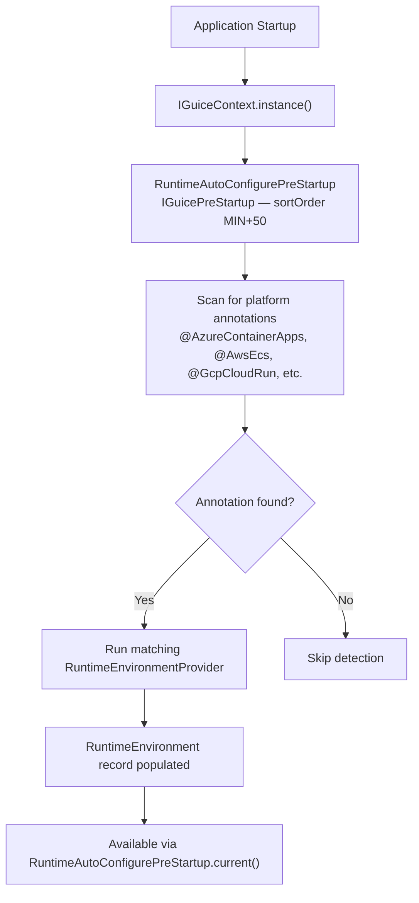
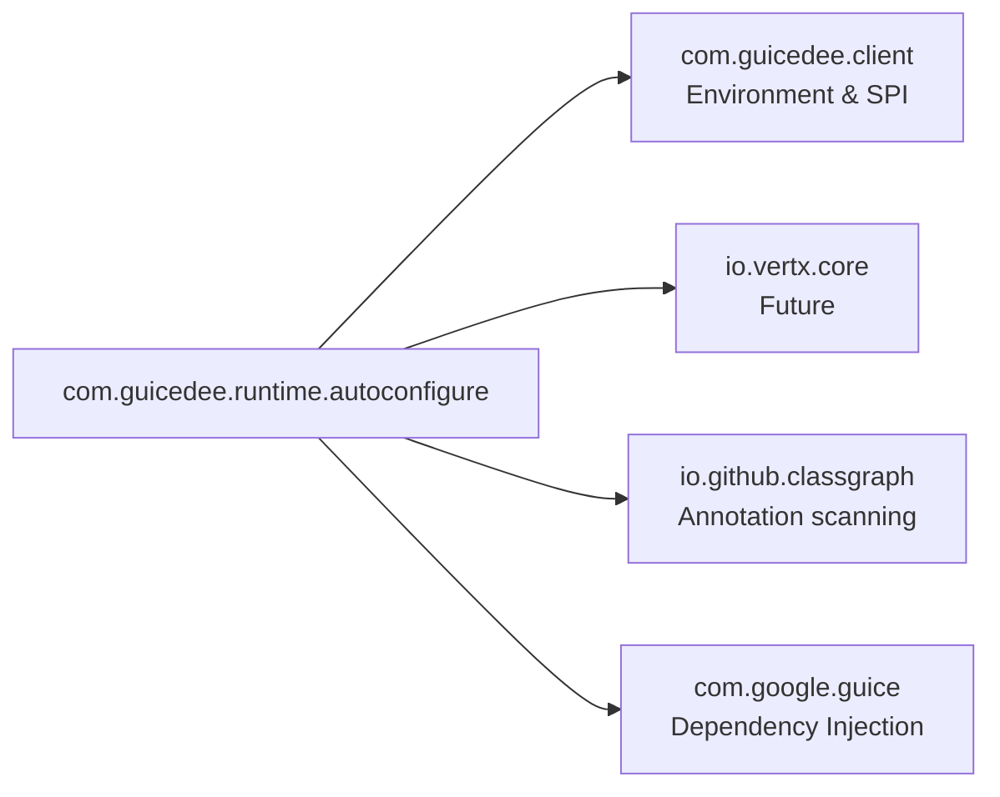

# com.guicedee:runtime-autoconfigure

Cloud runtime detection SPI — detects the platform and provides environment defaults

- Version line: `2.6.0` (verify publication separately).
- Packaging: `jar`.
- JPMS module: `com.guicedee.runtime.autoconfigure`.
- [Source POM](https://github.com/GuicedEE/RuntimeAutoconfigure/blob/master/pom.xml).
- [Reference guide](https://guicedee.com/reference/overview.md).

## Direct dependency declarations

Versions may be supplied by the BOM or properties in the linked POM; this is not a flattened dependency lock.

- `org.projectlombok:lombok`; scope `compile`.
- `com.guicedee:client`; scope `compile`.
- `com.guicedee:inject`; scope `test`.
- `org.junit.jupiter:junit-jupiter`; scope `test`.

## JPMS descriptor

```java
import com.guicedee.client.services.lifecycle.IGuicePreStartup;
import com.guicedee.runtime.autoconfigure.implementations.RuntimeAutoConfigurePreStartup;
import com.guicedee.runtime.autoconfigure.RuntimeEnvironmentProvider;
import com.guicedee.runtime.autoconfigure.providers.*;

module com.guicedee.runtime.autoconfigure {

    exports com.guicedee.runtime.autoconfigure;
    exports com.guicedee.runtime.autoconfigure.providers;

    requires transitive com.guicedee.client;
    requires org.apache.logging.log4j;
    requires io.vertx.core;
    requires io.github.classgraph;
    requires static lombok;

    provides IGuicePreStartup with RuntimeAutoConfigurePreStartup;

    provides RuntimeEnvironmentProvider with
            AzureContainerAppsEnvironmentProvider,
            AzureAppServiceEnvironmentProvider,
            AwsEcsEnvironmentProvider,
            AwsLambdaEnvironmentProvider,
            AwsAppRunnerEnvironmentProvider,
            AwsElasticBeanstalkEnvironmentProvider,
            GcpCloudRunEnvironmentProvider,
            GcpAppEngineEnvironmentProvider,
            DigitalOceanAppPlatformEnvironmentProvider,
            FlyIoEnvironmentProvider,
            RailwayEnvironmentProvider,
            RenderEnvironmentProvider,
            HerokuEnvironmentProvider,
            KubernetesEnvironmentProvider;

    uses RuntimeEnvironmentProvider;

    opens com.guicedee.runtime.autoconfigure to com.google.guice;
    opens com.guicedee.runtime.autoconfigure.providers to com.google.guice;

    //tests
    exports com.guicedee.runtime.autoconfigure.implementations to com.guicedee.runtime.autoconfigure.test, com.guicedee.vertx.servicediscovery.test, com.guicedee.service.registry.test;
}
```

## Module guide

Source: [README.md](https://github.com/GuicedEE/RuntimeAutoconfigure/blob/master/README.md). Historical version examples retain their original context.

# GuicedEE Runtime Autoconfigure

[](https://github.com/GuicedEE/RuntimeAutoconfigure/actions/workflows/build.yml)
[](https://github.com/GuicedEE/RuntimeAutoconfigure)
[](https://www.apache.org/licenses/LICENSE-2.0)


Cloud runtime detection for GuicedEE. Detects the running platform and provides environment defaults that integrate with all GuicedEE modules — service discovery, health, Consul, REST client endpoints, and more.

Built on [Google Guice](https://github.com/google/guice) · [Vert.x 5](https://vertx.io/) · JPMS module `com.guicedee.runtime.autoconfigure` · Java 25+

## 📦 Installation

```xml
<dependency>
  <groupId>com.guicedee</groupId>
  <artifactId>runtime-autoconfigure</artifactId>
</dependency>
```

One dependency — all cloud providers included.

## ✨ Features

- **Auto-detection** — detects cloud platform from environment variables at startup
- **@CloudRuntimeOptions** — annotation-driven configuration following the GuicedEE pattern
- **14 built-in providers** — Azure (Container Apps, App Service), AWS (ECS, Lambda, App Runner, Elastic Beanstalk), GCP (Cloud Run, App Engine), DigitalOcean, Fly.io, Railway, Render, Heroku, Kubernetes
- **Override-friendly** — env vars > annotation > cloud-detected > framework default
- **Pluggable** — `RuntimeEnvironmentProvider` SPI for custom platforms
- **Zero config** — just add the dependency, detection is automatic
- **JPMS-modular** — proper module-info with exports, uses, and provides

## 🚀 Quick Start

### Zero-config (auto-detect)

Just add the dependency. GuicedEE detects the platform at startup:

```java
RuntimeAutoConfigurePreStartup.current().ifPresent(env -> {
    String serviceName = env.serviceName();
    String hostname = env.hostname();
    int port = env.port();
    String fqdn = env.fqdn();
});
```

### Annotation-driven

```java
@CloudRuntimeOptions(
    preferredProvider = "azure-container-apps",
    defaultPort = 8080,
    healthPath = "/health/ready",
    autoConfigureResolver = true
)
package com.myapp;

import com.guicedee.runtime.autoconfigure.CloudRuntimeOptions;
```

### Environment variable overrides

```bash
# Disable detection entirely
CLOUD_RUNTIME_ENABLED=false

# Force a specific provider
CLOUD_RUNTIME_PREFERRED_PROVIDER=gcp-cloud-run

# Override detected values
CLOUD_RUNTIME_SERVICE_NAME=my-custom-name
CLOUD_RUNTIME_HOSTNAME=custom.host.com
CLOUD_RUNTIME_PORT=9090
CLOUD_RUNTIME_REGION=eu-west-1
```

## 🔌 Built-in Providers

| Provider ID | Platform | Detection |
|---|---|---|
| `azure-container-apps` | Azure Container Apps | `CONTAINER_APP_NAME` + `CONTAINER_APP_ENV_DNS_SUFFIX` |
| `azure-app-service` | Azure App Service | `WEBSITE_SITE_NAME` (without `CONTAINER_APP_NAME`) |
| `aws-ecs` | AWS ECS / Fargate | `ECS_CONTAINER_METADATA_URI_V4` or `ECS_CONTAINER_METADATA_URI` |
| `aws-lambda` | AWS Lambda | `AWS_LAMBDA_FUNCTION_NAME` (without ECS metadata) |
| `aws-app-runner` | AWS App Runner | `AWS_APP_RUNNER_SERVICE_NAME` |
| `aws-elastic-beanstalk` | AWS Elastic Beanstalk | `AWS_ELASTIC_BEANSTALK_ENVIRONMENT_NAME` |
| `gcp-cloud-run` | Google Cloud Run | `K_SERVICE` + `K_REVISION` |
| `gcp-app-engine` | Google App Engine | `GAE_APPLICATION` (without Cloud Run vars) |
| `digitalocean-app-platform` | DigitalOcean App Platform | `DIGITALOCEAN_APP_NAME` |
| `fly-io` | Fly.io | `FLY_APP_NAME` |
| `railway` | Railway | `RAILWAY_SERVICE_NAME` |
| `render` | Render | `RENDER_SERVICE_NAME` or `RENDER` |
| `heroku` | Heroku | `DYNO` |
| `kubernetes` | Generic Kubernetes | `KUBERNETES_SERVICE_HOST` (lowest priority) |

## 📐 Merge Rule

```
explicit env var (CLOUD_RUNTIME_*)
  > @CloudRuntimeOptions annotation override
  > cloud-detected value
  > framework default
```

## ⚙️ @CloudRuntimeOptions

| Property | Default | Purpose |
|---|---|---|
| `value` | `"default"` | Logical name for env var lookups |
| `preferredProvider` | `""` | Force a specific provider |
| `enabled` | `true` | Disable detection entirely |
| `defaultPort` | `8080` | Fallback port when none detected |
| `healthPath` | `"/health/ready"` | Health check path for registration |
| `autoRegisterConsul` | `false` | Auto-register with Consul |
| `autoConfigureResolver` | `true` | Auto-configure service resolver |
| `serviceName` | `""` | Override service name |
| `hostname` | `""` | Override hostname |
| `port` | `0` | Override port (0 = use detected) |
| `region` | `""` | Override region |

## 📐 Architecture



## 🧩 Integration with Service Discovery

When using `com.guicedee:service-discovery`, set type to `"auto"`:

```java
@ServiceResolverOptions(
    value = "my-service",
    type = "auto"
)
package com.myapp.clients;
```

The auto resolver checks the detected runtime and selects the best resolution strategy.

## 🧩 Custom Provider

```java
public class MyCloudProvider implements RuntimeEnvironmentProvider {

    @Override
    public boolean detected() {
        return EnvironmentUtils.has("MY_CLOUD_APP_NAME");
    }

    @Override
    public RuntimeEnvironment runtimeEnvironment() {
        return new RuntimeEnvironment(
            "my-cloud", EnvironmentUtils.env("MY_CLOUD_APP_NAME", ""),
            "", "", EnvironmentUtils.envInt("PORT", 8080),
            "", "", "", "", Map.of()
        );
    }

    @Override
    public String providerId() { return "my-cloud"; }

    @Override
    public Integer sortOrder() { return 100; }
}
```

Register in `module-info.java`:
```java
provides RuntimeEnvironmentProvider with MyCloudProvider;
```

## 🗺️ Module Graph



## 🏗️ Key Classes

| Class | Package | Role |
|---|---|---|
| `RuntimeEnvironment` | `autoconfigure` | Immutable record holding detected cloud metadata |
| `RuntimeEnvironmentProvider` | `autoconfigure` | SPI for cloud platform detection |
| `CloudRuntimeOptions` | `autoconfigure` | Annotation for configuring detection behavior |
| `CloudProvider` | `autoconfigure` | Enum of known cloud providers |
| `AzureContainerApps` | `autoconfigure` | Marker annotation for Azure Container Apps |
| `Kubernetes` | `autoconfigure` | Marker annotation for generic Kubernetes |
| `RuntimeAutoConfigurePreStartup` | `implementations` | Pre-startup hook that runs detection |
| `AzureContainerAppsEnvironmentProvider` | `providers` | Azure Container Apps detector |
| `AwsEcsEnvironmentProvider` | `providers` | AWS ECS/Fargate detector |
| `GcpCloudRunEnvironmentProvider` | `providers` | Google Cloud Run detector |
| `KubernetesEnvironmentProvider` | `providers` | Generic Kubernetes detector |
| `AbstractEnvironmentProvider` | `providers` | Base class with env var helpers |

## 🧩 JPMS

Module name: **`com.guicedee.runtime.autoconfigure`**

```java
module my.app {
    requires com.guicedee.runtime.autoconfigure;
}
```

## 🤝 Contributing

Issues and pull requests are welcome — please add tests for new cloud providers or configuration features.

## 📄 License

[Apache 2.0](https://www.apache.org/licenses/LICENSE-2.0)

## Declared API reference

Java public/protected declarations and public interface methods are parsed with the JDK compiler. This includes implementation types; package exports determine JPMS accessibility. Inherited and generated members are not expanded. Kotlin adapters retain their source and comments.

## AwsAppRunner

[Java source](https://github.com/GuicedEE/RuntimeAutoconfigure/blob/master/src/main/java/com/guicedee/runtime/autoconfigure/AwsAppRunner.java)

### AwsAppRunner

```java
String serviceName() default "";
int port() default 0;
String region() default "";
```

## AwsEcs

[Java source](https://github.com/GuicedEE/RuntimeAutoconfigure/blob/master/src/main/java/com/guicedee/runtime/autoconfigure/AwsEcs.java)

### AwsEcs

```java
String serviceName() default "";
String cluster() default "";
LaunchType launchType() default LaunchType.FARGATE;
String region() default "";
int port() default 0;
int desiredCount() default 0;
```

### LaunchType

```java
public static final LaunchType EC2;
public static final LaunchType FARGATE;
```

## AwsElasticBeanstalk

[Java source](https://github.com/GuicedEE/RuntimeAutoconfigure/blob/master/src/main/java/com/guicedee/runtime/autoconfigure/AwsElasticBeanstalk.java)

### AwsElasticBeanstalk

```java
String environmentName() default "";
int port() default 0;
String region() default "";
```

## AwsLambda

[Java source](https://github.com/GuicedEE/RuntimeAutoconfigure/blob/master/src/main/java/com/guicedee/runtime/autoconfigure/AwsLambda.java)

### AwsLambda

```java
String functionName() default "";
int memorySize() default 0;
int timeout() default 0;
String region() default "";
String handler() default "";
```

## AzureAppService

[Java source](https://github.com/GuicedEE/RuntimeAutoconfigure/blob/master/src/main/java/com/guicedee/runtime/autoconfigure/AzureAppService.java)

### AzureAppService

```java
String siteName() default "";
String slotName() default "";
int port() default 0;
String region() default "";
```

## AzureContainerApps

[Java source](https://github.com/GuicedEE/RuntimeAutoconfigure/blob/master/src/main/java/com/guicedee/runtime/autoconfigure/AzureContainerApps.java)

### AzureContainerApps

```java
String appName() default "";
String dnsSuffix() default "";
int port() default 0;
boolean internalOnly() default false;
String region() default "";
int minReplicas() default 0;
int maxReplicas() default 0;
```

## CloudProvider

[Java source](https://github.com/GuicedEE/RuntimeAutoconfigure/blob/master/src/main/java/com/guicedee/runtime/autoconfigure/CloudProvider.java)

### CloudProvider

```java
public static final CloudProvider AUTO;
public static final CloudProvider AZURE_CONTAINER_APPS;
public static final CloudProvider AZURE_APP_SERVICE;
public static final CloudProvider AWS_ECS;
public static final CloudProvider AWS_LAMBDA;
public static final CloudProvider AWS_APP_RUNNER;
public static final CloudProvider AWS_ELASTIC_BEANSTALK;
public static final CloudProvider GCP_CLOUD_RUN;
public static final CloudProvider GCP_APP_ENGINE;
public static final CloudProvider DIGITALOCEAN_APP_PLATFORM;
public static final CloudProvider FLY_IO;
public static final CloudProvider RAILWAY;
public static final CloudProvider RENDER;
public static final CloudProvider HEROKU;
public static final CloudProvider KUBERNETES;
public String id();
public static CloudProvider fromId(String id);
```

## CloudRuntimeOptions

[Java source](https://github.com/GuicedEE/RuntimeAutoconfigure/blob/master/src/main/java/com/guicedee/runtime/autoconfigure/CloudRuntimeOptions.java)

### CloudRuntimeOptions

```java
String value() default "default";
CloudProvider preferredProvider() default CloudProvider.AUTO;
boolean enabled() default true;
int defaultPort() default 8080;
String healthPath() default "/health/ready";
boolean autoRegisterConsul() default false;
boolean autoConfigureResolver() default true;
String serviceName() default "";
String hostname() default "";
int port() default 0;
String region() default "";
```

## DigitalOceanApp

[Java source](https://github.com/GuicedEE/RuntimeAutoconfigure/blob/master/src/main/java/com/guicedee/runtime/autoconfigure/DigitalOceanApp.java)

### DigitalOceanApp

```java
String componentName() default "";
String region() default "";
int port() default 0;
int instanceCount() default 0;
String instanceSize() default "";
```

## FlyIo

[Java source](https://github.com/GuicedEE/RuntimeAutoconfigure/blob/master/src/main/java/com/guicedee/runtime/autoconfigure/FlyIo.java)

### FlyIo

```java
String appName() default "";
int port() default 0;
String primaryRegion() default "";
```

## GcpAppEngine

[Java source](https://github.com/GuicedEE/RuntimeAutoconfigure/blob/master/src/main/java/com/guicedee/runtime/autoconfigure/GcpAppEngine.java)

### GcpAppEngine

```java
String serviceName() default "";
String projectId() default "";
int port() default 0;
String region() default "";
```

## GcpCloudRun

[Java source](https://github.com/GuicedEE/RuntimeAutoconfigure/blob/master/src/main/java/com/guicedee/runtime/autoconfigure/GcpCloudRun.java)

### GcpCloudRun

```java
String serviceName() default "";
String region() default "";
String projectId() default "";
int port() default 0;
int concurrency() default 0;
int minInstances() default 0;
int maxInstances() default 0;
int timeout() default 0;
```

## Heroku

[Java source](https://github.com/GuicedEE/RuntimeAutoconfigure/blob/master/src/main/java/com/guicedee/runtime/autoconfigure/Heroku.java)

### Heroku

```java
String appName() default "";
int port() default 0;
```

## PlatformAnnotationDefaults

[Java source](https://github.com/GuicedEE/RuntimeAutoconfigure/blob/master/src/main/java/com/guicedee/runtime/autoconfigure/implementations/PlatformAnnotationDefaults.java)

### PlatformAnnotationDefaults

```java
public static String fallback(String key, String fallback);
```

## RuntimeAutoConfigurePreStartup

[Java source](https://github.com/GuicedEE/RuntimeAutoconfigure/blob/master/src/main/java/com/guicedee/runtime/autoconfigure/implementations/RuntimeAutoConfigurePreStartup.java)

### RuntimeAutoConfigurePreStartup

```java
@Override public List<Future<Boolean>> onStartup();
public static Optional<RuntimeEnvironment> current();
public static boolean isCloudDetected();
@Override public Integer sortOrder();
```

## Kubernetes

[Java source](https://github.com/GuicedEE/RuntimeAutoconfigure/blob/master/src/main/java/com/guicedee/runtime/autoconfigure/Kubernetes.java)

### Kubernetes

```java
String serviceName() default "";
String namespace() default "";
int servicePort() default 0;
String cluster() default "";
int replicas() default 0;
```

## AbstractEnvironmentProvider

[Java source](https://github.com/GuicedEE/RuntimeAutoconfigure/blob/master/src/main/java/com/guicedee/runtime/autoconfigure/providers/AbstractEnvironmentProvider.java)

### AbstractEnvironmentProvider

```java
protected static String env(String key, String defaultValue);
protected static String env(String key);
protected static void ifPresent(String key, Consumer<String> consumer);
protected static boolean has(String key);
protected static int envInt(String key, int defaultValue);
```

## AwsAppRunnerEnvironmentProvider

[Java source](https://github.com/GuicedEE/RuntimeAutoconfigure/blob/master/src/main/java/com/guicedee/runtime/autoconfigure/providers/AwsAppRunnerEnvironmentProvider.java)

### AwsAppRunnerEnvironmentProvider

```java
@Override public boolean detected();
@Override public RuntimeEnvironment runtimeEnvironment();
@Override public String providerId();
@Override public Integer sortOrder();
```

## AwsEcsEnvironmentProvider

[Java source](https://github.com/GuicedEE/RuntimeAutoconfigure/blob/master/src/main/java/com/guicedee/runtime/autoconfigure/providers/AwsEcsEnvironmentProvider.java)

### AwsEcsEnvironmentProvider

```java
@Override public boolean detected();
@Override public RuntimeEnvironment runtimeEnvironment();
@Override public String providerId();
@Override public Integer sortOrder();
```

## AwsElasticBeanstalkEnvironmentProvider

[Java source](https://github.com/GuicedEE/RuntimeAutoconfigure/blob/master/src/main/java/com/guicedee/runtime/autoconfigure/providers/AwsElasticBeanstalkEnvironmentProvider.java)

### AwsElasticBeanstalkEnvironmentProvider

```java
@Override public boolean detected();
@Override public RuntimeEnvironment runtimeEnvironment();
@Override public String providerId();
@Override public Integer sortOrder();
```

## AwsLambdaEnvironmentProvider

[Java source](https://github.com/GuicedEE/RuntimeAutoconfigure/blob/master/src/main/java/com/guicedee/runtime/autoconfigure/providers/AwsLambdaEnvironmentProvider.java)

### AwsLambdaEnvironmentProvider

```java
@Override public boolean detected();
@Override public RuntimeEnvironment runtimeEnvironment();
@Override public String providerId();
@Override public Integer sortOrder();
```

## AzureAppServiceEnvironmentProvider

[Java source](https://github.com/GuicedEE/RuntimeAutoconfigure/blob/master/src/main/java/com/guicedee/runtime/autoconfigure/providers/AzureAppServiceEnvironmentProvider.java)

### AzureAppServiceEnvironmentProvider

```java
@Override public boolean detected();
@Override public RuntimeEnvironment runtimeEnvironment();
@Override public String providerId();
@Override public Integer sortOrder();
```

## AzureContainerAppsEnvironmentProvider

[Java source](https://github.com/GuicedEE/RuntimeAutoconfigure/blob/master/src/main/java/com/guicedee/runtime/autoconfigure/providers/AzureContainerAppsEnvironmentProvider.java)

### AzureContainerAppsEnvironmentProvider

```java
@Override public boolean detected();
@Override public RuntimeEnvironment runtimeEnvironment();
@Override public String providerId();
@Override public Integer sortOrder();
```

## DigitalOceanAppPlatformEnvironmentProvider

[Java source](https://github.com/GuicedEE/RuntimeAutoconfigure/blob/master/src/main/java/com/guicedee/runtime/autoconfigure/providers/DigitalOceanAppPlatformEnvironmentProvider.java)

### DigitalOceanAppPlatformEnvironmentProvider

```java
@Override public boolean detected();
@Override public RuntimeEnvironment runtimeEnvironment();
@Override public String providerId();
@Override public Integer sortOrder();
```

## FlyIoEnvironmentProvider

[Java source](https://github.com/GuicedEE/RuntimeAutoconfigure/blob/master/src/main/java/com/guicedee/runtime/autoconfigure/providers/FlyIoEnvironmentProvider.java)

### FlyIoEnvironmentProvider

```java
@Override public boolean detected();
@Override public RuntimeEnvironment runtimeEnvironment();
@Override public String providerId();
@Override public Integer sortOrder();
```

## GcpAppEngineEnvironmentProvider

[Java source](https://github.com/GuicedEE/RuntimeAutoconfigure/blob/master/src/main/java/com/guicedee/runtime/autoconfigure/providers/GcpAppEngineEnvironmentProvider.java)

### GcpAppEngineEnvironmentProvider

```java
@Override public boolean detected();
@Override public RuntimeEnvironment runtimeEnvironment();
@Override public String providerId();
@Override public Integer sortOrder();
```

## GcpCloudRunEnvironmentProvider

[Java source](https://github.com/GuicedEE/RuntimeAutoconfigure/blob/master/src/main/java/com/guicedee/runtime/autoconfigure/providers/GcpCloudRunEnvironmentProvider.java)

### GcpCloudRunEnvironmentProvider

```java
@Override public boolean detected();
@Override public RuntimeEnvironment runtimeEnvironment();
@Override public String providerId();
@Override public Integer sortOrder();
```

## HerokuEnvironmentProvider

[Java source](https://github.com/GuicedEE/RuntimeAutoconfigure/blob/master/src/main/java/com/guicedee/runtime/autoconfigure/providers/HerokuEnvironmentProvider.java)

### HerokuEnvironmentProvider

```java
@Override public boolean detected();
@Override public RuntimeEnvironment runtimeEnvironment();
@Override public String providerId();
@Override public Integer sortOrder();
```

## KubernetesEnvironmentProvider

[Java source](https://github.com/GuicedEE/RuntimeAutoconfigure/blob/master/src/main/java/com/guicedee/runtime/autoconfigure/providers/KubernetesEnvironmentProvider.java)

### KubernetesEnvironmentProvider

```java
@Override public boolean detected();
@Override public RuntimeEnvironment runtimeEnvironment();
@Override public String providerId();
@Override public Integer sortOrder();
```

## RailwayEnvironmentProvider

[Java source](https://github.com/GuicedEE/RuntimeAutoconfigure/blob/master/src/main/java/com/guicedee/runtime/autoconfigure/providers/RailwayEnvironmentProvider.java)

### RailwayEnvironmentProvider

```java
@Override public boolean detected();
@Override public RuntimeEnvironment runtimeEnvironment();
@Override public String providerId();
@Override public Integer sortOrder();
```

## RenderEnvironmentProvider

[Java source](https://github.com/GuicedEE/RuntimeAutoconfigure/blob/master/src/main/java/com/guicedee/runtime/autoconfigure/providers/RenderEnvironmentProvider.java)

### RenderEnvironmentProvider

```java
@Override public boolean detected();
@Override public RuntimeEnvironment runtimeEnvironment();
@Override public String providerId();
@Override public Integer sortOrder();
```

## Railway

[Java source](https://github.com/GuicedEE/RuntimeAutoconfigure/blob/master/src/main/java/com/guicedee/runtime/autoconfigure/Railway.java)

### Railway

```java
String serviceName() default "";
int port() default 0;
String region() default "";
```

## Render

[Java source](https://github.com/GuicedEE/RuntimeAutoconfigure/blob/master/src/main/java/com/guicedee/runtime/autoconfigure/Render.java)

### Render

```java
String serviceName() default "";
int port() default 0;
String region() default "";
```

## RuntimeEnvironment

[Java source](https://github.com/GuicedEE/RuntimeAutoconfigure/blob/master/src/main/java/com/guicedee/runtime/autoconfigure/RuntimeEnvironment.java)

### RuntimeEnvironment

```java
public String fqdn();
public Optional<String> extra(String key);
```

## RuntimeEnvironmentProvider

[Java source](https://github.com/GuicedEE/RuntimeAutoconfigure/blob/master/src/main/java/com/guicedee/runtime/autoconfigure/RuntimeEnvironmentProvider.java)

### RuntimeEnvironmentProvider

```java
boolean detected();
RuntimeEnvironment runtimeEnvironment();
String providerId();
```
