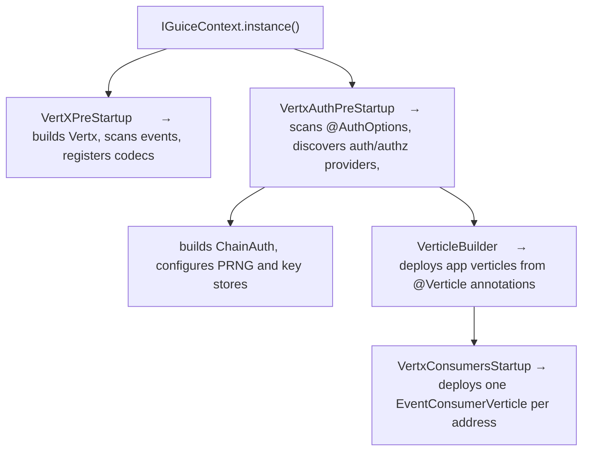
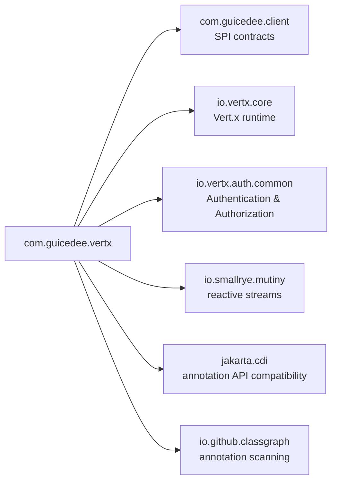

# com.guicedee:vertx

Guice-first integration layer for Vert.x 5: bootstraps Vert.x from GuicedEE, wires verticles and event bus publishers/consumers, and supplies codecs plus Mutiny helpers.

- Version line: `2.6.0` (verify publication separately).
- Packaging: `jar`.
- JPMS module: `com.guicedee.vertx`.
- [Source POM](https://github.com/GuicedEE/Guiced-Vert.x/blob/master/pom.xml).
- [Reference guide](https://guicedee.com/reference/overview.md).

## Direct dependency declarations

Versions may be supplied by the BOM or properties in the linked POM; this is not a flattened dependency lock.

- `org.projectlombok:lombok`; scope `compile`.
- `com.guicedee:client`; scope `compile`.
- `com.guicedee.modules.representations:json-representation`; scope `test`.
- `io.vertx:vertx-auth-common`; scope `compile`.
- `io.vertx:vertx-auth-oauth2`; scope `compile`; optional.
- `io.vertx:vertx-auth-jwt`; scope `compile`; optional.
- `io.vertx:vertx-auth-abac`; scope `compile`; optional.
- `io.vertx:vertx-auth-otp`; scope `compile`; optional.
- `io.vertx:vertx-auth-properties`; scope `compile`; optional.
- `io.vertx:vertx-auth-ldap`; scope `compile`; optional.
- `io.vertx:vertx-auth-htpasswd`; scope `compile`; optional.
- `io.vertx:vertx-auth-htdigest`; scope `compile`; optional.
- `io.vertx:vertx-http-proxy`; scope `compile`; optional.
- `io.vertx:vertx-redis-client`; scope `compile`; optional.
- `io.vertx:vertx-grpc-server`; scope `compile`; optional.
- `io.vertx:vertx-grpc-client`; scope `compile`; optional.
- `io.vertx:vertx-grpc-common`; scope `compile`; optional.
- `io.vertx:vertx-codegen`; scope `provided`.
- `org.junit.jupiter:junit-jupiter`; scope `test`.
- `jakarta.enterprise:jakarta.enterprise.cdi-api`; scope `compile`.

## JPMS descriptor

```java
import com.guicedee.client.services.lifecycle.IGuiceModule;
import com.guicedee.client.services.lifecycle.IGuicePostStartup;
import com.guicedee.client.services.lifecycle.IGuicePreDestroy;
import com.guicedee.client.services.lifecycle.IGuicePreStartup;
import com.guicedee.vertx.*;
import com.guicedee.vertx.auth.*;
import com.guicedee.vertx.implementations.VertxClassScanConfig;
import com.guicedee.vertx.spi.*;

module com.guicedee.vertx {
    provides io.vertx.core.spi.VertxServiceProvider with com.guicedee.vertx.HttpTransportCapture;
    requires io.netty.transport;
    requires io.netty.common;
    requires transitive io.vertx.auth.common;

    requires static io.vertx.auth.oauth2;
    requires static io.vertx.auth.jwt;
    requires static io.vertx.auth.abac;
    requires static io.vertx.auth.otp;
    requires static io.vertx.auth.properties;
    requires static io.vertx.auth.ldap;
    requires static io.vertx.auth.htpasswd;
    requires static io.vertx.auth.htdigest;

    requires static io.vertx.httpproxy;
    requires static io.vertx.redis.client;

    requires static io.vertx.grpc.server;
    requires static io.vertx.grpc.client;
    requires static io.vertx.grpc.common;

    requires transitive com.guicedee.client;

    requires transitive org.apache.logging.log4j;


    requires transitive io.smallrye.mutiny;

    requires transitive jakarta.cdi;


    requires static lombok;

    exports com.guicedee.vertx.spi;
    exports com.guicedee.vertx;
    exports com.guicedee.vertx.proxy;
    exports com.guicedee.vertx.redis;
    exports com.guicedee.vertx.auth;
    exports com.guicedee.vertx.grpc;
    exports com.guicedee.vertx.auth.oauth2;
    exports com.guicedee.vertx.auth.jwt;
    exports com.guicedee.vertx.auth.abac;
    exports com.guicedee.vertx.auth.otp;
    exports com.guicedee.vertx.auth.properties;
    exports com.guicedee.vertx.auth.ldap;
    exports com.guicedee.vertx.auth.htpasswd;
    exports com.guicedee.vertx.auth.htdigest;

    opens com.guicedee.vertx to com.google.guice;
    opens com.guicedee.vertx.proxy to com.google.guice, tools.jackson.databind;
    opens com.guicedee.vertx.redis to com.google.guice, tools.jackson.databind;
    opens com.guicedee.vertx.spi to com.google.guice;
    opens com.guicedee.vertx.auth to com.google.guice, tools.jackson.databind;
    opens com.guicedee.vertx.grpc to com.google.guice, tools.jackson.databind;
    opens com.guicedee.vertx.auth.oauth2 to com.google.guice, tools.jackson.databind;
    opens com.guicedee.vertx.auth.jwt to com.google.guice, tools.jackson.databind;
    opens com.guicedee.vertx.auth.abac to com.google.guice, tools.jackson.databind;
    opens com.guicedee.vertx.auth.otp to com.google.guice, tools.jackson.databind;
    opens com.guicedee.vertx.auth.properties to com.google.guice, tools.jackson.databind;
    opens com.guicedee.vertx.auth.ldap to com.google.guice, tools.jackson.databind;
    opens com.guicedee.vertx.auth.htpasswd to com.google.guice, tools.jackson.databind;
    opens com.guicedee.vertx.auth.htdigest to com.google.guice, tools.jackson.databind;

    provides IGuicePreStartup with VertXPreStartup, VertxAuthPreStartup, com.guicedee.vertx.redis.RedisPreStartup, com.guicedee.vertx.grpc.GrpcPreStartup;
    provides IGuicePostStartup with VertxVerticlePostStartup;
    provides IGuicePreDestroy with VertXPostStartup, VertxAuthPreDestroy;
    provides IGuiceModule with VertXModule, VertxAuthModule;
    provides com.guicedee.client.services.lifecycle.IGuiceConfigurator with VertxClassScanConfig;

    uses com.guicedee.vertx.spi.VertxConfigurator;
    uses VerticleStartup;
    uses IGuicedAuthenticationProvider;
    uses IGuicedAuthorizationProvider;

    provides VerticleStartup with com.guicedee.vertx.spi.VertxConsumersStartup;

    uses com.guicedee.vertx.auth.abac.IAbacPolicyProvider;
    uses com.guicedee.vertx.auth.otp.IOtpAuthenticatorService;
    uses com.guicedee.vertx.grpc.IGrpcServiceProvider;
}
```

## Module guide

Source: [README.md](https://github.com/GuicedEE/Guiced-Vert.x/blob/master/README.md). Historical version examples retain their original context.

# Guiced Vert.x

[](https://github.com/GuicedEE/Guiced-Vert.x/actions/workflows/build.yml)
[](https://github.com/GuicedEE/Guiced-Vert.x)
[](https://www.apache.org/licenses/LICENSE-2.0)


Guice-first integration layer for **Vert.x 5**. Bootstraps Vert.x from the [GuicedEE](https://github.com/GuicedEE) lifecycle, wires verticles and event-bus endpoints through dependency injection, and supplies codecs and Mutiny-friendly helpers so you can stay inside one DI container while building reactive services.

## ✨ Features

- **Vert.x lifecycle managed by GuicedEE** — `Vertx` is injected everywhere via `VertXModule`
- **Annotation-driven consumers** — `@VertxEventDefinition` + `@VertxEventOptions` with worker threads, instance counts, local-only, and backpressure hints
- **Injectable publishers** — `@Named` or `@VertxEventDefinition`, returning Vert.x `Future` or Mutiny `Uni`
- **Optional JSON mapping** — add `json-representation` for SPI-registered Jackson codecs; see [activation and migration](https://github.com/GuicedEE/Guiced-Vert.x/blob/client/JSON_OPT_IN.md)
- **Per-address consumer verticles** — each consumer runs in its own dedicated verticle
- **Publisher-side throttling** — FIFO queuing with configurable rate, no message loss
- **Runtime configuration** — annotations (`@VertX`, `@EventBusOptions`, `@FileSystemOptions`, `@MetricsOptions`) plus SPI hooks (`VertxConfigurator`, `ClusterVertxConfigurator`, `VerticleStartup`)
- **Authentication & Authorization** — annotation-driven auth via `@AuthOptions` with `ChainAuth`, `KeyStoreOptions`, `PubSecKeyOptions`, PRNG, and SPI-based provider registration

## 📦 Installation

```xml
<dependency>
  <groupId>com.guicedee</groupId>
  <artifactId>vertx</artifactId>
</dependency>
```

<details>
<summary>Gradle (Kotlin DSL)</summary>

```kotlin
implementation("com.guicedee:vertx:2.4.1")
```
</details>

## 🚀 Quick Start

Bootstrapping is automatic — call `IGuiceContext.instance().inject()` and `VertXModule` is discovered via SPI:

```java
IGuiceContext.registerModuleForScanning.add("my.app");
IGuiceContext.instance();
```

Tune the runtime through the application's `.env`, without a `@VertX` annotation:

```dotenv
VERTX_EVENT_LOOP_POOL_SIZE=2
VERTX_WORKER_POOL_SIZE=20
```

Resolution uses GuicedEE `Environment`: system properties, process environment, `.env.local`, `.env`, then annotation/framework defaults. With no annotation or override, Vert.x's runtime defaults are retained. Package/type annotations remain supported:

```java
@VertX(workerPoolSize = 32, haEnabled = true)
@EventBusOptions(clusterPublicHost = "127.0.0.1", preferNativeTransport = true)
class VertxRuntimeConfig {}
```

## 📥 Declaring Consumers

Method-based consumers are the preferred style — the registry scans your classpath and binds them automatically:

```java
import io.smallrye.mutiny.Uni;

public class GreetingConsumers {

    @VertxEventDefinition(value = "greeting.received",
            options = @VertxEventOptions(worker = true))
    public String handleGreeting(Message<Anything> message) {
        return "Hello " + message.body();
    }

    @VertxEventDefinition("user.created")
    public Uni<Void> trackUser(Anything payload) {
        return Uni.createFrom().voidItem();
    }
}
```

### Processing model

- **One verticle per address** — `VertxConsumersStartup` deploys an `EventConsumerVerticle` for every discovered event address
- **Scaling** — `@VertxEventOptions.instances()` > 1 deploys multiple consumer verticles with round-robin
- **Worker execution** — `options.worker()` dispatches off the event loop to a named worker pool
- **Local-only** — `options.localOnly()` registers a local consumer inside its per-address verticle
- **Type mapping** — non-Vert.x parameter types are mapped automatically via Jackson

## 📤 Publishing Events

Inject a publisher using `@Named`:

```java
import io.smallrye.mutiny.Uni;

public class GreetingPublisher {

    @Inject
    @Named("greeting.received")
    private VertxEventPublisher<String> publisher;

    public Uni<String> greet(String name) {
        return publisher.send(name);       // request/response
    }

    public void broadcast(UserCreated event) {
        publisher.publish(event);           // fire to all consumers
    }
}
```

### Configuration contract

The [Vert.x 5.2.3 reference](https://github.com/GuicedEE/Guiced-Vert.x/blob/website/docs/configuration/README.md) records
annotation attributes, environment keys, units, defaults and activation requirements.
Publisher throttling environment keys are not implemented. Event ordering, batch and
resume options are reserved metadata and do not implement those behaviors.

## ⚙️ Runtime Overrides

Override event bus addresses and consumer options at runtime via system properties, environment variables, `.env.local` or `.env`:

| Variable | Type | Purpose |
|---|---|---|
| `VERTX_EVENT_ADDRESS_<ADDR>` | string | Override the resolved address |
| `VERTX_EVENT_LOCAL_ONLY` | boolean | Force local-only consumers |
| `VERTX_EVENT_CONSUMER_COUNT` | int | Default consumer count |
| `VERTX_EVENT_WORKER` | boolean | Default worker mode |
| `VERTX_EVENT_WORKER_POOL` | string | Worker pool name |
| `VERTX_EVENT_WORKER_POOL_SIZE` | int | Worker pool size |
| `VERTX_EVENT_INSTANCES` | int | Verticle instances per address |
| `VERTX_EVENT_TIMEOUT_MS` | long | Consumer timeout |
| `VERTX_EVENT_BATCH_WINDOW_MS` | int | Batch window |
| `VERTX_EVENT_BATCH_MAX` | int | Max batch size |
| `VERTX_EVENT_MAX_BUFFERED_MESSAGES` | int | Backpressure buffer limit |
| `VERTX_EVENT_RESUME_AT_MESSAGES` | int | Resume threshold |

## 🔐 Authentication & Authorization

Built-in support for [Vert.x Common Auth](https://vertx.io/docs/vertx-auth-common/java/) — annotation-driven configuration with Guice injection for all auth types.

### Quick Setup

Place `@AuthOptions` on a class or `package-info.java`:

```java
@AuthOptions(
    chainMode = AuthOptions.ChainMode.ANY,
    keyStore = @AuthKeyStore(
        path = "/path/to/keystore.pkcs12",
        type = "pkcs12",
        password = "changeit"
    ),
    pubSecKeys = {
        @AuthPubSecKey(algorithm = "RS256", path = "/path/to/public.pem")
    },
    prngAlgorithm = "SHA1PRNG",
    leeway = 5
)
package com.example.auth;
```

### Authentication Providers (SPI)

Register custom authentication providers via `IGuicedAuthenticationProvider`:

```java
public class MyAuthProvider implements IGuicedAuthenticationProvider {
    @Override
    public AuthenticationProvider getAuthenticationProvider() {
        // Return your provider implementation
        // e.g. UsernamePasswordCredentials-based, JWT, OAuth2, etc.
        return myProvider;
    }
}
```

Register in `module-info.java`:
```java
provides IGuicedAuthenticationProvider with MyAuthProvider;
```

Multiple providers are combined via `ChainAuth` (ANY = first match wins, ALL = all must pass).

### Authorization Providers (SPI)

Register custom authorization providers via `IGuicedAuthorizationProvider`:

```java
public class MyAuthzProvider implements IGuicedAuthorizationProvider {
    @Override
    public AuthorizationProvider getAuthorizationProvider() {
        return myAuthorizationProvider;
    }
}
```

### Guice Bindings

| Type | Scope | Description |
|---|---|---|
| `AuthenticationProvider` | Singleton | Primary provider (or `ChainAuth` if multiple) |
| `ChainAuth` | Singleton | The authentication chain |
| `AuthorizationProvider` | Singleton | Primary authorization provider |
| `Set<AuthorizationProvider>` | Multibinder | All registered authorization providers |
| `VertxContextPRNG` | Singleton | Shared PRNG (non-blocking, event-loop safe) |
| `KeyStoreOptions` | Instance | JVM keystore config (if configured) |
| `Set<PubSecKeyOptions>` | Multibinder | PEM key configs (if configured) |

### Using Authentication

```java
public class LoginService {
    @Inject private AuthenticationProvider authProvider;

    public Future<User> login(String username, String password) {
        return authProvider.authenticate(
            new UsernamePasswordCredentials(username, password));
    }
}
```

### Using Authorization

Vert.x provides multiple authorization types:

```java
// Role-based
RoleBasedAuthorization.create("admin").match(user);

// Permission-based
PermissionBasedAuthorization.create("printer:print").match(user);

// Wildcard permission
WildcardPermissionBasedAuthorization.create("printer:*").match(user);

// Logical combinations
AndAuthorization.create()
    .addAuthorization(RoleBasedAuthorization.create("admin"))
    .addAuthorization(PermissionBasedAuthorization.create("users:write"));

OrAuthorization.create()
    .addAuthorization(RoleBasedAuthorization.create("admin"))
    .addAuthorization(RoleBasedAuthorization.create("manager"));

NotAuthorization.create(RoleBasedAuthorization.create("guest"));
```

Load authorizations onto a user:

```java
@Inject private Set<AuthorizationProvider> authzProviders;

public Future<Void> loadAuthorizations(User user) {
    List<Future<Void>> futures = authzProviders.stream()
        .map(p -> p.getAuthorizations(user))
        .toList();
    return Future.all(futures).mapEmpty();
}
```

### User Principal & Attributes

```java
// Access principal data (source identity)
JsonObject principal = user.principal();

// Access computed attributes
JsonObject attributes = user.attributes();

// Unified lookup (attributes first, then principal)
if (user.containsKey("sub")) {
    String sub = user.get("sub");
}

// Token expiration (exp, iat, nbf with leeway)
boolean expired = user.expired();
```

### PRNG (Pseudo Random Number Generator)

The shared `VertxContextPRNG` is event-loop safe and injectable:

```java
@Inject private VertxContextPRNG prng;

String token = prng.nextString(32);
int randomInt = prng.nextInt();
```

Configure via annotation or environment variables:

| Attribute | Variable | Default | System Property |
|---|---|---|---|
| `prngAlgorithm` | `VERTX_AUTH_PRNG_ALGORITHM` | (system) | `io.vertx.ext.auth.prng.algorithm` |
| `prngSeedInterval` | `VERTX_AUTH_PRNG_SEED_INTERVAL` | 300000 ms | `io.vertx.ext.auth.prng.seed.interval` |
| `prngSeedBits` | `VERTX_AUTH_PRNG_SEED_BITS` | 64 | `io.vertx.ext.auth.prng.seed.bits` |

### Working with Keys

**JVM KeyStore** (pkcs12, jks):

```java
@AuthOptions(keyStore = @AuthKeyStore(
    path = "/path/to/keystore.pkcs12",
    type = "pkcs12",
    password = "changeit",
    alias = "mykey",
    aliasPassword = "keypass"
))
```

Import PEM to PKCS12: `openssl pkcs12 -export -in cert.pem -out keystore.pkcs12 -name myAlias -noiter -nomaciter`

**PEM Keys** (PKCS8 format):

```java
@AuthOptions(pubSecKeys = {
    @AuthPubSecKey(algorithm = "RS256", path = "/path/to/public.pem"),
    @AuthPubSecKey(algorithm = "ES256", buffer = "-----BEGIN PUBLIC KEY-----\n...")
})
```

Convert to PKCS8: `openssl pkcs8 -topk8 -inform PEM -in private.pem -out private_key.pem -nocrypt`

### Environment Variable Overrides

| Property | Variable |
|---|---|
| `chainMode()` | `VERTX_AUTH_CHAIN_MODE` |
| `keyStore.path()` | `VERTX_AUTH_KEYSTORE_PATH` |
| `keyStore.type()` | `VERTX_AUTH_KEYSTORE_TYPE` |
| `keyStore.password()` | `VERTX_AUTH_KEYSTORE_PASSWORD` |
| `keyStore.alias()` | `VERTX_AUTH_KEYSTORE_ALIAS` |
| `keyStore.aliasPassword()` | `VERTX_AUTH_KEYSTORE_ALIAS_PASSWORD` |
| `pubSecKeys[n].algorithm()` | `VERTX_AUTH_PUBSECKEY_n_ALGORITHM` |
| `pubSecKeys[n].buffer()` | `VERTX_AUTH_PUBSECKEY_n_BUFFER` |
| `pubSecKeys[n].path()` | `VERTX_AUTH_PUBSECKEY_n_PATH` |
| `prngAlgorithm()` | `VERTX_AUTH_PRNG_ALGORITHM` |
| `prngSeedInterval()` | `VERTX_AUTH_PRNG_SEED_INTERVAL` |
| `prngSeedBits()` | `VERTX_AUTH_PRNG_SEED_BITS` |
| `leeway()` | `VERTX_AUTH_LEEWAY` |

## 🔄 Startup Flow



## 🔌 SPI Hooks

| SPI | Purpose |
|---|---|
| `VertxConfigurator` | Customize `VertxOptions` during startup |
| `ClusterVertxConfigurator` | Configure clustering |
| `VerticleStartup` | Register custom verticles from Guice |
| `IGuicedAuthenticationProvider` | Contribute authentication providers to `ChainAuth` |
| `IGuicedAuthorizationProvider` | Contribute authorization providers |

Each `VerticleStartup` receives its own readiness promise. Complete it after all asynchronous setup finishes, or fail it when setup fails; synchronous hooks must complete it before returning. Deployment and `getLoadingFinished()` await every hook and consumer registration. Returning without completing the promise no longer reports the application ready prematurely.

## 🗺️ Module Graph



## Bounded HTTP stream cancellation

`HttpTransportCapture` is dual-registered as a Vert.x service provider. It wraps
the selected transport's server factory, retaining at most 8192 active accepted
TCP contexts before TLS and HTTP outbound handlers. Other transport behavior is
delegated unchanged. Channel closure releases the context and capacity.

Owners of long-lived private responses resolve
`HttpTransportCapture.cancellation(request)` at admission and retain that
callback for termination. HTTP/1 requires a captured, active transport; otherwise
admission fails. The callback pins the exact accepted channel so reused TCP
endpoints cannot redirect later cancellation. It cancels the response and
schedules physical closure after two seconds beneath a blocked HTTP/TLS flush.
Channel closure cancels that deadline. HTTP/2 uses the response's stream-local
cancellation and never schedules connection-wide closure.

Release application subscriptions, timers and authorization state before invoking
the callback. Test with a real peer that stops reading, including TLS and router
wrappers; response-future completion alone does not prove physical closure.

Reactive helpers expose `Uni` from `io.smallrye.mutiny`. Applications using
`io.vertx.mutiny.*` wrapper types must declare the `vertx-mutiny` dependency and
`requires io.vertx.mutiny` themselves; Guiced Vert.x does not require those bindings.
The transitive `jakarta.cdi` API remains available for existing consumers, including
access to `jakarta.inject` annotations. Its Maven dependency is declared directly.

## 🤝 Contributing

Issues and pull requests are welcome — please add tests for new event patterns, codecs, or configurators.

## 📄 License

[Apache 2.0](https://www.apache.org/licenses/LICENSE-2.0)

## Declared API reference

Java public/protected declarations and public interface methods are parsed with the JDK compiler. This includes implementation types; package exports determine JPMS accessibility. Inherited and generated members are not expanded. Kotlin adapters retain their source and comments.

## AbacAuthorizationProvider

[Java source](https://github.com/GuicedEE/Guiced-Vert.x/blob/master/src/main/java/com/guicedee/vertx/auth/abac/AbacAuthorizationProvider.java)

### AbacAuthorizationProvider

```java
@Override public AuthorizationProvider getAuthorizationProvider();
public static void reset();
@Override public Integer sortOrder();
```

## AbacOptions

[Java source](https://github.com/GuicedEE/Guiced-Vert.x/blob/master/src/main/java/com/guicedee/vertx/auth/abac/AbacOptions.java)

### AbacOptions

```java
String[] policies() default {};
String[] policyFiles() default {};
```

## IAbacPolicyProvider

[Java source](https://github.com/GuicedEE/Guiced-Vert.x/blob/master/src/main/java/com/guicedee/vertx/auth/abac/IAbacPolicyProvider.java)

### IAbacPolicyProvider

```java
List<Policy> getPolicies();
```

## AuthKeyStore

[Java source](https://github.com/GuicedEE/Guiced-Vert.x/blob/master/src/main/java/com/guicedee/vertx/auth/AuthKeyStore.java)

### AuthKeyStore

```java
String path() default "";
String type() default "pkcs12";
String password() default "";
String alias() default "";
String aliasPassword() default "";
```

## AuthOptions

[Java source](https://github.com/GuicedEE/Guiced-Vert.x/blob/master/src/main/java/com/guicedee/vertx/auth/AuthOptions.java)

### AuthOptions

```java
ChainMode chainMode() default ChainMode.ANY;
AuthKeyStore keyStore() default @AuthKeyStore;
AuthPubSecKey[] pubSecKeys() default {};
String prngAlgorithm() default "";
long prngSeedInterval() default 0;
int prngSeedBits() default 0;
int leeway() default 0;
```

### ChainMode

```java
public static final ChainMode ANY;
public static final ChainMode ALL;
```

## AuthPubSecKey

[Java source](https://github.com/GuicedEE/Guiced-Vert.x/blob/master/src/main/java/com/guicedee/vertx/auth/AuthPubSecKey.java)

### AuthPubSecKey

```java
String algorithm() default "";
String buffer() default "";
String path() default "";
```

## HtdigestAuthenticationProvider

[Java source](https://github.com/GuicedEE/Guiced-Vert.x/blob/master/src/main/java/com/guicedee/vertx/auth/htdigest/HtdigestAuthenticationProvider.java)

### HtdigestAuthenticationProvider

```java
@Override public AuthenticationProvider getAuthenticationProvider();
public static void reset();
@Override public Integer sortOrder();
```

## HtdigestAuthOptions

[Java source](https://github.com/GuicedEE/Guiced-Vert.x/blob/master/src/main/java/com/guicedee/vertx/auth/htdigest/HtdigestAuthOptions.java)

### HtdigestAuthOptions

```java
String path() default ".htdigest";
```

## HtpasswdAuthenticationProvider

[Java source](https://github.com/GuicedEE/Guiced-Vert.x/blob/master/src/main/java/com/guicedee/vertx/auth/htpasswd/HtpasswdAuthenticationProvider.java)

### HtpasswdAuthenticationProvider

```java
@Override public AuthenticationProvider getAuthenticationProvider();
public static void reset();
@Override public Integer sortOrder();
```

## HtpasswdAuthOptions

[Java source](https://github.com/GuicedEE/Guiced-Vert.x/blob/master/src/main/java/com/guicedee/vertx/auth/htpasswd/HtpasswdAuthOptions.java)

### HtpasswdAuthOptions

```java
String path() default ".htpasswd";
boolean plainTextEnabled() default false;
```

## IGuicedAuthenticationProvider

[Java source](https://github.com/GuicedEE/Guiced-Vert.x/blob/master/src/main/java/com/guicedee/vertx/auth/IGuicedAuthenticationProvider.java)

### IGuicedAuthenticationProvider

```java
AuthenticationProvider getAuthenticationProvider();
```

## IGuicedAuthorizationProvider

[Java source](https://github.com/GuicedEE/Guiced-Vert.x/blob/master/src/main/java/com/guicedee/vertx/auth/IGuicedAuthorizationProvider.java)

### IGuicedAuthorizationProvider

```java
AuthorizationProvider getAuthorizationProvider();
```

## JwtAuthenticationProvider

[Java source](https://github.com/GuicedEE/Guiced-Vert.x/blob/master/src/main/java/com/guicedee/vertx/auth/jwt/JwtAuthenticationProvider.java)

### JwtAuthenticationProvider

```java
@Override public AuthenticationProvider getAuthenticationProvider();
public static void reset();
@Override public Integer sortOrder();
```

## JwtAuthOptions

[Java source](https://github.com/GuicedEE/Guiced-Vert.x/blob/master/src/main/java/com/guicedee/vertx/auth/jwt/JwtAuthOptions.java)

### JwtAuthOptions

```java
String keystorePath() default "";
String keystoreType() default "jceks";
String keystorePassword() default "";
JwtPubSecKey[] pubSecKeys() default {};
String[] jwks() default {};
String algorithm() default "HS256";
String[] audience() default {};
String issuer() default "";
String subject() default "";
int leeway() default -1;
boolean ignoreExpiration() default false;
int expiresInSeconds() default 0;
boolean noTimestamp() default false;
String permissionsClaimKey() default "permissions";
JwtAuthorizationType authorizationType() default JwtAuthorizationType.JWT;
```

## JwtAuthorizationProvider

[Java source](https://github.com/GuicedEE/Guiced-Vert.x/blob/master/src/main/java/com/guicedee/vertx/auth/jwt/JwtAuthorizationProvider.java)

### JwtAuthorizationProvider

```java
@Override public AuthorizationProvider getAuthorizationProvider();
@Override public Integer sortOrder();
```

## JwtAuthorizationType

[Java source](https://github.com/GuicedEE/Guiced-Vert.x/blob/master/src/main/java/com/guicedee/vertx/auth/jwt/JwtAuthorizationType.java)

### JwtAuthorizationType

```java
public static final JwtAuthorizationType JWT;
public static final JwtAuthorizationType MICROPROFILE;
public static final JwtAuthorizationType NONE;
```

## JwtPubSecKey

[Java source](https://github.com/GuicedEE/Guiced-Vert.x/blob/master/src/main/java/com/guicedee/vertx/auth/jwt/JwtPubSecKey.java)

### JwtPubSecKey

```java
String algorithm() default "";
String buffer() default "";
String path() default "";
String id() default "";
```

## LdapAuthenticationProvider

[Java source](https://github.com/GuicedEE/Guiced-Vert.x/blob/master/src/main/java/com/guicedee/vertx/auth/ldap/LdapAuthenticationProvider.java)

### LdapAuthenticationProvider

```java
@Override public AuthenticationProvider getAuthenticationProvider();
public static void reset();
@Override public Integer sortOrder();
```

## LdapAuthOptions

[Java source](https://github.com/GuicedEE/Guiced-Vert.x/blob/master/src/main/java/com/guicedee/vertx/auth/ldap/LdapAuthOptions.java)

### LdapAuthOptions

```java
String url();
String authenticationQuery();
String authenticationMechanism() default "simple";
String referral() default "follow";
```

## OAuth2AuthenticationProvider

[Java source](https://github.com/GuicedEE/Guiced-Vert.x/blob/master/src/main/java/com/guicedee/vertx/auth/oauth2/OAuth2AuthenticationProvider.java)

### OAuth2AuthenticationProvider

```java
@Override public AuthenticationProvider getAuthenticationProvider();
public static void reset();
@Override public Integer sortOrder();
```

## OAuth2Flow

[Java source](https://github.com/GuicedEE/Guiced-Vert.x/blob/master/src/main/java/com/guicedee/vertx/auth/oauth2/OAuth2Flow.java)

### OAuth2Flow

```java
public static final OAuth2Flow AUTH_CODE;
public static final OAuth2Flow PASSWORD;
public static final OAuth2Flow CLIENT_CREDENTIALS;
public static final OAuth2Flow AUTH_JWT;
```

## OAuth2JwtOptions

[Java source](https://github.com/GuicedEE/Guiced-Vert.x/blob/master/src/main/java/com/guicedee/vertx/auth/oauth2/OAuth2JwtOptions.java)

### OAuth2JwtOptions

```java
String audience() default "";
String issuer() default "";
int leeway() default -1;
boolean ignoreExpiration() default false;
```

## OAuth2Options

[Java source](https://github.com/GuicedEE/Guiced-Vert.x/blob/master/src/main/java/com/guicedee/vertx/auth/oauth2/OAuth2Options.java)

### OAuth2Options

```java
String clientId() default "";
String clientSecret() default "";
String tenant() default "";
WellKnownProvider wellKnownProvider() default WellKnownProvider.CUSTOM;
String site() default "";
OAuth2Flow flow() default OAuth2Flow.AUTH_CODE;
String authorizationPath() default "";
String tokenPath() default "";
String revocationPath() default "";
String introspectionPath() default "";
String jwkPath() default "";
String userInfoPath() default "";
String logoutPath() default "";
String scopes() default "";
String scopeDelimiter() default " ";
OAuth2JwtOptions jwtOptions() default @OAuth2JwtOptions;
String extraParameters() default "";
String redirectUri() default "";
int connectTimeout() default 0;
int readTimeout() default 0;
```

## WellKnownProvider

[Java source](https://github.com/GuicedEE/Guiced-Vert.x/blob/master/src/main/java/com/guicedee/vertx/auth/oauth2/WellKnownProvider.java)

### WellKnownProvider

```java
public static final WellKnownProvider CUSTOM;
public static final WellKnownProvider GOOGLE;
public static final WellKnownProvider AZURE_AD;
public static final WellKnownProvider KEYCLOAK;
public static final WellKnownProvider SALESFORCE;
public static final WellKnownProvider GITHUB;
public static final WellKnownProvider IBM_CLOUD;
public static final WellKnownProvider AMAZON_COGNITO;
public static final WellKnownProvider OPENID_CONNECT;
```

## IOtpAuthenticatorService

[Java source](https://github.com/GuicedEE/Guiced-Vert.x/blob/master/src/main/java/com/guicedee/vertx/auth/otp/IOtpAuthenticatorService.java)

### IOtpAuthenticatorService

```java
Function<String, Future<Authenticator>> authenticatorFetcher();
Function<Authenticator, Future<Void>> authenticatorUpdater();
```

## OtpAuthenticationProvider

[Java source](https://github.com/GuicedEE/Guiced-Vert.x/blob/master/src/main/java/com/guicedee/vertx/auth/otp/OtpAuthenticationProvider.java)

### OtpAuthenticationProvider

```java
public OtpAuthenticationProvider();
@Override public AuthenticationProvider getAuthenticationProvider();
public static void reset();
@Override public Integer sortOrder();
```

## OtpAuthOptions

[Java source](https://github.com/GuicedEE/Guiced-Vert.x/blob/master/src/main/java/com/guicedee/vertx/auth/otp/OtpAuthOptions.java)

### OtpAuthOptions

```java
OtpType type() default OtpType.TOTP;
int passwordLength() default 6;
int authAttemptsLimit() default 0;
int period() default 30;
int lookAheadWindow() default 0;
long counter() default 0;
```

## OtpType

[Java source](https://github.com/GuicedEE/Guiced-Vert.x/blob/master/src/main/java/com/guicedee/vertx/auth/otp/OtpType.java)

### OtpType

```java
public static final OtpType HOTP;
public static final OtpType TOTP;
```

## PropertyFileAuthenticationProvider

[Java source](https://github.com/GuicedEE/Guiced-Vert.x/blob/master/src/main/java/com/guicedee/vertx/auth/properties/PropertyFileAuthenticationProvider.java)

### PropertyFileAuthenticationProvider

```java
public PropertyFileAuthenticationProvider();
@Override public AuthenticationProvider getAuthenticationProvider();
public static void reset();
@Override public Integer sortOrder();
```

## PropertyFileAuthOptions

[Java source](https://github.com/GuicedEE/Guiced-Vert.x/blob/master/src/main/java/com/guicedee/vertx/auth/properties/PropertyFileAuthOptions.java)

### PropertyFileAuthOptions

```java
String path();
```

## PropertyFileAuthorizationProvider

[Java source](https://github.com/GuicedEE/Guiced-Vert.x/blob/master/src/main/java/com/guicedee/vertx/auth/properties/PropertyFileAuthorizationProvider.java)

### PropertyFileAuthorizationProvider

```java
public PropertyFileAuthorizationProvider();
@Override public AuthorizationProvider getAuthorizationProvider();
public static void reset();
@Override public Integer sortOrder();
```

## VertxAuthModule

[Java source](https://github.com/GuicedEE/Guiced-Vert.x/blob/master/src/main/java/com/guicedee/vertx/auth/VertxAuthModule.java)

### VertxAuthModule

```java
@Override protected void configure();
```

## VertxAuthPreDestroy

[Java source](https://github.com/GuicedEE/Guiced-Vert.x/blob/master/src/main/java/com/guicedee/vertx/auth/VertxAuthPreDestroy.java)

### VertxAuthPreDestroy

```java
@Override public void onDestroy();
@Override public Integer sortOrder();
```

## VertxAuthPreStartup

[Java source](https://github.com/GuicedEE/Guiced-Vert.x/blob/master/src/main/java/com/guicedee/vertx/auth/VertxAuthPreStartup.java)

### VertxAuthPreStartup

```java
@Override public List<Future<Boolean>> onStartup();
public static int resolveLeeway();
public static void reset();
@Override public Integer sortOrder();
```

## GrpcConnectionInfo

[Java source](https://github.com/GuicedEE/Guiced-Vert.x/blob/master/src/main/java/com/guicedee/vertx/grpc/GrpcConnectionInfo.java)

### GrpcConnectionInfo

```java
```

## GrpcModule

[Java source](https://github.com/GuicedEE/Guiced-Vert.x/blob/master/src/main/java/com/guicedee/vertx/grpc/GrpcModule.java)

### GrpcModule

```java
protected abstract GrpcConnectionInfo getGrpcConnectionInfo();
@Override protected void configure();
@Override public void onDestroy();
@Override public Integer sortOrder();
```

## GrpcOptions

[Java source](https://github.com/GuicedEE/Guiced-Vert.x/blob/master/src/main/java/com/guicedee/vertx/grpc/GrpcOptions.java)

### GrpcOptions

```java
String name() default "default";
String host() default "${GRPC_HOST:0.0.0.0}";
int port() default 50051;
boolean tlsEnabled() default false;
String tlsCertPath() default "${GRPC_TLS_CERT_PATH:}";
String tlsKeyPath() default "${GRPC_TLS_KEY_PATH:}";
int maxMessageSize() default 4194304;
boolean deadlinePropagation() default false;
boolean scheduleDeadlineAutomatically() default false;
boolean grpcWebEnabled() default true;
boolean transcodingEnabled() default true;
boolean defaultConnection() default true;
```

## GrpcOptionsContainer

[Java source](https://github.com/GuicedEE/Guiced-Vert.x/blob/master/src/main/java/com/guicedee/vertx/grpc/GrpcOptionsContainer.java)

### GrpcOptionsContainer

```java
GrpcOptions[] value();
```

## GrpcPreStartup

[Java source](https://github.com/GuicedEE/Guiced-Vert.x/blob/master/src/main/java/com/guicedee/vertx/grpc/GrpcPreStartup.java)

### GrpcPreStartup

```java
@Override public List<Future<Boolean>> onStartup();
public static GrpcConnectionInfo buildFromAnnotation(GrpcOptions opts);
public static String resolveEnvPlaceholders(String value);
@Override public Integer sortOrder();
```

## IGrpcServiceProvider

[Java source](https://github.com/GuicedEE/Guiced-Vert.x/blob/master/src/main/java/com/guicedee/vertx/grpc/IGrpcServiceProvider.java)

### IGrpcServiceProvider

```java
void registerServices(GrpcServer server);
```

## HttpTransportCapture

[Java source](https://github.com/GuicedEE/Guiced-Vert.x/blob/master/src/main/java/com/guicedee/vertx/HttpTransportCapture.java)

### HttpTransportCapture

```java
@Override public void init(VertxBootstrap bootstrap);
public static java.util.function.Supplier<Future<Boolean>> cancellation(HttpServerRequest request);
```

## VertxClassScanConfig

[Java source](https://github.com/GuicedEE/Guiced-Vert.x/blob/master/src/main/java/com/guicedee/vertx/implementations/VertxClassScanConfig.java)

### VertxClassScanConfig

```java
@Override public IGuiceConfig<?> configure(IGuiceConfig<?> config);
```

## ProxyConnectionInfo

[Java source](https://github.com/GuicedEE/Guiced-Vert.x/blob/master/src/main/java/com/guicedee/vertx/proxy/ProxyConnectionInfo.java)

### ProxyConnectionInfo

```java
public ProxyConnectionInfo addInterceptor(Class<?> interceptorClass);
public ProxyConnectionInfo addWebSocketInterceptor(Class<?> interceptorClass);
```

## ProxyModule

[Java source](https://github.com/GuicedEE/Guiced-Vert.x/blob/master/src/main/java/com/guicedee/vertx/proxy/ProxyModule.java)

### ProxyModule

```java
protected abstract ProxyConnectionInfo getProxyConnectionInfo();
@Override protected void configure();
@Override public void onDestroy();
@Override public Integer sortOrder();
```

## RedisConnectionInfo

[Java source](https://github.com/GuicedEE/Guiced-Vert.x/blob/master/src/main/java/com/guicedee/vertx/redis/RedisConnectionInfo.java)

### RedisConnectionInfo

```java
public RedisConnectionInfo addEndpoint(String endpoint);
```

### RedisMode

```java
public static final RedisMode STANDALONE;
public static final RedisMode SENTINEL;
public static final RedisMode CLUSTER;
public static final RedisMode REPLICATION;
```

### RedisProtocol

```java
public static final RedisProtocol RESP2;
public static final RedisProtocol RESP3;
```

## RedisModule

[Java source](https://github.com/GuicedEE/Guiced-Vert.x/blob/master/src/main/java/com/guicedee/vertx/redis/RedisModule.java)

### RedisModule

```java
protected abstract RedisConnectionInfo getRedisConnectionInfo();
@Override protected void configure();
@Override public void onDestroy();
@Override public Integer sortOrder();
```

## RedisOptions

[Java source](https://github.com/GuicedEE/Guiced-Vert.x/blob/master/src/main/java/com/guicedee/vertx/redis/RedisOptions.java)

### RedisOptions

```java
String name() default "default";
String connectionString() default "${REDIS_CONNECTION_STRING:redis://localhost:6379}";
String[] endpoints() default {};
Mode mode() default Mode.STANDALONE;
String password() default "${REDIS_PASSWORD:}";
int maxPoolSize() default 6;
int maxWaitingHandlers() default 24;
boolean tlsEnabled() default false;
String tlsCertPath() default "${REDIS_TLS_CERT_PATH:}";
String tlsVerifyHost() default "${REDIS_TLS_VERIFY_HOST:}";
Protocol protocol() default Protocol.AUTO;
String masterName() default "${REDIS_MASTER_NAME:mymaster}";
int database() default -1;
boolean defaultConnection() default true;
```

### Mode

```java
public static final Mode STANDALONE;
public static final Mode SENTINEL;
public static final Mode CLUSTER;
public static final Mode REPLICATION;
```

### Protocol

```java
public static final Protocol AUTO;
public static final Protocol RESP2;
public static final Protocol RESP3;
```

## RedisOptionsContainer

[Java source](https://github.com/GuicedEE/Guiced-Vert.x/blob/master/src/main/java/com/guicedee/vertx/redis/RedisOptionsContainer.java)

### RedisOptionsContainer

```java
RedisOptions[] value();
```

## RedisPreStartup

[Java source](https://github.com/GuicedEE/Guiced-Vert.x/blob/master/src/main/java/com/guicedee/vertx/redis/RedisPreStartup.java)

### RedisPreStartup

```java
@Override public List<Future<Boolean>> onStartup();
public static RedisConnectionInfo buildFromAnnotation(RedisOptions opts);
public static String resolveEnvPlaceholders(String value);
@Override public Integer sortOrder();
```

## AddressResolverOptions

[Java source](https://github.com/GuicedEE/Guiced-Vert.x/blob/master/src/main/java/com/guicedee/vertx/spi/AddressResolverOptions.java)

### AddressResolverOptions

```java
String hostsPath() default "";
int hostsRefreshPeriod() default 0;
java.util.concurrent.TimeUnit hostsRefreshPeriodUnit() default java.util.concurrent.TimeUnit.MILLISECONDS;
String[] servers() default {};
boolean rotateServers() default false;
int cacheMinTimeToLive() default 0;
int cacheMaxTimeToLive() default Integer.MAX_VALUE;
int cacheNegativeTimeToLive() default 0;
long queryTimeout() default 5000;
int maxQueries() default 4;
boolean rdFlag() default true;
String[] searchDomains() default {};
int ndots() default -1;
boolean optResourceEnabled() default false;
boolean roundRobinInetAddress() default false;
```

## ClusterVertxConfigurator

[Java source](https://github.com/GuicedEE/Guiced-Vert.x/blob/master/src/main/java/com/guicedee/vertx/spi/ClusterVertxConfigurator.java)

### ClusterVertxConfigurator

```java
ClusterManager getClusterManager();
default boolean enabled();
@Override default VertxBuilder builder(VertxBuilder builder);
```

## CodecRegistry

[Java source](https://github.com/GuicedEE/Guiced-Vert.x/blob/master/src/main/java/com/guicedee/vertx/spi/CodecRegistry.java)

### CodecRegistry

```java
public static void reset();
public static boolean isStandardVertxType(Class<?> clazz);
public static String toKebabCase(String camelCase);
public static String getCodecName(Class<?> clazz);
public static String getCodecName(Type type);
@SuppressWarnings("unchecked") public static <T> String createAndRegisterCodec(Vertx vertx, Type type);
public static void createAndRegisterCodecsForAllEventTypes(Vertx vertx);
```

## DynamicCodec

[Java source](https://github.com/GuicedEE/Guiced-Vert.x/blob/master/src/main/java/com/guicedee/vertx/spi/DynamicCodec.java)

### DynamicCodec

```java
public DynamicCodec(Class<T> type, String codecName);
public DynamicCodec(Type type, String codecName);
@Override public void encodeToWire(Buffer buffer, T object);
@Override public T decodeFromWire(int pos, Buffer buffer);
@Override public T transform(T object);
@Override public String name();
@Override public byte systemCodecID();
```

## EventBusOptions

[Java source](https://github.com/GuicedEE/Guiced-Vert.x/blob/master/src/main/java/com/guicedee/vertx/spi/EventBusOptions.java)

### EventBusOptions

```java
String clusterPublicHost() default "";
int clusterPublicPort() default -1;
long clusterPingInterval() default 20000;
long clusterPingReplyInterval() default 20000;
String host() default "";
int port() default 0;
int acceptBacklog() default -1;
int reconnectAttempts() default 0;
long reconnectInterval() default 1000;
int connectTimeout() default 60000;
boolean trustAll() default true;
String clientAuth() default "NONE";
```

## EventConsumerVerticle

[Java source](https://github.com/GuicedEE/Guiced-Vert.x/blob/master/src/main/java/com/guicedee/vertx/spi/EventConsumerVerticle.java)

### EventConsumerVerticle

```java
public EventConsumerVerticle(String address, VertxEventDefinition definition, Method targetMethod, Class<?> targetClass);
@Override public void start(Promise<Void> startPromise);
```

## SampleClusterConfigurator

[Java source](https://github.com/GuicedEE/Guiced-Vert.x/blob/master/src/main/java/com/guicedee/vertx/spi/examples/SampleClusterConfigurator.java)

### SampleClusterConfigurator

```java
public SampleClusterConfigurator();
@Override public ClusterManager getClusterManager();
@Override public VertxBuilder builder(VertxBuilder builder);
```

## FileSystemOptions

[Java source](https://github.com/GuicedEE/Guiced-Vert.x/blob/master/src/main/java/com/guicedee/vertx/spi/FileSystemOptions.java)

### FileSystemOptions

```java
boolean classPathResolvingEnabled() default true;
boolean fileCachingEnabled() default true;
String fileCacheDir() default "";
boolean fileCacheDirAsExactPath() default false;
```

## MetricsOptions

[Java source](https://github.com/GuicedEE/Guiced-Vert.x/blob/master/src/main/java/com/guicedee/vertx/spi/MetricsOptions.java)

### MetricsOptions

```java
boolean enabled() default false;
```

## Verticle

[Java source](https://github.com/GuicedEE/Guiced-Vert.x/blob/master/src/main/java/com/guicedee/vertx/spi/Verticle.java)

### Verticle

```java
ThreadingModel threadingModel() default ThreadingModel.EVENT_LOOP;
int defaultInstances() default 1;
boolean ha() default false;
String value();
int workerPoolSize() default 20;
long maxWorkerExecuteTime() default 60000;
TimeUnit maxWorkerExecuteTimeUnit() default TimeUnit.MILLISECONDS;
Capabilities[] capabilities() default {};
```

### Capabilities

```java
public static final Capabilities Rest;
public static final Capabilities RabbitMQ;
public static final Capabilities Web;
public static final Capabilities Telemetry;
public static final Capabilities MicroProfileConfig;
public static final Capabilities OpenAPI;
public static final Capabilities Swagger;
public static final Capabilities Hazelcast;
public static final Capabilities Cerial;
public static final Capabilities Persistence;
public static final Capabilities Sockets;
public static final Capabilities WebServices;
public String getPackageName();
```

## VerticleBuilder

[Java source](https://github.com/GuicedEE/Guiced-Vert.x/blob/master/src/main/java/com/guicedee/vertx/spi/VerticleBuilder.java)

### VerticleBuilder

```java
public static void reset();
public Map<String, io.vertx.core.Verticle> findVerticles();
public static Optional<Verticle> getVerticleAnnotation(Class<?> clazz);
```

## VerticleStartup

[Java source](https://github.com/GuicedEE/Guiced-Vert.x/blob/master/src/main/java/com/guicedee/vertx/spi/VerticleStartup.java)

### VerticleStartup

```java
void start(Promise<Void> startPromise, Vertx vertx, AbstractVerticle verticle, String assignedPackage);
```

## VertX

[Java source](https://github.com/GuicedEE/Guiced-Vert.x/blob/master/src/main/java/com/guicedee/vertx/spi/VertX.java)

### VertX

```java
int eventLoopPoolSize() default -1;
int workerPoolSize() default 20;
long blockedThreadCheckInterval() default 1000;
TimeUnit blockedThreadCheckIntervalTimeUnit() default TimeUnit.MILLISECONDS;
long maxEventLoopExecuteTime() default 2000;
TimeUnit maxEventLoopExecuteTimeUnit() default TimeUnit.MILLISECONDS;
long maxWorkerExecuteTime() default 60000;
TimeUnit maxWorkerExecuteTimeUnit() default TimeUnit.MILLISECONDS;
int internalBlockingPoolSize() default 20;
boolean haEnabled() default false;
int quorumSize() default 1;
String haGroup() default "__DEFAULT__";
long warningExceptionTime() default 5000;
TimeUnit warningExceptionTimeUnit() default TimeUnit.MILLISECONDS;
boolean preferNativeTransport() default false;
boolean useDaemonThreads() default false;
boolean disableTCCL() default false;
```

## VertxConfigurator

[Java source](https://github.com/GuicedEE/Guiced-Vert.x/blob/master/src/main/java/com/guicedee/vertx/spi/VertxConfigurator.java)

### VertxConfigurator

```java
VertxBuilder builder(VertxBuilder builder);
default io.vertx.core.VertxOptions options(io.vertx.core.VertxOptions options);
```

## VertxConsumersStartup

[Java source](https://github.com/GuicedEE/Guiced-Vert.x/blob/master/src/main/java/com/guicedee/vertx/spi/VertxConsumersStartup.java)

### VertxConsumersStartup

```java
@Override public void start(Promise<Void> startPromise, Vertx vertx, AbstractVerticle verticle, String assignedPackage);
```

## VertxEventRegistry

[Java source](https://github.com/GuicedEE/Guiced-Vert.x/blob/master/src/main/java/com/guicedee/vertx/spi/VertxEventRegistry.java)

### VertxEventRegistry

```java
public static void reset();
public static void scanAndRegisterEvents();
public static void registerEventConsumersFiltered(String assignedPackage, java.util.List<String> excludedPrefixes);
public static Uni<Void> dispatch(Vertx vertx, Message<?> message, Method method, Class<?> methodClass, VertxEventDefinition eventDefinition);
```

## VertXPreStartup

[Java source](https://github.com/GuicedEE/Guiced-Vert.x/blob/master/src/main/java/com/guicedee/vertx/spi/VertXPreStartup.java)

### VertXPreStartup

```java
public static Optional<io.vertx.core.Verticle> getAssociatedVerticle(Class<?> clazz);
@Override public List<Future<Boolean>> onStartup();
public static synchronized boolean ready();
public static synchronized Vertx getVertx();
public static synchronized Future<Void> closeVertx();
@Override public void onDestroy();
@Override public Integer shutdownSortOrder();
@Override public Integer sortOrder();
```

## VertxVerticlePostStartup

[Java source](https://github.com/GuicedEE/Guiced-Vert.x/blob/master/src/main/java/com/guicedee/vertx/spi/VertxVerticlePostStartup.java)

### VertxVerticlePostStartup

```java
@Override public List<Uni<Boolean>> postLoad();
@Override public Integer sortOrder();
```

## VertxEventDefinition

[Java source](https://github.com/GuicedEE/Guiced-Vert.x/blob/master/src/main/java/com/guicedee/vertx/VertxEventDefinition.java)

### VertxEventDefinition

```java
String value();
VertxEventOptions options() default @VertxEventOptions;
```

## VertxEventOptions

[Java source](https://github.com/GuicedEE/Guiced-Vert.x/blob/master/src/main/java/com/guicedee/vertx/VertxEventOptions.java)

### VertxEventOptions

```java
boolean localOnly() default false;
boolean autobind() default true;
int consumerCount() default 1;
boolean worker() default false;
String workerPool() default "";
int workerPoolSize() default 0;
int instances() default 0;
String orderedByHeader() default "";
int maxBufferedMessages() default 0;
int resumeAtMessages() default 0;
int batchWindowMs() default 0;
int batchMax() default 0;
long timeoutMs() default 0L;
```

## VertxEventPublisher

[Java source](https://github.com/GuicedEE/Guiced-Vert.x/blob/master/src/main/java/com/guicedee/vertx/VertxEventPublisher.java)

### VertxEventPublisher

```java
public VertxEventPublisher(Vertx vertx, String address, VertxEventDefinition eventDefinition);
public VertxEventPublisher(Vertx vertx, String address, VertxEventDefinition eventDefinition, Type referenceType);
public void publish(T message);
public void send(T message);
public void publish(T message, DeliveryOptions options);
public void publishLocal(T message);
public void publish(T message, java.util.Map<String, String> headers, boolean localOnly);
public void send(T message, DeliveryOptions options);
public void sendLocal(T message);
public void send(T message, java.util.Map<String, String> headers, boolean localOnly);
public <R> Future<R> request(T message);
public <R> Future<R> request(T message, DeliveryOptions options);
public <R> Future<R> request(T message, long timeoutMs);
public <R> Future<R> request(T message, java.util.Map<String, String> headers, long timeoutMs);
```

## VertXModule

[Java source](https://github.com/GuicedEE/Guiced-Vert.x/blob/master/src/main/java/com/guicedee/vertx/VertXModule.java)

### VertXModule

```java
@Override protected void configure();
```

## VertXPostStartup

[Java source](https://github.com/GuicedEE/Guiced-Vert.x/blob/master/src/main/java/com/guicedee/vertx/VertXPostStartup.java)

### VertXPostStartup

```java
@Override public void onDestroy();
@Override public Integer shutdownSortOrder();
@Override public Integer sortOrder();
```

## WebSocketBackpressure

[Java source](https://github.com/GuicedEE/Guiced-Vert.x/blob/master/src/main/java/com/guicedee/vertx/WebSocketBackpressure.java)

### WebSocketBackpressure

```java
public static HttpServerRequest capture(HttpServerRequest request);
public static Future<Void> close(ServerWebSocket socket, short code, String reason);
public static Future<Void> close(ServerWebSocket socket, HttpConnection upgradeConnection, short code, String reason);
```
